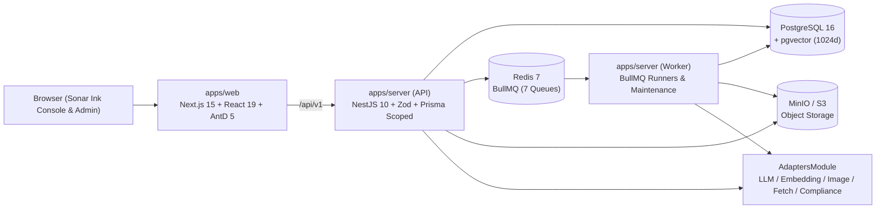

<div align="center">

```text
    ╭─────╮      ██████╗ ███████╗ ██████╗ ███╗   ███╗██╗██╗  ██╗
   ╱ ╭───╮ ╲    ██╔════╝ ██╔════╝██╔═══██╗████╗ ████║██║╚██╗██╔╝
  │  │  ╱│  │   ██║  ███╗█████╗  ██║   ██║██╔████╔██║██║ ╚███╔╝
  │ ─┼─*─┼─ │   ██║   ██║██╔══╝  ██║   ██║██║╚██╔╝██║██║ ██╔██╗
   ╲ ╰───╯ ╱    ╚██████╔╝███████╗╚██████╔╝██║ ╚═╝ ██║██║██╔╝ ██╗
    ╰─────╯      ╚═════╝ ╚══════╝ ╚═════╝ ╚═╝     ╚═╝╚═╝╚═╝  ╚═╝

  GEO CONTENT CREATION   /   AI VISIBILITY RADAR   /   SONAR INK
```

**Multi-Tenant Generative Engine Optimization (GEO) Content Creation & AI Visibility Platform**

[](https://github.com/yexiu700/geomix/actions/workflows/ci.yml)


**English** · [简体中文](./README.zh-CN.md)

</div>

---

## Overview

**GeoMix** is a full-stack TypeScript monorepo platform built for **Generative Engine Optimization (GEO)** content workflows and **AI Visibility Diagnostics**. All branding, UI copy, design tokens (**Sonar Ink** dark theme), compliance agreements, and prompt templates are original and self-authored.

Development and CI default to deterministic fake model/storage adapters and `BILLING_MODE=SHADOW` (full ledger accounting with zero point deduction), enabling local startup and end-to-end testing without external API keys.

## Key Capabilities

- **Multi-Tenant Auth, Billing & Admin Core**
  - Server-drawn PNG captcha login, JWT access/refresh rotation, rate limiting, and expired-tenant read-only guard (`TenantActiveGuard`).
  - Prisma tenant-isolation extension (`prisma.scoped`) across 34 models, `SHADOW` / `STRICT` point reservation & idempotent settlement billing, stock/cumulative quota enforcement, and admin console (tenants, pricing, announcements, system templates, daily LLM cost report).
- **AI Content Studio**
  - Keywords & AI question distillation, writing question bank, enterprise image gallery (auto-compression, EXIF stripping, thumbnails, S3/MinIO storage), and enterprise knowledge base (structured/summary modes, compliance agreement signing, 1024-dim `pgvector` HNSW retrieval).
  - Prompt library (10+7+1 built-in read-only templates + cloning), article categories, BullMQ-backed AI writing pipeline, lightweight rich-text editor, review workflow, and batch ZIP export (`Markdown` / `HTML` / `Docx`).
- **Viral Traffic Replication & AI Image Generation**
  - Single-article and batch content replication with SSRF-guarded fetching, `robots.txt` validation, 5-gram similarity checks, and compliant rewriting.
  - Feature-flagged AI image workbench (`FEATURE_AI_IMAGE`) with prompt optimization and direct gallery saving.
- **AI Visibility Radar & Analytics**
  - Feature-flagged AI Data Dashboard and AI Visibility Diagnostics (`FEATURE_VISIBILITY`): monitoring profiles, multi-engine collection & LLM judge scoring, citation trace graphs, and Sonar Ink radar visualizations.
- **Console Experience & Engineering Delivery**
  - Keep-alive multi-tab console shell with persisted layout preferences (`User.uiPrefs`), ⌘K command palette, and 16 legacy `/user/*` route redirects.
  - Full Vitest unit/contract test suite, Playwright full-stack E2E workflow, and GHCR + Self-Hosted Runner CD pipeline.

## Architecture



## Tech Stack & Repository Layout

- **Frontend**: Next.js 15 (App Router), React 19, Ant Design 5, Zustand 5, native CSS (`--gm-*` Sonar Ink tokens), hand-crafted SVG visualizations
- **Backend**: NestJS 10 (dual-entry `api` + `worker` from one codebase), Zod 3, BullMQ 5, `sharp`, `undici`
- **Data & Infra**: PostgreSQL 16 (`pgvector`), Prisma 5, Redis 7, MinIO (S3-compatible), Docker Compose
- **Toolchain**: pnpm 10 workspace, Turborepo 2, TypeScript 5 (`strict`), Vitest 3, Playwright, ESLint 9, Prettier 3

```text
geomix/
├─ apps/
│  ├─ web/                 # @geomix/web — Next.js 15 console shell, business screens & admin panel
│  └─ server/              # @geomix/server — NestJS 10 API (main.api.ts) & Worker (main.worker.ts)
├─ packages/
│  ├─ shared/              # @geomix/shared — cross-app contracts, Zod schemas, billing/queue/time/UX logic
│  ├─ db/                  # @geomix/db — Prisma schema (34 models), migrations, idempotent seed & tenant scope
│  ├─ prompts/             # @geomix/prompts — prompt rendering & 10+7+1 built-in system templates
│  └─ config/              # @geomix/config — shared ESLint & TypeScript configs
├─ e2e/                    # Playwright full-stack end-to-end test suite
├─ scripts/                # Staging deploy, backup, restore & root env loader scripts
├─ docker/                 # Dockerfiles, Nginx TLS template & Postgres pgvector init SQL
├─ docs/                   # Agent playbook, live architecture map, ops manual & QA baselines
└─ .github/                # CI/E2E/CD/Auto-Merge workflows, issue forms & PR template
```

## Quick Start

### Prerequisites

- **Node.js >= 22**
- **pnpm 10** (`corepack enable`)
- **Docker Compose v2**

### Run Locally

```bash
cp .env.example .env
docker compose up -d
pnpm install --frozen-lockfile
pnpm db:migrate
pnpm db:seed
pnpm dev
```

`docker compose up -d` starts PostgreSQL 16 (`pgvector/pgvector:pg16`, auto-enabling `vector` on first init), Redis 7, and Chainguard MinIO.

> **PostgreSQL `pgvector` Note**: The bundled Compose user (`geomix`) is a database superuser. If you point `DATABASE_URL` at an external PostgreSQL instance with a non-superuser role, have a superuser run `CREATE EXTENSION IF NOT EXISTS vector;` first, then run `pnpm db:migrate` (`prisma migrate deploy`). Never modify already-committed migration SQL files.

`pnpm dev` starts all three local processes simultaneously (works out of the box even without copying `.env`; exported shell variables take precedence):

| Process  | URL                     | Description                                                    |
| -------- | ----------------------- | -------------------------------------------------------------- |
| `web`    | `http://localhost:3000` | Console (`/dashboard`), Login (`/login`), Admin (`/admin`)     |
| `api`    | `http://localhost:3001` | NestJS REST API (`/api/v1`), health check `GET /api/v1/health` |
| `worker` | —                       | BullMQ background worker consuming 7 queues                    |

Default local seed accounts (**local development only** — change via `.env` outside git before any shared environment):

- Admin: `admin` / `geomix-admin-dev`
- Demo tenant: `demo` / `geomix-demo-dev` (1,000 initial points, inherits global `BILLING_MODE=SHADOW`)

`pnpm db:seed` is idempotent: re-running restores default pricing items and built-in system templates without duplicating points or overwriting customized passwords, expiries, quotas, or tenant billing overrides.

## Common Scripts

| Command            | Purpose                                                                        |
| ------------------ | ------------------------------------------------------------------------------ |
| `pnpm dev`         | Run `web`, `api`, and `worker` concurrently                                    |
| `pnpm build`       | Build all packages, `server`, and `web` (runs `prisma generate` automatically) |
| `pnpm lint`        | Full-repo ESLint + `prettier --check .`                                        |
| `pnpm format`      | Format codebase and docs with Prettier                                         |
| `pnpm typecheck`   | Workspace `tsc --noEmit` (including `e2e/tsconfig.json`)                       |
| `pnpm test`        | Workspace Vitest unit tests (no DB/Redis required by default)                  |
| `pnpm test:e2e`    | Playwright full-stack E2E suite (requires PG + Redis + migrated/built apps)    |
| `pnpm db:validate` | Validate Prisma schema                                                         |
| `pnpm db:migrate`  | Apply committed Prisma migrations (`migrate deploy`)                           |
| `pnpm db:seed`     | Run idempotent database seed                                                   |

Run a single backend entrypoint:

```bash
pnpm --filter @geomix/server dev:api
pnpm --filter @geomix/server dev:worker
```

## Testing & CI/CD

Every push and Pull Request triggers [`.github/workflows/ci.yml`](.github/workflows/ci.yml) with two required gates:

1. **`lint, typecheck, test`**: Runs `pnpm install --frozen-lockfile`, `prisma generate`, `pnpm lint`, `pnpm typecheck`, and `pnpm test`.
2. **`playwright e2e`** ([`e2e.yml`](.github/workflows/e2e.yml)): Spins up PostgreSQL 16 (`pgvector`) and Redis 7 service containers, runs migrations + seed, builds with `NEXT_E2E_FAST_BUILD=1`, and executes the full Playwright E2E suite with deterministic fake adapters.

Optional local DB / Redis integration tests:

```bash
# Database integration tests (@geomix/server creates and drops isolated temporary DBs)
GEOMIX_DB_INTEGRATION=1 pnpm --filter @geomix/server test

# Full backend integration tests including BullMQ / Redis queues
GEOMIX_DB_INTEGRATION=1 GEOMIX_REDIS_INTEGRATION=1 pnpm --filter @geomix/server test
```

## Documentation

| Document                                                               | Audience & Purpose                                                                               |
| ---------------------------------------------------------------------- | ------------------------------------------------------------------------------------------------ |
| [README.zh-CN.md](README.zh-CN.md)                                     | 简体中文项目文档                                                                                 |
| [AGENTS.md](AGENTS.md)                                                 | Quick-start guide, hard redlines & CI guardrails for AI coding agents                            |
| [docs/AGENTS.md](docs/AGENTS.md)                                       | Full engineering handbook, machine-enforced contracts & change recipes                           |
| [docs/架构与模块索引.md](docs/架构与模块索引.md)                       | Live architecture map (tech stack, API routes, 7 queues, 34 Prisma models, frontend foundations) |
| [docs/运维与部署手册.md](docs/运维与部署手册.md)                       | Staging/production Docker Compose, Nginx HTTPS, backup/restore & LLM cost report                 |
| [docs/CD部署指南.md](docs/CD部署指南.md)                               | GHCR + Self-Hosted Runner automated deployment setup                                             |
| [docs/页面对照验收清单.md](docs/页面对照验收清单.md)                   | End-to-end QA matrix (`M01`–`M09`) & screen parity checklist (`S00`–`S27`)                       |
| [docs/decisions.md](docs/decisions.md)                                 | Confirmed product/compliance decisions & evolution notes                                         |
| [docs/设计系统与UI重构Issue清单.md](docs/设计系统与UI重构Issue清单.md) | Sonar Ink dark design system token specification (`ISSUE-01`–`ISSUE-10` completed)               |
| [CONTRIBUTING.md](CONTRIBUTING.md)                                     | Contribution workflow, commit conventions & PR checklist                                         |
| [SECURITY.md](SECURITY.md)                                             | Vulnerability reporting & built-in security boundaries                                           |

## Contributing & Security

- Please read [CONTRIBUTING.md](CONTRIBUTING.md) before opening a Pull Request.
- AI coding agents working on this repository should start with [AGENTS.md](AGENTS.md) and [docs/AGENTS.md](docs/AGENTS.md).
- To report a security vulnerability privately, see [SECURITY.md](SECURITY.md).
