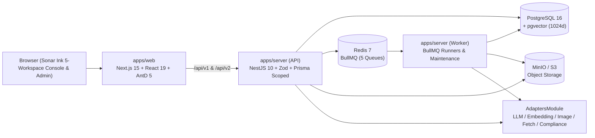

<div align="center">

```text
    ╭─────╮      ██████╗ ███████╗ ██████╗ ███╗   ███╗██╗██╗  ██╗
   ╱ ╭───╮ ╲    ██╔════╝ ██╔════╝██╔═══██╗████╗ ████║██║╚██╗██╔╝
  │  │  ╱│  │   ██║  ███╗█████╗  ██║   ██║██╔████╔██║██║ ╚███╔╝
  │ ─┼─*─┼─ │   ██║   ██║██╔══╝  ██║   ██║██║╚██╔╝██║██║ ██╔██╗
   ╲ ╰───╯ ╱    ╚██████╔╝███████╗╚██████╔╝██║ ╚═╝ ██║██║██╔╝ ██╗
    ╰─────╯      ╚═════╝ ╚══════╝ ╚═════╝ ╚═╝     ╚═╝╚═╝╚═╝  ╚═╝

  GEO CONTENT CREATION   /   AI VISIBILITY RADAR   /   SONAR INK
```

**Multi-Tenant Generative Engine Optimization (GEO) Growth & AI Visibility Platform**

[](https://github.com/yexiu700/geomix/actions/workflows/ci.yml)


**English** · [简体中文](./README.zh-CN.md)

</div>

---

## Overview

**GeoMix** (GeoMix 2.0 / v2.1) is a full-stack TypeScript monorepo platform built for dual-market (**CN / GLOBAL**) **Generative Engine Optimization (GEO)** content workflows, multi-channel distribution, and **AI Visibility Diagnostics**. All branding, UI copy, design tokens (**Sonar Ink** dark theme), and compliance agreements are original and self-authored.

Development and CI default to deterministic fake model/storage adapters and `BILLING_MODE=SHADOW` (full ledger accounting with zero point deduction), enabling local startup and full-stack end-to-end testing without external API keys.

## Key Capabilities

- **Multi-Tenant Auth, Billing & Admin Core**
  - Server-drawn PNG captcha login, JWT access/refresh rotation, IP/account rate limiting, and expired-tenant read-only guard (`TenantActiveGuard`).
  - Prisma tenant-isolation extension (`prisma.scoped`) across 31 models (27 tenant-scoped) with an AST ratchet allowlist on `prisma.base`, `SHADOW` / `STRICT` point reservation & idempotent settlement across 4 unified paid actions (`geo_write`, `visibility_check`, `inline_image_gen`, `geo_variant`), 7 zero-point rate-limited actions (`geo_brief`, `brand_fact_extract`, `geo_evaluate`, `rewrite_section`, `distribution_preflight`, `crawl_probe`, `pr_packet_share`), and admin console (tenants, pricing, announcements, daily LLM cost report).
- **Brand Assets & Dual-Market Foundation (`CN` / `GLOBAL`)**
  - Brand profiles with independent `CN` and `GLOBAL` market configurations (owned domains, local category, competitors, AES-256-GCM encrypted L1 CMS connections).
  - Structured Brand Fact Cards (4 core slots + extra long documents) with 0-point AI extraction from URLs, pasted text, or `.txt`/`.md`/`.pdf` uploads, automatic 1024-dim `pgvector` HNSW chunk indexing (`fact-index` queue) for long facts, and a brand media gallery (auto-compression, EXIF stripping, thumbnails, S3/MinIO storage, and `FEATURE_AI_IMAGE`-gated inline AI image generation).
- **AI Visibility Radar & Diagnosis-to-Brief Engine**
  - Feature-flagged AI Visibility Diagnostics (`FEATURE_VISIBILITY`) supporting 8 domestic CN engines (`deepseek`, `doubao`, `yuanbao`, `tongyi`, `wenxin`, `nami`, `kimi`, `zhipu`) and 5 global engines (`chatgpt`, `perplexity`, `claude`, `gemini`, `google_aio`), engine health probes, LLM judge scoring, trend charts, citation trace graphs, and opportunity gaps.
  - Automated & manual GEO Brief generation (`briefs`) triggered after visibility runs or via competitor high-citation URL counter-play (`from-citation-url`) with SSRF-guarded fetching and `robots.txt` validation.
- **GEO Content Studio, Global-First Distribution & Attribution Loop**
  - SSE streaming targeted writer (`POST /api/v2/brands/:brandId/articles/stream`) with 4 GEO recipes × market-specific target formats, plus BullMQ-backed 2–20 article batch generation (`geo-batch` queue).
  - Markdown/preview editor with inline media insertion, selection-level section rewriting (`rewrite-section`), dual-track compliance & preflight gate (CN Advertising Law + GLOBAL FTC/claims), 5-dimension GEO evaluator, Schema JSON-LD / `llms.txt` generation, multi-format delivery export (`Markdown` / `HTML` / `Docx` / ZIP), async 1→N multi-channel variant generation (`distribution` queue), L1 official CMS push (Shopify / WordPress / Webflow / signed Webhook + IndexNow), login-free external PR/KOL Media Kits (`/share/pr/[token]`), and T+1 Crawl/Schema Probe + T+7/14/30 automated retest attribution on Action Home (`/home`).
- **Minimalist 5-Workspace Shell & Engineering Delivery**
  - Brand & dual-market scoped 5-workspace console (`/home`, `/brands`, `/visibility`, `/studio`, `/account`), persisted sidebar collapse (`User.uiPrefs`), `⌘K` command palette, and 23 legacy route redirects (`/dashboard`, `/me/*`, `/visibility/*`, `/user/*`).
  - Full Vitest unit/contract test suite, Playwright full-stack E2E suite (including `e2e/v2/` 4-tier + Tier 5 adversarial tests), and GHCR + Self-Hosted Runner CD pipeline.

## Architecture



## Tech Stack & Repository Layout

- **Frontend**: Next.js 15 (App Router), React 19, Ant Design 5, Zustand 5, native CSS (`--gm-*` Sonar Ink tokens), hand-crafted SVG visualizations, SSE streaming client
- **Backend**: NestJS 10 (dual-entry `api` + `worker`, URI versioned `/api/v1` & `/api/v2`), Zod 3, BullMQ 5, `sharp`, `undici`
- **Data & Infra**: PostgreSQL 16 (`pgvector`), Prisma 5, Redis 7, MinIO (S3-compatible), Docker Compose
- **Toolchain**: pnpm 10 workspace, Turborepo 2, TypeScript 5 (`strict`), Vitest 3, Playwright, ESLint 9, Prettier 3

```text
geomix/
├─ apps/
│  ├─ web/                 # @geomix/web — Next.js 15 5-workspace console & admin panel
│  └─ server/              # @geomix/server — NestJS 10 API (main.api.ts) & Worker (main.worker.ts)
├─ packages/
│  ├─ shared/              # @geomix/shared — cross-app contracts, Zod schemas, GEO/billing/queue/time/UX logic
│  ├─ db/                  # @geomix/db — Prisma schema (31 models), 14 migrations, idempotent seed & tenant scope
│  ├─ prompts/             # @geomix/prompts — retained standalone v1 prompt package (no runtime downstream deps)
│  └─ config/              # @geomix/config — shared ESLint & TypeScript configs
├─ e2e/                    # Playwright full-stack E2E suite (baseline + e2e/v2 4-tier & Tier 5 adversarial)
├─ scripts/                # Staging deploy, backup, restore & root env loader scripts
├─ docker/                 # Dockerfiles, Nginx TLS template & Postgres pgvector init SQL
├─ docs/                   # Agent playbook, live architecture map, ops manual & historical QA baselines
└─ .github/                # CI/E2E/CD/Auto-Merge workflows, issue forms & PR template
```

## Quick Start

### Prerequisites

- **Node.js >= 22**
- **pnpm 10** (`corepack enable`)
- **Docker Compose v2**

### Run Locally

```bash
cp .env.example .env
docker compose up -d
pnpm install --frozen-lockfile
pnpm db:migrate
pnpm db:seed
pnpm dev
```

`docker compose up -d` starts PostgreSQL 16 (`pgvector/pgvector:pg16`, auto-enabling `vector` on first init), Redis 7, and Chainguard MinIO.

> **PostgreSQL `pgvector` Note**: The bundled Compose user (`geomix`) is a database superuser. If you point `DATABASE_URL` at an external PostgreSQL instance with a non-superuser role, have a superuser run `CREATE EXTENSION IF NOT EXISTS vector;` first, then run `pnpm db:migrate` (`prisma migrate deploy`). Never modify already-committed migration SQL files.

`pnpm dev` starts all three local processes simultaneously (works out of the box even without copying `.env`; exported shell variables take precedence):

| Process  | URL                     | Description                                                                                                     |
| -------- | ----------------------- | --------------------------------------------------------------------------------------------------------------- |
| `web`    | `http://localhost:3000` | Console (`/home`), Login (`/login`), Admin (`/admin`)                                                           |
| `api`    | `http://localhost:3001` | NestJS REST API (`/api/v1` & `/api/v2`), health check `GET /api/v1/health`                                      |
| `worker` | —                       | BullMQ worker consuming 5 queues (`fact-index`, `geo-batch`, `visibility-check`, `distribution`, `maintenance`) |

Default local seed accounts (**local development only** — change via `.env` outside git before any shared environment):

- Admin: `admin` / `geomix-admin-dev`
- Demo tenant: `demo` / `geomix-demo-dev` (1,000 initial points, 0 initial brands for onboarding, inherits global `BILLING_MODE=SHADOW`)

`pnpm db:seed` is idempotent: re-running synchronizes the 4 GeoMix v2.1 default pricing items (removing deprecated pricing keys) without duplicating points or overwriting customized passwords, expiries, quotas, or tenant billing overrides.

## Common Scripts

| Command                  | Purpose                                                                        |
| ------------------------ | ------------------------------------------------------------------------------ |
| `pnpm dev`               | Run `web`, `api`, and `worker` concurrently                                    |
| `pnpm build`             | Build all packages, `server`, and `web` (runs `prisma generate` automatically) |
| `pnpm lint`              | Full-repo ESLint + `prettier --check .`                                        |
| `pnpm format`            | Format codebase and docs with Prettier                                         |
| `pnpm typecheck`         | Workspace `tsc --noEmit` (including `e2e/tsconfig.json`)                       |
| `pnpm test`              | Workspace Vitest unit tests (no DB/Redis required by default)                  |
| `E2E_V2=1 pnpm test:e2e` | Full Playwright E2E suite including `e2e/v2/` (requires PG + Redis + build)    |
| `pnpm db:validate`       | Validate Prisma schema                                                         |
| `pnpm db:migrate`        | Apply committed Prisma migrations (`migrate deploy`)                           |
| `pnpm db:seed`           | Run idempotent database seed                                                   |

Run a single backend entrypoint:

```bash
pnpm --filter @geomix/server dev:api
pnpm --filter @geomix/server dev:worker
```

## Testing & CI/CD

Every push and Pull Request triggers [`.github/workflows/ci.yml`](.github/workflows/ci.yml) with two required gates:

1. **`lint, typecheck, test`**: Runs `pnpm install --frozen-lockfile`, `prisma generate`, `pnpm lint`, `pnpm typecheck`, and `pnpm test`.
2. **`playwright e2e`** ([`e2e.yml`](.github/workflows/e2e.yml)): Spins up PostgreSQL 16 (`pgvector`) and Redis 7 service containers, runs migrations + seed, builds with `NEXT_E2E_FAST_BUILD=1`, and executes the full Playwright E2E suite (`E2E_V2=1`) with deterministic fake adapters.

Optional local DB / Redis integration tests:

```bash
# Database integration tests (@geomix/server creates and drops isolated temporary DBs)
GEOMIX_DB_INTEGRATION=1 pnpm --filter @geomix/server test

# Full backend integration tests including BullMQ / Redis queues
GEOMIX_DB_INTEGRATION=1 GEOMIX_REDIS_INTEGRATION=1 pnpm --filter @geomix/server test
```

## Documentation

| Document                                                               | Audience & Purpose                                                                                           |
| ---------------------------------------------------------------------- | ------------------------------------------------------------------------------------------------------------ |
| [README.zh-CN.md](README.zh-CN.md)                                     | 简体中文项目文档                                                                                             |
| [AGENTS.md](AGENTS.md)                                                 | Quick-start guide, hard redlines & CI guardrails for AI coding agents                                        |
| [docs/AGENTS.md](docs/AGENTS.md)                                       | Full engineering handbook, machine-enforced contracts & change recipes                                       |
| [docs/架构与模块索引.md](docs/架构与模块索引.md)                       | Live GeoMix 2.0/v2.1 architecture map (stack, `/api/v1`+`/api/v2`, 5 queues, 31 Prisma models, 5 workspaces) |
| [docs/运维与部署手册.md](docs/运维与部署手册.md)                       | Staging/production Docker Compose, Nginx HTTPS, backup/restore & LLM cost report                             |
| [docs/CD部署指南.md](docs/CD部署指南.md)                               | GHCR + Self-Hosted Runner automated deployment setup                                                         |
| [docs/decisions.md](docs/decisions.md)                                 | Confirmed product/compliance decisions & GeoMix 2.0 evolution notes                                          |
| [docs/设计系统与UI重构Issue清单.md](docs/设计系统与UI重构Issue清单.md) | Sonar Ink dark design system token specification (`ISSUE-01`–`ISSUE-10` completed)                           |
| [docs/页面对照验收清单.md](docs/页面对照验收清单.md)                   | Historical Phase-1 QA baseline (`M01`–`M09` / `S00`–`S27`, retained & verified by `qa.spec.ts`)              |
| [CONTRIBUTING.md](CONTRIBUTING.md)                                     | Contribution workflow, commit conventions & PR checklist                                                     |
| [SECURITY.md](SECURITY.md)                                             | Vulnerability reporting & built-in security boundaries                                                       |

## Contributing & Security

- Please read [CONTRIBUTING.md](CONTRIBUTING.md) before opening a Pull Request.
- AI coding agents working on this repository should start with [AGENTS.md](AGENTS.md) and [docs/AGENTS.md](docs/AGENTS.md).
- To report a security vulnerability privately, see [SECURITY.md](SECURITY.md).
