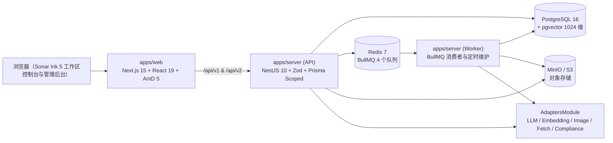

<div align="center">

```text
    ╭─────╮      ██████╗ ███████╗ ██████╗ ███╗   ███╗██╗██╗  ██╗
   ╱ ╭───╮ ╲    ██╔════╝ ██╔════╝██╔═══██╗████╗ ████║██║╚██╗██╔╝
  │  │  ╱│  │   ██║  ███╗█████╗  ██║   ██║██╔████╔██║██║ ╚███╔╝
  │ ─┼─*─┼─ │   ██║   ██║██╔══╝  ██║   ██║██║╚██╔╝██║██║ ██╔██╗
   ╲ ╰───╯ ╱    ╚██████╔╝███████╗╚██████╔╝██║ ╚═╝ ██║██║██╔╝ ██╗
    ╰─────╯      ╚═════╝ ╚══════╝ ╚═════╝ ╚═╝     ╚═╝╚═╝╚═╝  ╚═╝

  GEO CONTENT CREATION   /   AI VISIBILITY RADAR   /   SONAR INK
```

**多租户生成式引擎优化（GEO）增长与 AI 可见度平台**

[](https://github.com/yexiu700/geomix/actions/workflows/ci.yml)


[English](./README.md) · **简体中文**

</div>

---

## 项目简介

**GeoMix**（GeoMix 2.0）是一个基于 TypeScript Monorepo 的多租户双市场（**国内 `CN` / 海外 `GLOBAL`**）**GEO（Generative Engine Optimization）** 内容增长与 **AI 可见度诊断**平台。全站品牌、文案、**Sonar Ink（声呐墨）** 暗色设计令牌与合规承诺协议均为原创自制。

本地开发与 CI 默认启用确定性假模型/内存存储适配器以及 `BILLING_MODE=SHADOW`（完整记账、不实扣点数），无需配置外部真实密钥即可一键启动并运行完整端到端测试。

## 核心能力

- **认证、多租户与计费底座**
  - 服务端绘制 PNG 图形验证码登录、JWT 访问/刷新令牌轮换、IP/账号限流与到期账号只读守卫（`TenantActiveGuard`）。
  - 覆盖 27 个数据模型的 Prisma 租户隔离扩展（`prisma.scoped`）与 `prisma.base` AST 棘轮白名单；`SHADOW` / `STRICT` 双模式整单冻结与幂等结算，统一收敛为 3 项付费动作（`geo_write`、`visibility_check`、`inline_image_gen`）+ 4 项 0 点限流标配动作（`geo_brief`、`brand_fact_extract`、`geo_evaluate`、`rewrite_section`）；管理后台支持租户开户、价格表、公告与 LLM 成本日报。
- **品牌资产与双市场基座（`CN` / `GLOBAL`）**
  - 品牌档案支持独立配置国内与海外市场（自有域名、本地品类、竞品列表）。
  - 结构化品牌事实卡（4 大核心槽位 + 补充长文档）支持 URL / 粘贴文本 / `.txt` / `.md` / `.pdf` 上传 0 点 AI 提炼，超长文档经 `fact-index` 队列自动切片并建立 1024 维 `pgvector` HNSW 向量索引；品牌素材库支持自动压缩、去 EXIF、缩略图、S3/MinIO 存储及受 `FEATURE_AI_IMAGE` 控制的行内 AI 配图。
- **AI 可见度诊断与写作意见引擎**
  - 受 `FEATURE_VISIBILITY` 开关控制的 AI 可见度诊断：支持国内 8 引擎（DeepSeek / 豆包 / 元宝 / 通义 / 文心 / 纳米 / Kimi / 智谱）与海外 5 引擎（ChatGPT / Perplexity / Claude / Gemini / Google AI Overviews），内置引擎健康探测、LLM 裁判评分、趋势图、引用源追踪与机会缺口分析。
  - GEO 写作意见引擎（`briefs`）：支持诊断完成后自动生成机会意见、手工自由选题以及竞品高引用 URL 反制生成（内置 SSRF 校验、DNS 钉住与 `robots.txt` 校验）。
- **GEO 写作台与发布复测闭环**
  - 基于 SSE 的靶向流式写作（4 套 GEO 配方 × 市场专属成稿格式）与基于 BullMQ `geo-batch` 队列的 2–20 篇批量生成。
  - Markdown/预览一体化编辑器，支持行内插图与局部划词改写、双轨合规扫描（国内广告法 + 海外 FTC/宣称校验）、5 维 GEO 体检与 Schema JSON-LD / `llms.txt` / 爬虫清单生成、`Markdown` / `HTML` / `Docx` / ZIP 交付包导出，以及发布回链一键复测与行动首页（`/home`）。
- **极简 5 工作区壳与工程交付**
  - 品牌 + 双市场作用域驱动的极简 5 工作区控制台（`/home`、`/brands`、`/visibility`、`/studio`、`/account`），支持侧栏折叠偏好持久化（`User.uiPrefs`）、`⌘K` 命令面板与 23 条旧入口 307 重定向（`/dashboard`、`/me/*`、`/visibility/*`、`/user/*`）。
  - 全仓 Vitest 单元测试与契约守卫、Playwright 全栈端到端测试（含 `e2e/v2/` 四层与 Tier 5 对抗套件），以及 GHCR + Self-Hosted Runner 自动发布流水线。

## 系统架构



## 技术栈与仓库结构

- **前端**：Next.js 15（App Router）、React 19、Ant Design 5、Zustand 5、原生 CSS（`--gm-*` Sonar Ink 令牌）、手写 SVG 可视化、SSE 流式客户端
- **后端**：NestJS 10（同代码库 `api` 与 `worker` 双入口、URI 版本化 `/api/v1` & `/api/v2`）、Zod 3、BullMQ 5、`sharp`、`undici`
- **数据与基础设施**：PostgreSQL 16（`pgvector`）、Prisma 5、Redis 7、MinIO（S3 兼容）、Docker Compose
- **工程工具链**：pnpm 10 workspace、Turborepo 2、TypeScript 5（`strict`）、Vitest 3、Playwright、ESLint 9、Prettier 3

```text
geomix/
├─ apps/
│  ├─ web/                 # @geomix/web — Next.js 15 极简 5 工作区控制台与管理后台
│  └─ server/              # @geomix/server — NestJS 10 API（main.api.ts）与 Worker（main.worker.ts）
├─ packages/
│  ├─ shared/              # @geomix/shared — 跨端契约、Zod Schema、GEO/计费/队列/时间/UX 纯函数
│  ├─ db/                  # @geomix/db — Prisma schema（27 模型）、12 个迁移、幂等种子与租户隔离扩展
│  ├─ prompts/             # @geomix/prompts — 一期保留的独立提示词模板包（暂无下游运行时依赖）
│  └─ config/              # @geomix/config — 共享 ESLint 与 tsconfig 预设
├─ e2e/                    # Playwright 全栈端到端测试套件（含 e2e/v2/ 四层与 Tier 5 对抗套件）
├─ scripts/                # 单机部署、备份、恢复与环境变量加载脚本
├─ docker/                 # Dockerfile、Nginx TLS 模板与 PostgreSQL pgvector 初始化脚本
├─ docs/                   # 代理开发手册、实时架构索引、运维手册与历史基线文档
└─ .github/                # CI/E2E/CD/Auto-Merge 工作流、Issue 表单与 PR 模板
```

## 快速开始

### 环境要求

- **Node.js >= 22**
- **pnpm 10**（`corepack enable`）
- **Docker Compose v2**

### 本地启动

```bash
cp .env.example .env
docker compose up -d
pnpm install --frozen-lockfile
pnpm db:migrate
pnpm db:seed
pnpm dev
```

`docker compose up -d` 启动 PostgreSQL 16（`pgvector/pgvector:pg16`，首次初始化自动启用 `vector` 扩展）、Redis 7 和 Chainguard MinIO 镜像。

> **PostgreSQL `pgvector` 权限说明**：本地 Compose 的 `geomix` 账号默认具备库超级用户权限；若连接外部 PostgreSQL 且业务账号非超级用户，请先由超级用户在目标库执行 `CREATE EXTENSION IF NOT EXISTS vector;`，再运行 `pnpm db:migrate`（`prisma migrate deploy`）。已提交的迁移 SQL 不可改写。

`pnpm dev` 会同时启动以下三个进程（不复制 `.env` 也可使用与 `.env.example` 一致的缺省值启动，已导出环境变量优先于 `.env`）：

| 进程     | 地址                    | 说明                                                                                                 |
| -------- | ----------------------- | ---------------------------------------------------------------------------------------------------- |
| `web`    | `http://localhost:3000` | 工作台（`/home`）、登录页（`/login`）、管理后台（`/admin`）                                          |
| `api`    | `http://localhost:3001` | NestJS REST API（`/api/v1` 与 `/api/v2`），健康检查 `GET /api/v1/health`                             |
| `worker` | —                       | BullMQ 后台消费者，消费 4 个异步队列（`fact-index`、`geo-batch`、`visibility-check`、`maintenance`） |

本地开发默认种子账号（**仅限本机使用**，共享或预发环境务必通过仓库外 `.env` 修改）：

- 管理员：`admin` / `geomix-admin-dev`
- 演示商户：`demo` / `geomix-demo-dev`（初始 1000 点，初始 0 品牌以便直接体验建档流程，默认继承全局 `BILLING_MODE=SHADOW`）

重复执行 `pnpm db:seed` 是幂等的：会将价格表同步为 GeoMix 2.0 的 3 项默认值并清理已废弃计费项，不会重复加点，也不会覆盖已修改的口令、有效期、配额或租户计费模式覆盖。

## 常用脚本

| 命令                     | 作用                                                                       |
| ------------------------ | -------------------------------------------------------------------------- |
| `pnpm dev`               | 同时启动 `web`、`api`、`worker`                                            |
| `pnpm build`             | 构建全部 packages、`server` 与 `web`（自动先执行 `prisma generate`）       |
| `pnpm lint`              | 全仓 ESLint + `prettier --check .`                                         |
| `pnpm format`            | 使用 Prettier 格式化全仓代码与文档                                         |
| `pnpm typecheck`         | 全仓 `tsc --noEmit`（含 `e2e/tsconfig.json`）                              |
| `pnpm test`              | 全仓 Vitest 单元测试（默认不连接 DB / Redis）                              |
| `E2E_V2=1 pnpm test:e2e` | 全量 Playwright 端到端测试（含 `e2e/v2/`，需 PG + Redis + 已迁移与已构建） |
| `pnpm db:validate`       | 校验 Prisma schema                                                         |
| `pnpm db:migrate`        | 应用已提交的 Prisma 迁移（`migrate deploy`）                               |
| `pnpm db:seed`           | 写入可重复执行的种子数据                                                   |

按进程单独启动后端：

```bash
pnpm --filter @geomix/server dev:api
pnpm --filter @geomix/server dev:worker
```

## 测试与 CI/CD

每次 Push 与 Pull Request 都会触发 [`.github/workflows/ci.yml`](.github/workflows/ci.yml) 的两项必过门禁：

1. **`lint, typecheck, test`**：安装依赖、生成 Prisma Client 并执行 `pnpm lint`、`pnpm typecheck`、`pnpm test`。
2. **`playwright e2e`**（[`e2e.yml`](.github/workflows/e2e.yml)）：拉起 PostgreSQL 16（`pgvector`）与 Redis 7 容器，执行迁移、种子、快速构建（`NEXT_E2E_FAST_BUILD=1`）并以确定性假适配器运行全量 Playwright 端到端测试（`E2E_V2=1`）。

本地按需运行数据库 / Redis 集成测试：

```bash
# 数据库集成测试（@geomix/server 自动建/删临时隔离库，不污染开发库）
GEOMIX_DB_INTEGRATION=1 pnpm --filter @geomix/server test

# 包含 BullMQ / Redis 队列的完整后端集成测试
GEOMIX_DB_INTEGRATION=1 GEOMIX_REDIS_INTEGRATION=1 pnpm --filter @geomix/server test
```

## 文档索引

| 文档                                                                   | 适用场景与用途                                                                             |
| ---------------------------------------------------------------------- | ------------------------------------------------------------------------------------------ |
| [README.md](README.md)                                                 | English README                                                                             |
| [AGENTS.md](AGENTS.md)                                                 | 编码代理入口速查（红线、高频 CI 契约与常用命令）                                           |
| [docs/AGENTS.md](docs/AGENTS.md)                                       | 编码代理完整开发规范、机器强制契约与高频变更配方                                           |
| [docs/架构与模块索引.md](docs/架构与模块索引.md)                       | GeoMix 2.0 实时架构地图（技术栈、`/api/v1`+`/api/v2`、4 个队列、27 个数据模型与 5 工作区） |
| [docs/运维与部署手册.md](docs/运维与部署手册.md)                       | 单机预发/生产 Compose、Nginx HTTPS、备份恢复与 LLM 成本日报                                |
| [docs/CD部署指南.md](docs/CD部署指南.md)                               | GHCR + Self-Hosted Runner 自动发布配置                                                     |
| [docs/decisions.md](docs/decisions.md)                                 | 立项已确认决策与 GeoMix 2.0 演进补充                                                       |
| [docs/设计系统与UI重构Issue清单.md](docs/设计系统与UI重构Issue清单.md) | Sonar Ink 暗色视觉令牌规范（`ISSUE-01`–`ISSUE-10` 已落地）                                 |
| [docs/页面对照验收清单.md](docs/页面对照验收清单.md)                   | 一期历史验收基线（`M01`–`M09` / `S00`–`S27`，保留并受 `qa.spec.ts` 校验）                  |
| [CONTRIBUTING.md](CONTRIBUTING.md)                                     | 贡献流程、提交规范与 PR 自检清单                                                           |
| [SECURITY.md](SECURITY.md)                                             | 安全漏洞披露规范与内置安全边界                                                             |

## 参与贡献与安全反馈

- 提交 Pull Request 前请先阅读 [CONTRIBUTING.md](CONTRIBUTING.md)。
- 在本仓库协作的 AI 编码代理请从 [AGENTS.md](AGENTS.md) 与 [docs/AGENTS.md](docs/AGENTS.md) 入手。
- 如发现安全漏洞，请遵循 [SECURITY.md](SECURITY.md) 进行私密报告，切勿直接公开披露。
