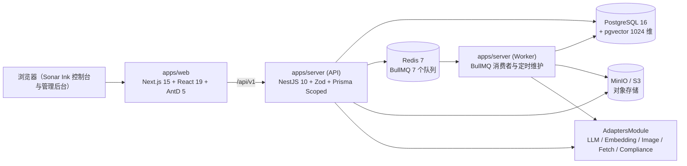

<div align="center">

```text
    ╭─────╮      ██████╗ ███████╗ ██████╗ ███╗   ███╗██╗██╗  ██╗
   ╱ ╭───╮ ╲    ██╔════╝ ██╔════╝██╔═══██╗████╗ ████║██║╚██╗██╔╝
  │  │  ╱│  │   ██║  ███╗█████╗  ██║   ██║██╔████╔██║██║ ╚███╔╝
  │ ─┼─*─┼─ │   ██║   ██║██╔══╝  ██║   ██║██║╚██╔╝██║██║ ██╔██╗
   ╲ ╰───╯ ╱    ╚██████╔╝███████╗╚██████╔╝██║ ╚═╝ ██║██║██╔╝ ██╗
    ╰─────╯      ╚═════╝ ╚══════╝ ╚═════╝ ╚═╝     ╚═╝╚═╝╚═╝  ╚═╝

  GEO CONTENT CREATION   /   AI VISIBILITY RADAR   /   SONAR INK
```

**多租户生成式引擎优化（GEO）内容创作与 AI 可见度平台**

[](https://github.com/yexiu700/geomix/actions/workflows/ci.yml)


[English](./README.md) · **简体中文**

</div>

---

## 项目简介

**GeoMix** 是一个基于 TypeScript Monorepo 的多租户 **GEO（Generative Engine Optimization）** 内容创作与 **AI 可见度诊断**平台。全站品牌、文案、**Sonar Ink（声呐墨）** 暗色设计令牌、合规协议与系统提示词模板均为自制。

本地开发与 CI 默认启用确定性假模型/内存存储适配器以及 `BILLING_MODE=SHADOW`（完整记账、不实扣点数），无需配置外部真实密钥即可一键启动并运行完整端到端测试。

## 核心能力

- **认证、多租户与计费底座**
  - 服务端绘制 PNG 图形验证码登录、JWT 访问/刷新令牌轮换、IP 限流与到期账号只读守卫（`TenantActiveGuard`）。
  - 覆盖 34 个数据模型的 Prisma 租户隔离扩展（`prisma.scoped`）、`SHADOW` / `STRICT` 双模式整单冻结与幂等结算计费、存量/累计配额管控，以及管理后台（租户开户、价格表、公告、系统模板、LLM 成本日报）。
- **AI 创作工作台**
  - 关键词管理与 AI 问题蒸馏、写作标题池、企业画像图库（自动压缩、去 EXIF、缩略图、S3/MinIO 存储）、企业知识库（细分/汇总双模式、必读承诺协议签署、1024 维 `pgvector` HNSW 检索）。
  - 写作指令库（10+7+1 套自写只读系统模板 + 克隆编辑）、文章分类聚合、基于 BullMQ 的 AI 写作任务流水线、自研轻量富文本编辑、审核流转与批量 ZIP 导出（`Markdown` / `HTML` / `Docx`）。
- **流量复刻与 AI 生图**
  - 单篇及批量全网爆文复刻，内置 SSRF 校验、DNS 钉住、`robots.txt` 校验、5-gram 相似度自检与合规改写。
  - 受 `FEATURE_AI_IMAGE` 开关控制的 AI 生图工作台，支持提示词优化与一键保存至企业图库。
- **AI 可见度监测与看板**
  - 受 `FEATURE_VISIBILITY` 开关控制的 AI 数据看板与 AI 可见度诊断：监测档案管理、多引擎采集与裁判评分、引用来源追踪与 Sonar Ink 声呐雷达可视化。
- **工作台体验与工程交付**
  - 多标签保活后台壳，支持布局偏好后端持久化（`User.uiPrefs`）、`⌘K` 命令面板与 16 条 `/user/*` 历史入口跳转。
  - 全仓 Vitest 单元测试与契约守卫、Playwright 全栈端到端测试，以及 GHCR + Self-Hosted Runner 自动发布流水线。

## 系统架构



## 技术栈与仓库结构

- **前端**：Next.js 15（App Router）、React 19、Ant Design 5、Zustand 5、原生 CSS（`--gm-*` Sonar Ink 令牌）、手写 SVG 可视化
- **后端**：NestJS 10（同代码库 `api` 与 `worker` 双入口）、Zod 3、BullMQ 5、`sharp`、`undici`
- **数据与基础设施**：PostgreSQL 16（`pgvector`）、Prisma 5、Redis 7、MinIO（S3 兼容）、Docker Compose
- **工程工具链**：pnpm 10 workspace、Turborepo 2、TypeScript 5（`strict`）、Vitest 3、Playwright、ESLint 9、Prettier 3

```text
geomix/
├─ apps/
│  ├─ web/                 # @geomix/web — Next.js 15 多标签工作台、全业务页面与管理后台
│  └─ server/              # @geomix/server — NestJS 10 API（main.api.ts）与 Worker（main.worker.ts）
├─ packages/
│  ├─ shared/              # @geomix/shared — 跨端契约、Zod Schema、计费/队列/时间/UX 纯函数
│  ├─ db/                  # @geomix/db — Prisma schema（34 模型）、迁移、幂等种子与租户隔离扩展
│  ├─ prompts/             # @geomix/prompts — 提示词渲染与 10+7+1 套自写系统模板
│  └─ config/              # @geomix/config — 共享 ESLint 与 tsconfig 预设
├─ e2e/                    # Playwright 全栈端到端测试套件
├─ scripts/                # 单机部署、备份、恢复与环境变量加载脚本
├─ docker/                 # Dockerfile、Nginx TLS 模板与 PostgreSQL pgvector 初始化脚本
├─ docs/                   # 代理开发手册、实时架构索引、运维手册与验收清单
└─ .github/                # CI/E2E/CD/Auto-Merge 工作流、Issue 表单与 PR 模板
```

## 快速开始

### 环境要求

- **Node.js >= 22**
- **pnpm 10**（`corepack enable`）
- **Docker Compose v2**

### 本地启动

```bash
cp .env.example .env
docker compose up -d
pnpm install --frozen-lockfile
pnpm db:migrate
pnpm db:seed
pnpm dev
```

`docker compose up -d` 启动 PostgreSQL 16（`pgvector/pgvector:pg16`，首次初始化自动启用 `vector` 扩展）、Redis 7 和 Chainguard MinIO 镜像。

> **PostgreSQL `pgvector` 权限说明**：本地 Compose 的 `geomix` 账号默认具备库超级用户权限；若连接外部 PostgreSQL 且业务账号非超级用户，请先由超级用户在目标库执行 `CREATE EXTENSION IF NOT EXISTS vector;`，再运行 `pnpm db:migrate`（`prisma migrate deploy`）。已提交的迁移 SQL 不可改写。

`pnpm dev` 会同时启动以下三个进程（不复制 `.env` 也可使用与 `.env.example` 一致的缺省值启动，已导出环境变量优先于 `.env`）：

| 进程     | 地址                    | 说明                                                             |
| -------- | ----------------------- | ---------------------------------------------------------------- |
| `web`    | `http://localhost:3000` | 工作台（`/dashboard`）、登录页（`/login`）、管理后台（`/admin`） |
| `api`    | `http://localhost:3001` | NestJS REST API（`/api/v1`），健康检查 `GET /api/v1/health`      |
| `worker` | —                       | BullMQ 后台消费者，消费 7 个异步队列                             |

本地开发默认种子账号（**仅限本机使用**，共享或预发环境务必通过仓库外 `.env` 修改）：

- 管理员：`admin` / `geomix-admin-dev`
- 演示商户：`demo` / `geomix-demo-dev`（初始 1000 点，默认继承全局 `BILLING_MODE=SHADOW`）

重复执行 `pnpm db:seed` 是幂等的：仅恢复系统默认价格项和系统模板，不会重复加点，也不会覆盖已修改的口令、有效期、配额或租户计费模式覆盖。

## 常用脚本

| 命令               | 作用                                                                 |
| ------------------ | -------------------------------------------------------------------- |
| `pnpm dev`         | 同时启动 `web`、`api`、`worker`                                      |
| `pnpm build`       | 构建全部 packages、`server` 与 `web`（自动先执行 `prisma generate`） |
| `pnpm lint`        | 全仓 ESLint + `prettier --check .`                                   |
| `pnpm format`      | 使用 Prettier 格式化全仓代码与文档                                   |
| `pnpm typecheck`   | 全仓 `tsc --noEmit`（含 `e2e/tsconfig.json`）                        |
| `pnpm test`        | 全仓 Vitest 单元测试（默认不连接 DB / Redis）                        |
| `pnpm test:e2e`    | Playwright 全栈端到端测试（需 PG + Redis + 已迁移与已构建）          |
| `pnpm db:validate` | 校验 Prisma schema                                                   |
| `pnpm db:migrate`  | 应用已提交的 Prisma 迁移（`migrate deploy`）                         |
| `pnpm db:seed`     | 写入可重复执行的种子数据                                             |

按进程单独启动后端：

```bash
pnpm --filter @geomix/server dev:api
pnpm --filter @geomix/server dev:worker
```

## 测试与 CI/CD

每次 Push 与 Pull Request 都会触发 [`.github/workflows/ci.yml`](.github/workflows/ci.yml) 的两项必过门禁：

1. **`lint, typecheck, test`**：安装依赖、生成 Prisma Client 并执行 `pnpm lint`、`pnpm typecheck`、`pnpm test`。
2. **`playwright e2e`**（[`e2e.yml`](.github/workflows/e2e.yml)）：拉起 PostgreSQL 16（`pgvector`）与 Redis 7 容器，执行迁移、种子、快速构建（`NEXT_E2E_FAST_BUILD=1`）并以确定性假适配器运行全量 Playwright 端到端测试。

本地按需运行数据库 / Redis 集成测试：

```bash
# 数据库集成测试（@geomix/server 自动建/删临时隔离库，不污染开发库）
GEOMIX_DB_INTEGRATION=1 pnpm --filter @geomix/server test

# 包含 BullMQ / Redis 队列的完整后端集成测试
GEOMIX_DB_INTEGRATION=1 GEOMIX_REDIS_INTEGRATION=1 pnpm --filter @geomix/server test
```

## 文档索引

| 文档                                                                   | 适用场景与用途                                                      |
| ---------------------------------------------------------------------- | ------------------------------------------------------------------- |
| [README.md](README.md)                                                 | English README                                                      |
| [AGENTS.md](AGENTS.md)                                                 | 编码代理入口速查（红线、高频 CI 契约与常用命令）                    |
| [docs/AGENTS.md](docs/AGENTS.md)                                       | 编码代理完整开发规范、机器强制契约与高频变更配方                    |
| [docs/架构与模块索引.md](docs/架构与模块索引.md)                       | 实时架构地图（技术栈、API 路由、7 个队列、34 个数据模型与前端底座） |
| [docs/运维与部署手册.md](docs/运维与部署手册.md)                       | 单机预发/生产 Compose、Nginx HTTPS、备份恢复与 LLM 成本日报         |
| [docs/CD部署指南.md](docs/CD部署指南.md)                               | GHCR + Self-Hosted Runner 自动发布配置                              |
| [docs/页面对照验收清单.md](docs/页面对照验收清单.md)                   | 端到端主流程（`M01`–`M09`）与逐页验收基线（`S00`–`S27`）            |
| [docs/decisions.md](docs/decisions.md)                                 | 立项已确认决策与后续演进记录                                        |
| [docs/设计系统与UI重构Issue清单.md](docs/设计系统与UI重构Issue清单.md) | Sonar Ink 暗色视觉令牌规范（`ISSUE-01`–`ISSUE-10` 已落地）          |
| [CONTRIBUTING.md](CONTRIBUTING.md)                                     | 贡献流程、提交规范与 PR 自检清单                                    |
| [SECURITY.md](SECURITY.md)                                             | 安全漏洞披露规范与内置安全边界                                      |

## 参与贡献与安全反馈

- 提交 Pull Request 前请先阅读 [CONTRIBUTING.md](CONTRIBUTING.md)。
- 在本仓库协作的 AI 编码代理请从 [AGENTS.md](AGENTS.md) 与 [docs/AGENTS.md](docs/AGENTS.md) 入手。
- 如发现安全漏洞，请遵循 [SECURITY.md](SECURITY.md) 进行私密报告，切勿直接公开披露。
