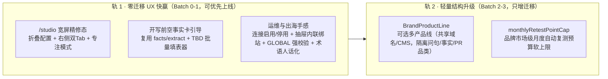

# GeoMix 产品体验与多产品线轻量改造方案（PM / UI / UX）

> **定位**：面向品牌经理日常高频工作流的轻量体验跃升与多品类支持（双轨推进：零迁移 UX 快赢 + 只增迁移结构增强）  
> **基线代码版本**：`main@686015d`（已包含 GeoMix 2.0、v2.1 分发归因与最新活文档对齐）  
> **关联追踪**：总 Epic [#388](https://github.com/yexiu700/geomix/issues/388) · Batch 0–3 拆分单 [#384](https://github.com/yexiu700/geomix/issues/384)–[#387](https://github.com/yexiu700/geomix/issues/387) · 开发红线详见 [docs/AGENTS.md](./AGENTS.md)

---

## 一、背景与改造目标

结合品牌经理从「冷启动建档 → 监测诊断 → 写作精修 → 多渠道分发 → 复测归因」的真实工作流，本方案在不破坏极简 4 栏架构、不与 v2.2（[#375](https://github.com/yexiu700/geomix/issues/375)）及品牌官网（[#382](https://github.com/yexiu700/geomix/issues/382)）产生字段冲突的前提下，聚焦解决 4 类最高 ROI 痛点：

1. **冷启动满屏 `[TBD]` 与重复点小气泡**：复用后端已有的 `POST /api/v2/brands/:id/facts/extract`，在 `/studio` 开写前引入「0 点快速导入商品页/参数建事实卡」引导，并在编辑画布提供「一键批量补全 `[TBD]` 抽屉」。
2. **`/studio` 四列拥挤、编辑区过窄**：拆分「生成态 / 精修态」（选文后默认折叠顶部配置表单），新增「专注宽屏编辑」模式与右侧双 Tab（`体检与合规` | `交付与追踪`），在常见 1024–1440px 屏幕下将正文宽度提升至 55%–80%。
3. **多产品线品牌品类互串**：引入**完全可选、零强制迁移**的 `BrandProductLine` 轻量产品线层，共享品牌官网域名、CMS 连接与品牌级资质，隔离各产品线的 SKU 事实卡、竞品、监测问句、写作与外部 PR 供稿单品类。
4. **日常运维与出海细节断层**：补齐渠道连接卡片「一键停用 / 重新启用」（复用后端已有 `PATCH status`）、`/studio` 抽屉内联快捷绑站、`GLOBAL` 市场中文品牌名强校验、术语人话化词典与单品牌市场「月度自动复测预算软上限」。



---

## 二、已确认关键产品决策

1. **双轨解耦上线**：Batch 0 与 Batch 1 保持**零数据库迁移**，优先合并释放高频写作体验收益；Batch 2–3 通过只增迁移引入多产品线与预算上限，零破坏存量单品类数据。
2. **多产品线渐进显露**：单品类品牌保持 `productLineId = null`（不强制创建产品线），仅当品牌已配置 ≥ 1 条产品线时，`/visibility`、`/studio` 与 `/home` 顶部才展示产品线切换胶囊，确保单品类用户界面零额外噪音。
3. **品牌通用事实 + 产品线专属事实合并检索**：`BrandFact.productLineId = null` 作为品牌级通用背书（企业资质、通用认证），对所有产品线共享；`productLineId = <lineId>` 仅在对应产品线写作、JSON-LD 与 PR 供稿单中优先注入，杜绝跨品类标题/摘要错位。
4. **GLOBAL 市场英文身份护栏**：新建或保存 `GLOBAL` 市场时，若 `localBrandName` / `localCategory` 含中文字符则默认阻断保存，并提供显式特例勾选框「我的海外品牌名本身包含中文字符」放行。
5. **预算上限仅约束无人值守自动复测**：`BrandMarket.monthlyRetestPointCap` 默认 `null`（不限）；设置后仅在 `T+7/14/30` 定时自动复测超限时温和跳过并置为 `SKIPPED_BUDGET_CAP`，不影响品牌经理手动触发的写作与监测。

---

## 三、分模块详细设计

### 3.1 Batch 0：术语人话化与 `/studio` 宽屏专注布局重构（零迁移）

- **`packages/shared/src/ux-foundation.ts`**：
  - 扩充 `UX_TERMS` 与新增只读 `UX_GLOSSARY_TOOLTIPS`（同步在 `src/index.ts` 导出）：
    - `fanOutCoverage`：`AI 追问覆盖度`（含白话 Tooltip）
    - `channelModeL1`：`一键直发自有站`
    - `channelModeL3Community`：`社区合规辅发`
    - `channelModeL3Pr`：`外部媒体 / KOL 供稿`
    - `crawlSchemaProbe`：`AI 抓取与结构化体检`
    - `highConfidenceSampling`：`3 次采样（结果更稳）`
- **`apps/web/components/studio/` & `apps/web/app/globals.css`**：
  - `studio-prewrite-bar.tsx` + `studio-workspace.tsx`：选中历史成稿且非流式生成态时默认折叠顶部配置表单为单行摘要条（`data-testid="studio-prewrite-collapsed-bar"`）；点击「+ 自由选题」或待写意见卡时自动展开；
  - 新增「专注编辑（宽屏）」切换按钮（折叠左右双栏，释放 ≥80% 视口宽度）；`< 1360px` 视口打开成稿时默认将左侧队列收起为 `44px` 窄轨；
  - `studio-right-pane.tsx`：顶部常驻「进入分发工作台」主按钮，下方拆分为 **`体检与合规`** 与 **`交付与追踪`**（带发布条数/抓取异常红点角标）双 Tab，保持既有核心 `data-testid` 零回归。

### 3.2 Batch 1：冷启动快速抽事实、`[TBD]` 批量回填与运维打磨（零迁移）

- **开写前快速抽事实（`apps/web/components/brands/quick-fact-extract-modal.tsx`）**：
  - 抽取独立 `<QuickFactExtractModal>`，100% 复用既有 `POST /api/v2/brands/:id/facts/extract`（URL / 粘贴文本 / 上传文档，0 点限流）与 `PUT /api/v2/brands/:id/facts`；
  - 在 `/studio` 点击「立即生成（10 点）」且当前有效事实卡为 0 时弹出引导，保存后自动续跑写作，并保留「跳过并直接生成」次要按钮。
- **`[TBD]` 一键批量填表抽屉（`apps/web/components/studio/studio-editor-canvas.tsx`）**：
  - 在 `studio-missing-fact-bar` 增加「批量补填（N 项）」按钮，侧滑抽屉一次性列出全部 `extractMissingFactSlots(draftMarkdown)` 槽位、上下文摘录、参数输入与分类选择，底部支持「同步反哺品牌事实卡」总开关与「一键填入全部并保存」（按索引倒序替换正文）。
- **渠道连接一键停用 / 启用 & 抽屉内联绑站**：
  - `brand-channel-connections.tsx` 卡片新增「停用 / 重新启用」按钮，直接调用既有 `PATCH /api/v2/brands/:brandId/connections/:id` 更新 `status: 'DISABLED' | 'ACTIVE'`（停用前走 `useUxFeedback().confirm()` 二次确认）；停用连接在 `/studio` 抽屉 L1 列表自动隐藏；
  - 抽取 `<ChannelConnectionCreateModal>`，支持在 `StudioDistributionDrawer` 未绑站态内联快速绑站而不离开写作页。
- **GLOBAL 英文身份强校验**：
  - `packages/shared/src/brands.ts` 的 `createBrandSchema` / `updateBrandMarketSchema` 追加可选 `allowCjkGlobalIdentity?: boolean`（默认 `false`），前后端统一拦截 `GLOBAL` 市场未勾选特例时的中文 `localBrandName` / `localCategory`。

### 3.3 Batch 2：可选多产品线与月度自动复测预算上限（DB & Server）

- **`packages/db/prisma/schema.prisma`（只增迁移，同步更新 `tenant-scope.ts` 与 `schema-contract.spec.ts`）**：
  ```prisma
  model BrandProductLine {
    id                  String   @id @default(cuid())
    tenantId            String
    tenant              Tenant   @relation(fields: [tenantId], references: [id], onDelete: Cascade)
    brandId             String
    brand               Brand    @relation(fields: [brandId], references: [id], onDelete: Cascade)
    name                String
    localNamesJson      Json     @default("{}")
    category            String
    localCategoriesJson Json     @default("{}")
    seedPromptsJson     Json     @default("{}")
    competitorsJson     Json     @default("{}")
    sortOrder           Int      @default(0)
    createdAt           DateTime @default(now())
    updatedAt           DateTime @updatedAt

    facts          BrandFact[]
    visibilityRuns VisibilityRun[]
    geoBriefs      GeoBrief[]
    geoArticles    GeoArticle[]

    @@unique([brandId, name])
    @@index([tenantId, brandId, sortOrder])
  }
  ```
  - 向 `BrandFact`、`VisibilityRun`、`GeoBrief`、`GeoArticle` 追加可空 `productLineId String?`（`onDelete: SetNull`）；
  - 向 `BrandMarket` 追加 `monthlyRetestPointCap Int?`；向 `RetestScheduleStatus` 追加 `SKIPPED_BUDGET_CAP`；
  - `BrandProductLine` 登记至 `REQUIRED_TENANT_MODELS`。
- **`packages/shared/src/product-lines.ts`**（同步注册 `package.json#exports` 与 `src/index.ts`）：
  - `BrandProductLineDto`、`createProductLineSchema`、`updateProductLineSchema`（每品牌上限 20 条）、`resolveEffectiveCategory()`。
- **`apps/server` 领域服务**：
  - 新建 `GET/POST/PATCH/DELETE /api/v2/brands/:id/product-lines`（全走 `prisma.scoped` + `AuthGuard` + `TenantActiveGuard`）；
  - `BrandFactsService`、`VisibilityRunLifecycleService` / `VisibilityAnalyticsService`、`StudioGenerationService`、`PublicPrPacketService` 透传 `productLineId` 与 `resolveEffectiveCategory()`；
  - `RetestSchedulerService` 按 `Asia/Shanghai` 自然月校验 `monthlyRetestPointCap`，超限时温和跳过写入 `SKIPPED_BUDGET_CAP`，`GeoDeliveryService.getActionHome()` 返回月度预算用量。

### 3.4 Batch 3：产品线前端渐进集成与全链路 E2E

- `/brands` 新增 `brand-product-lines-section.tsx`（增删改产品线、事实卡按「品牌通用 / 产品线」归类）及「本月自动复测点数上限」配置；
- `workspace-store.ts` 增加 `activeProductLineId: string | null`（切品牌自动清零），仅当品牌存在 ≥1 条产品线时在 `/visibility`、`/studio`、`/home` 展示产品线筛选胶囊；
- `/home` 支持渲染 `SKIPPED_BUDGET_CAP` 温和提示与月度自动复测预算进度条；
- 新增 `e2e/ux-polish-product-lines.spec.ts` 锁定窄屏专注编辑、空事实卡引导、批量 `[TBD]` 回填、连接启停与内联绑站、`GLOBAL` 中文阻断以及双产品线品类隔离。

---

## 四、分批交付路线与 GitHub Issues 映射

| 批次        | Issue                                                 | 核心范围                                                                                     | 依赖           | 并发策略                 |
| :---------- | :---------------------------------------------------- | :------------------------------------------------------------------------------------------- | :------------- | :----------------------- |
| **Epic**    | [#388](https://github.com/yexiu700/geomix/issues/388) | 品牌经理体验跃升与可选多产品线改造总追踪                                                     | —              | 总控                     |
| **Batch 0** | [#384](https://github.com/yexiu700/geomix/issues/384) | 术语人话化词典、`/studio` 生成态/精修态折叠、专注宽屏与右侧双 Tab 重构                       | 无             | 零迁移，优先合入         |
| **Batch 1** | [#385](https://github.com/yexiu700/geomix/issues/385) | 开写前 URL 抽事实卡引导、`[TBD]` 批量填表器、渠道一键停用/内联绑定与 `GLOBAL` 英文身份强校验 | `#384`         | 零迁移，与 `#386` 并行   |
| **Batch 2** | [#386](https://github.com/yexiu700/geomix/issues/386) | 可选多产品线（`BrandProductLine`）领域模型、事实/监测/写作/PR 透传与月度自动复测预算软上限   | 无             | 只增迁移，与 `#385` 并行 |
| **Batch 3** | [#387](https://github.com/yexiu700/geomix/issues/387) | 多产品线渐进切换 UI、月度预算进度看板与全链路 Playwright E2E 回归                            | `#385`, `#386` | 端到端收口               |

---

## 五、CI 门禁与验收标准

每个 Batch PR 必须 100% 通过：

```bash
pnpm db:validate && pnpm lint && pnpm typecheck && pnpm test && pnpm build
E2E_V2=1 pnpm test:e2e
```

并严守 `AGENTS.md` 红线：不引入 Tailwind 等未批准依赖、不修改历史迁移 SQL、保持 `ux-foundation-guard.spec.ts` / `package-contract.spec.ts` / `schema-contract.spec.ts` / `prisma-base-usage.spec.ts` 全绿、严禁在 `docs/` 提交图片二进制文件。
