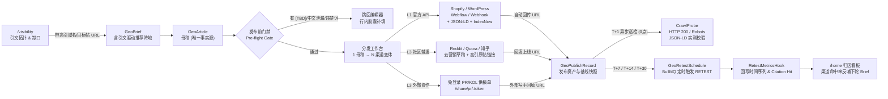

# GeoMix v2.1 需求规格与技术架构设计（Global-First：写作与分发全链路打通）

> **版本定位**：海外优先（Global-First），兼顾国内双市场兼容  
> **基线代码版本**：`main@b6fb675`（已包含 PR `#347` 对 `#343` 英文 `[TBD: …]` 占位符与 `#345` 跨市场自有域名并集归类的基础能力）  
> **关联追踪**：总 Epic [#357](https://github.com/yexiu700/geomix/issues/357) · Batch 0–3 拆分单 [#349](https://github.com/yexiu700/geomix/issues/349)–[#356](https://github.com/yexiu700/geomix/issues/356) · 开发红线详见 [docs/AGENTS.md](./AGENTS.md)

---

## 一、目标与范围界定（Goal & Scope）

### 1.1 为什么开启 v2.1（解决的 4 个核心断点）

GeoMix 2.0 已完成「可见度诊断 → 写作意见 → 单篇流式精写」的极简闭环，但在写作（`/studio`）到真实 GEO 效果验证之间存在 4 处结构性断点：

1. **一稿不可直接多投**：同一篇 2500 字独立站长文直接发往 Reddit / Quora / 知乎会触犯社区反软广规则，且第三方平台会剥离 JSON-LD Schema。
2. **分发前缺少统一阻断门禁**：虽然 `#343` 已补齐英文 `[TBD: …]` 占位符与导出提醒，但进入多渠道变体与 L1 API 自动推送前仍需要服务端 + 前端统一的强校验门禁（拦截未回填槽位、GLOBAL 中文泄漏、合规硬阻断项）。
3. **手工贴 URL 导致归因断链**：现有 [studio-publish-retest.tsx](../apps/web/components/studio/studio-publish-retest.tsx) 依赖人工发完再回来粘贴 `publishedUrl`，真实业务漏填率高；同时海外客户最需要的第三方测评媒体/KOL 合作缺少免登录协作外发形态。
4. **“发完立刻点复测”反 GEO 规律**：新内容被搜索引擎与 AI 检索层收录通常需要 7–30 天，缺少 T+1 可抓取/Schema 巡检与 T+7/14/30 自动阶梯追踪。

### 1.2 v2.1 范围（In-Scope vs Out-of-Scope）

| 类别               | v2.1 纳入范围（Global-First）                                                                                                                                                       | 明确不纳入（留 V2.2+）                                                                  |
| :----------------- | :---------------------------------------------------------------------------------------------------------------------------------------------------------------------------------- | :-------------------------------------------------------------------------------------- |
| **地基与门禁**     | 复用 `#343`/`#345` 基础能力，补齐分发领域表、`SecretBox` 凭证加密、`evaluateDistributionPreflight()` 统一门禁                                                                       | `#340` 其余纯视觉微调走独立 UI 修复单                                                   |
| **内容变体**       | **1 母稿 → N 渠道变体**：海外 5 模板（独立站长文+Schema、Reddit 去营销讨论体、Quora 问答体、LinkedIn/X 观点摘录、PR/KOL 媒体供稿包）+ 国内 1 模板（知乎/值得买实测回答）            | 富文本多图自动排版引擎、视频脚本生成                                                    |
| **L1 直发通道**    | **Shopify Blog**（Admin GraphQL）、**WordPress**（REST API v2）、**Webflow CMS**（Data API v2）、**通用签名 Webhook**（兼容 Ghost / Make / Zapier / Postiz）+ **IndexNow 自动推送** | 微信公众号草稿箱 API（与国内插件统一放 V2.2）                                           |
| **L2 浏览器插件**  | —                                                                                                                                                                                   | **Chrome 扩展**（知乎/头条/值得买/小红书本地 Cookie 推草稿箱 + 自动捕获 URL）→ **V2.2** |
| **L3 辅发与协作**  | **Reddit / Quora 合规辅发**（直达被引原帖 + 反封号清单，严禁自动发帖）；**免登录外部 PR/KOL 供稿单**（外部写手/公关看事实包、上线后回填 URL）                                       | 达人撮合交易市场、CRM 邮件群发                                                          |
| **收录与自动复测** | **T+1 线上可抓取 & Schema 体检**（HTTP 200 / `robots.txt` AI 爬虫放行矩阵 / 真实 JSON-LD）；**T+7 / T+14 / T+30 定时自动复测** + **渠道引用命中率归因**                             | AI 对话流实时 Webhook 监控                                                              |

---

## 二、已拍板核心产品与安全决策（Single Source of Truth）

1. **D1 · 保持极简 4 栏导航外壳**：不新增第 5 个一级菜单（仍为 `/home`、`/brands`、`/visibility`、`/studio` + 左下角 `/account`）。「渠道连接」按市场收敛至 `/brands`；「分发与变体工作台」作为 `/studio` 写完后的沉浸式抽屉；「收录预警与 T+7/14/30 归因」收敛至 `/home`。待 V2.2 排期日历变重时再评估拆出 `/distribution`。
2. **D2 · 海外独立站 L1 连接器（3+1）与接入方式**：
   - **Shopify Blog**：首期采用 **Custom App Admin Access Token**（2 分钟配置、零商店审核周期），Connector 接口底层预留 OAuth 字段供 V2.2 平滑升级。
   - **WordPress**：REST API v2 + Application Password（Basic Auth），支持 Gutenberg `<!-- wp:html -->` 块包裹 JSON-LD 防止清洗破坏。
   - **Webflow CMS**：Data API v2 Token + 可视化 Collection 字段映射（`Title / Slug / RichText / Meta / JSON-LD`）。
   - **通用签名 Webhook**：HMAC-SHA256 签名投递，覆盖 Ghost / Headless CMS / Make / Zapier / 自建社媒工作流。
3. **D3 · 定价与配额口径**（与 [catalog.ts](../packages/shared/src/catalog.ts) 对齐）：
   - **新增收费项**：`geo_variant`（母稿一键派生渠道变体）默认 **`2 点 / 渠道`**（接入 `/admin/pricing`，支持运营后台调价至 `0` 点促销）；自动阶梯复测沿用 `visibility_check`（`2 点 / 引擎 / 次`），默认 **1 次采样**（提供可选「3 次高置信采样」开关），开启前明示预算上限，余额不足温和跳过（`SKIPPED_INSUFFICIENT_POINTS`），绝不强扣负余额。
   - **免费标配（0 点 + 租户限流）**：CMS 渠道连接（激活既有 `SOCIAL_AUTH` 存量配额）、L1 API 推文（激活既有 `PUBLISH` 累计配额）、IndexNow 提交、发布前门禁、T+1 收录与 Schema 巡检、免登录 PR 供稿单。
4. **D4 · 安全与反滥用红线（不可妥协）**：
   - 所有租户 CMS 凭证（Token / Application Password / Webhook Secret）100% 经 **AES-256-GCM 密文落库**，接口永不回传明文，仅返回脱敏掩码与连接状态。
   - 所有出站请求（L1 CMS 推送、IndexNow、Webhook、T+1 收录巡检）**100% 强制经过 [ssrf.ts](../apps/server/src/infra/ssrf.ts) + [guarded-request.ts](../apps/server/src/infra/guarded-request.ts)**，严禁访问私网/环回/容器内网地址及重定向绕过。
   - 外部 PR 协作单使用 32 字节高熵随机 Token（数据库仅存 `SHA-256` 哈希）、默认 30 天过期、支持随时撤销、严格 IP 限流，且公开接口仅返回脱敏白名单字段（绝不暴露 `tenantId`、内部账号或未公开草稿）。
   - **严禁为 Reddit / Quora 开发自动发帖脚本**，统一走去营销人工辅发与防封号清单。
5. **D5 · 与上游采集网关（SonarGate）并行协同**：v2.1 与上游网关补齐海外 5 引擎 citations & fan-out 并行推进；当上游暂未返回引用 URL 时，v2.1 归因看板平滑降级展示「品牌提及率 + 首位顺位 + 情感」变化，待上游引文就绪后 `Citation Hit` 指标无缝点亮。

---

## 三、端到端闭环架构



---

## 四、核心数据模型设计（`packages/db/prisma/schema.prisma`）

新增 6 个枚举与 3 张多租户核心表，并向后兼容扩展 `GeoPublishRecord`（须同步维护 `packages/db/src/tenant-scope.ts` 与 `packages/db/src/schema-contract.spec.ts`）：

```prisma
enum ChannelProvider {
  SHOPIFY
  WORDPRESS
  WEBFLOW
  WEBHOOK
  REDDIT_ASSIST
  QUORA_ASSIST
  PR_PACKET
  CN_COMMUNITY_ASSIST
}

enum ChannelConnectionStatus {
  ACTIVE
  INVALID
  DISABLED
}

enum DistributionMode {
  L1_API
  L3_COMMUNITY_ASSIST
  L3_PR_PACKET
}

enum DistributionTaskStatus {
  DRAFT_VARIANT
  READY_TO_PUBLISH
  PUBLISHING
  DRAFT_PUSHED
  PUBLISHED
  FAILED
  ARCHIVED
}

enum CrawlProbeStatus {
  PENDING
  OK
  WARNING
  BLOCKED
  FAILED
}

enum RetestScheduleStatus {
  PENDING
  RUNNING
  COMPLETED
  SKIPPED_INSUFFICIENT_POINTS
  SKIPPED_NO_ENGINE
  FAILED
  CANCELLED
}

model ChannelConnection {
  id                    String                  @id @default(cuid())
  tenantId              String
  tenant                Tenant                  @relation(fields: [tenantId], references: [id], onDelete: Cascade)
  brandId               String
  brand                 Brand                   @relation(fields: [brandId], references: [id], onDelete: Cascade)
  brandMarketId         String
  brandMarket           BrandMarket             @relation(fields: [brandMarketId], references: [id], onDelete: Cascade)
  provider              ChannelProvider
  displayName           String
  siteBaseUrl           String
  credentialsCiphertext String
  credentialsIv         String
  credentialsTag        String
  keyVersion            Int                     @default(1)
  credentialHint        String
  configJson            Json                    @default("{}")
  status                ChannelConnectionStatus @default(ACTIVE)
  lastTestedAt          DateTime?
  lastError             String?
  createdAt             DateTime                @default(now())
  updatedAt             DateTime                @updatedAt

  distributionTasks     GeoDistributionTask[]

  @@index([tenantId, brandMarketId, provider])
  @@index([tenantId, brandId])
}

model GeoDistributionTask {
  id                  String                 @id @default(cuid())
  tenantId            String
  tenant              Tenant                 @relation(fields: [tenantId], references: [id], onDelete: Cascade)
  brandId             String
  brand               Brand                  @relation(fields: [brandId], references: [id], onDelete: Cascade)
  brandMarketId       String
  brandMarket         BrandMarket            @relation(fields: [brandMarketId], references: [id], onDelete: Cascade)
  articleId           String
  article             GeoArticle             @relation(fields: [articleId], references: [id], onDelete: Cascade)
  connectionId        String?
  connection          ChannelConnection?     @relation(fields: [connectionId], references: [id], onDelete: SetNull)
  provider            ChannelProvider
  mode                DistributionMode
  channelLabel        String
  targetUrlHint       String?
  variantTitle        String
  variantSlug         String?
  variantMetaDesc     String?
  variantMarkdown     String
  variantHtml         String
  variantExtrasJson   Json                   @default("{}")
  preflightJson       Json?
  status              DistributionTaskStatus @default(DRAFT_VARIANT)
  publishAsDraft      Boolean                @default(true)
  remotePostId        String?
  remoteAdminUrl      String?
  remotePublishedUrl  String?
  indexNowStatus      String?
  lastError           String?
  shareTokenHash      String?                @unique
  shareExpiresAt      DateTime?
  shareRevokedAt      DateTime?
  publishedAt         DateTime?
  createdAt           DateTime               @default(now())
  updatedAt           DateTime               @updatedAt

  publishRecords      GeoPublishRecord[]

  @@index([tenantId, articleId, createdAt])
  @@index([tenantId, brandMarketId, status])
}

model GeoRetestSchedule {
  id                  String               @id @default(cuid())
  tenantId            String
  tenant              Tenant               @relation(fields: [tenantId], references: [id], onDelete: Cascade)
  brandId             String
  brand               Brand                @relation(fields: [brandId], references: [id], onDelete: Cascade)
  brandMarketId       String
  brandMarket         BrandMarket          @relation(fields: [brandMarketId], references: [id], onDelete: Cascade)
  publishRecordId     String
  publishRecord       GeoPublishRecord     @relation(fields: [publishRecordId], references: [id], onDelete: Cascade)
  milestoneDay        Int
  sampleCount         Int                  @default(1)
  dueAt               DateTime
  status              RetestScheduleStatus @default(PENDING)
  visibilityRunId     String?
  metricsSnapshotJson Json?
  skipReason          String?
  executedAt          DateTime?
  createdAt           DateTime             @default(now())
  updatedAt           DateTime             @updatedAt

  @@unique([publishRecordId, milestoneDay])
  @@index([status, dueAt])
  @@index([tenantId, brandMarketId, status])
}
```

`GeoPublishRecord` 向后兼容追加字段：

```prisma
  distributionTaskId String?
  distributionTask   GeoDistributionTask? @relation(fields: [distributionTaskId], references: [id], onDelete: SetNull)
  crawlStatus        CrawlProbeStatus     @default(PENDING)
  crawlCheckedAt     DateTime?
  crawlReportJson    Json?
  indexNowSubmitted  Boolean              @default(false)
  retestSchedules    GeoRetestSchedule[]
```

---

## 五、分层模块与接口清单

### 5.1 `@geomix/shared`（`packages/shared`）

- `src/catalog.ts`：新增 `geo_variant`（`2` 点）；新增免费限流动作 `distribution_preflight`、`crawl_probe`、`pr_packet_share`；补齐 `QUOTA_MEASURE` 中的 `PUBLISH: 'cumulative'`、`SOCIAL_AUTH: 'stock'`。
- `src/queue.ts` & `src/infra.ts`：`QUEUE_NAMES` 追加 `'distribution'`；`parseEnv()` 追加可选 `CREDENTIAL_ENCRYPTION_KEY` 与 `PUBLIC_APP_URL`（同步更新 `.env.example`）。
- `src/distribution.ts`（新建，须同步在 `packages/shared/package.json#exports` 与 `index.ts` 精确导出）：全部 v2.1 Zod Schema、DTO 及统一门禁函数 `evaluateDistributionPreflight()`（直接复用 `#343` 已合入的 `extractMissingFactSlots()`）。

### 5.2 `@geomix/server`（`apps/server`）

- `src/common/secret-box.ts`：基于 `node:crypto` 的 AES-256-GCM 加解密与 `maskSecret()`。
- `src/distribution/`（新建独立模块，注册至 `AppModule` 与 `WorkerModule`）：
  - `connections.controller.ts` / `connections.service.ts`：`GET/POST/PATCH/DELETE /api/v2/brands/:brandId/connections` + `POST .../test`。
  - `connectors/`：`ShopifyConnector`、`WordPressConnector`、`WebflowConnector`、`WebhookConnector`（全部经 `ssrf.ts` + `guarded-request.ts`）。
  - `indexnow.service.ts`：自有域名上线后异步推送 `https://api.indexnow.org/indexnow`。
  - `variant-generator.service.ts`：6 套渠道模板（`OWNED_BLOG_SEO_GEO` / `REDDIT_DISCUSSION` / `QUORA_ANSWER` / `SOCIAL_THREAD` / `PR_MEDIA_PACKET` / `CN_COMMUNITY_QA`），走 `BillingService` 预扣/结算/退款。
  - `crawl-probe.service.ts`：复用 `public-fetch.ts` 检查 HTTP 状态、`robots.txt`（`*` / `GPTBot` / `OAI-SearchBot` / `PerplexityBot` / `Googlebot`）、`meta noindex`、线上真实 JSON-LD 与 `canonical`。
  - `retest-scheduler.service.ts`：BullMQ `maintenance` 新增 `retest-schedule-sweep`（每 15 分钟）与 `crawl-probe-sweep`（每 30 分钟）；到期自动检查余额与在线引擎，幂等触发 `RETEST`。
  - `distribution.controller.ts` / `distribution.service.ts` / `distribution.runner.ts`：编排 `/api/v2/articles/:articleId/preflight`、`/distributions*`、`/publish`（BullMQ `'distribution'` 异步推文并自动建 `GeoPublishRecord`）、`/pr-share`、`POST /publish-records/:id/crawl-probe`、`PATCH /publish-records/:id/retest-schedules`。
  - `public-pr-packet.controller.ts`（无 `AuthGuard`，Token SHA-256 + IP 限流）：`GET /api/v2/public/pr-packets/:token`、`POST /api/v2/public/pr-packets/:token/submit`。
- 既有服务增强：
  - `briefs-auto-generator.service.ts`：基于 `VisibilityCitation` 动态生成带 `citedExampleUrls` 的引文驱动 `recommendedChannels`。
  - `retest-metrics-hook.service.ts`：复测完成后同步回写关联 `GeoRetestSchedule` 与里程碑快照。
  - `geo-delivery.service.ts`：`createPublishRecord()` 支持默认生成 T+7/14/30 排期；`getActionHome()` 增补 `distributionSummary`（收录异常预警、即将执行排期、渠道归因对比）。

### 5.3 `@geomix/web`（`apps/web`）

- `lib/distribution.ts`：封装全部 v2.1 HTTP API 与 `Idempotency-Key`。
- `components/brands/brand-channel-connections.tsx`：`/brands` 市场级渠道连接配置与测试面板。
- `components/studio/studio-distribution-drawer.tsx`：`/studio` 4 步式分发与变体工作台抽屉（门禁体检 → 引文渠道选择 → 多渠道变体 Tab 编辑器 → 自动衔接发布资产）。
- `components/studio/studio-publish-retest.tsx`：升级展示 T+1 收录/Schema 体检徽章、`T+0 → T+7 → T+14 → T+30` 阶梯时间轴与采样次数开关，将“立刻手动复测”降级为次要操作。
- `app/share/pr/[token]/page.tsx`：独立于 `(console)` 的免登录外部 PR/KOL 供稿单页（自动按市场切换 EN/CN 文案，底部回填上线 URL）。
- `/home`：新增紧凑型「分发追踪与渠道归因」区块（收录异常预警条 + 即将执行/跳过排期 + 渠道 `Citation Hit` 简表）。

---

## 六、分批交付路线与 GitHub Issues 映射

| 批次        | Issue                                                 | 范围                                                                                               | 依赖                   | 并发策略              |
| :---------- | :---------------------------------------------------- | :------------------------------------------------------------------------------------------------- | :--------------------- | :-------------------- |
| **Epic**    | [#357](https://github.com/yexiu700/geomix/issues/357) | GeoMix v2.1 Global-First 写作与分发全链路打通总追踪                                                | —                      | 总控                  |
| **Batch 0** | [#349](https://github.com/yexiu700/geomix/issues/349) | DB 新表与迁移、`packages/shared` 契约/`geo_variant` 定价/`distribution` 队列、门禁与 `SecretBox`   | 无                     | 顺序优先合并          |
| **Batch 1** | [#350](https://github.com/yexiu700/geomix/issues/350) | 海外 L1 官方 API 连接器（Shopify / WordPress / Webflow / Webhook）+ `ChannelConnection` + IndexNow | `#349`                 | 与 `#351`/`#352` 并行 |
| **Batch 1** | [#351](https://github.com/yexiu700/geomix/issues/351) | 1 母稿派生 N 渠道变体引擎（6 套模板 + 账本预扣退款）+ 引文驱动阵地推荐                             | `#349`                 | 与 `#350`/`#352` 并行 |
| **Batch 1** | [#352](https://github.com/yexiu700/geomix/issues/352) | T+1 线上可抓取与 Schema 巡检 + T+7/14/30 定时自动复测调度器 + 里程碑与首页归因                     | `#349`                 | 与 `#350`/`#351` 并行 |
| **Batch 2** | [#353](https://github.com/yexiu700/geomix/issues/353) | 分发编排 API、BullMQ `distribution` 队列异步推文与免登录外部 PR 协作接口                           | `#350`, `#351`, `#352` | 服务端合流            |
| **Batch 3** | [#354](https://github.com/yexiu700/geomix/issues/354) | `/brands` 渠道连接面板 + `/studio` 分发与变体工作台抽屉                                            | `#353`                 | 与 `#355` 并行        |
| **Batch 3** | [#355](https://github.com/yexiu700/geomix/issues/355) | 独立 `/share/pr/[token]` 外部供稿页 + 阶梯复测时间轴 + `/home` 归因看板                            | `#353`                 | 与 `#354` 并行        |
| **Batch 3** | [#356](https://github.com/yexiu700/geomix/issues/356) | v2.1 全链路集成测试（Mock CMS / SSRF 负向 / PR 回填 / 定时复测）与 Playwright E2E                  | `#354`, `#355`         | 端到端收口            |

---

## 七、编码代理 CI 契约与验收清单

实现 `#349`–`#356` 时请严格遵循 [docs/AGENTS.md](./AGENTS.md) 机器强制契约，避免常见 CI 返工：

1. **`@geomix/shared`**：新增 `src/distribution.ts` 必须在 `packages/shared/package.json#exports` 与 `index.ts` 保持 1 对 1 双射（键序 `types` 在前、`default` 在后），零循环依赖、禁止 `@geomix/shared` 自引用。
2. **`@geomix/db`**：新增迁移目录不可改动既有迁移 SQL；新增 3 张模型必须同步登记到 `packages/db/src/tenant-scope.ts` 与 `packages/db/src/schema-contract.spec.ts`。
3. **`@geomix/web`**：禁止 `Modal.confirm(...)`（用 `useUxFeedback().confirm`）、禁止手写时间切片（用 `formatShanghaiDateTime` / `formatShanghaiDate`）、轮询用 `useTaskPolling`、跨页签刷新用 `invalidateFreshness`、样式使用 `var(--gm-*)` 令牌并兼顾 `1015×909` 与 `1440×900` 视口。
4. **本地与 CI 全绿门禁**：
   ```bash
   pnpm format && pnpm lint && pnpm typecheck && pnpm test && pnpm build
   pnpm --filter @geomix/db exec prisma validate
   ```
5. **端到端验收场景**：门禁拦截 `[TBD]` 与补填放行 → L1 推草稿/上线自动建 `GeoPublishRecord`（验证 JSON-LD 完整 + IndexNow）→ SSRF 私网地址被 `400` 拒绝 → 匿名无痕打开 `/share/pr/[token]` 提交上线 URL 自动回流 → T+1 巡检识别 `robots.txt` / `noindex` / JSON-LD → 定时复测余额充足幂等扣点回写、余额 `0` 跳过且不扣成负值。
