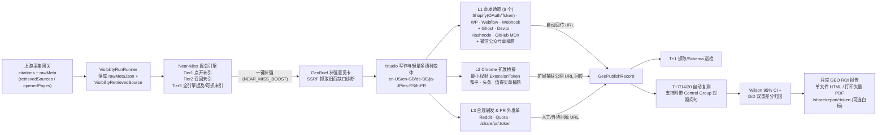

# GeoMix v2.2 需求规格与技术架构设计（可证明 ROI 闭环 + 渠道扩容 + 国内 L2 桥接）

> **版本定位**：主攻「海外深度增长与可证明 ROI（主线 A）」+「国内半封闭生态轻量破局（主线 B 轻量版）」，严格维持 4 栏极简导航外壳  
> **前置基线**：`main@02b8425`（v2.1 PR `#361`）+ v2.1.1 独立热修收口（`#359`、`#360`、`#362`–`#366`，尤其 `#362` 凭证加密主密钥与 `#363` 变体异步化）  
> **关联追踪**：总 Epic [#375](https://github.com/yexiu700/geomix/issues/375) · Batch 0–4 拆分单 [#367](https://github.com/yexiu700/geomix/issues/367)–[#374](https://github.com/yexiu700/geomix/issues/374) · 伴生扩展仓 [`yexiu700/geomix-extension`](https://github.com/yexiu700/geomix-extension) · 开发红线详见 [docs/AGENTS.md](./AGENTS.md)

---

## 一、目标与范围界定（Goal & Scope）

### 1.1 为什么开启 v2.2（解决的 4 个核心商业断点）

GeoMix v2.1 已打通「诊断 → 母稿 → 1→N 变体 → L1/L3 分发 → T+1 体检 → T+7/14/30 自动复测」的工程闭环；但在面向海外客户续费转化、多语种出海与国内重点内容平台触达时，仍存在 4 个关键断点：

1. **只盯「已引用」漏掉最高 ROI 的「差一步被引用」页面**：上游采集网关已产出 AI 检索召回（`retrievedSources`）与实际点开阅读（`openedPages`）却未引用的页面，但 GeoMix 当前在 `VisibilityRunRunner` 落库时丢弃了 `rawMeta`；同时部分海外数据源仅返回最终引文，需融合通用规则信号识别「提及未引官网」「T+1 可抓取但复测未进引文」的存量页面，一键补强远比从零起稿见效更快。
2. **单次复测波动大，难以向管理层或甲方证明 GEO ROI**：现有复测仅提供点估计，缺少 **Wilson 95% 置信区间** 与 **对照组问句（Difference-in-Differences 双重差分）**，且缺乏可直接发给决策层或代理商客户的「月度 GEO 增长复盘报告」。
3. **海外生态覆盖不足且写作/门禁写死英文单语种**：Shopify 仍需客户手工配置 Custom App Token；开发者与独立博客高频阵地 Ghost / Dev.to / Hashnode / GitHub MDX 尚未原生直连；写作指令与门禁默认英文单轨，尚不支持欧洲/日系市场小语种（`en-GB` / `de-DE` / `ja-JP` / `es-ES` / `fr-FR`）直出。
4. **国内高权生态（知乎 / 今日头条 / 什么值得买 / 微信公众号）仍依赖手工搬运**：v2.1 的 `CN_COMMUNITY_ASSIST` 需人工复制贴图并手工回填 URL，漏填率高导致国内归因断链；微信公众号草稿箱尚未接入官方 API。

### 1.2 v2.2 范围边界（In-Scope vs Out-of-Scope）

| 类别 | v2.2 纳入范围 | 明确不纳入（留 v2.1.1 或 v2.3+） |
| :--- | :--- | :--- |
| **与 v2.1.1 边界** | 纯增量新能力；前置依赖 v2.1.1 独立收口 `#359` / `#360` / `#362`–`#366` | 不混入 v2.1 缺陷热修 |
| **导航外壳** | 保持极简 4 栏一级导航（`/home`、`/brands`、`/visibility`、`/studio` + `/account`） | 独立 `/distribution` 第 5 工作区与团队审核流（留 v2.3+） |
| **主线 A1 · Near-Miss 掘金** | `VisibilityObservation.rawMetaJson` + `VisibilityRetrievedSource` 落库；4 层双信号（点开未引 / 召回未引 / 可抓取未引 / 提及未引官网）掘金榜；一键生成 `NEAR_MISS_BOOST` 补强意见卡 | AI 对话流实时 Webhook 监控 |
| **主线 A2 · 统计置信与 ROI 报告** | Wilson 95% 置信区间 + 置信等级 + 双比例显著性检验；`BrandMarket.controlPrompts` 对照组与 DiD 净增益；月度 GEO ROI 报告（单文件内联 SVG HTML + `@media print` 矢量 PDF + 支持可选 `whiteLabelOrg` 白标的 `/share/report/[token]`） | 服务端引入 Chromium / Puppeteer 渲染 PDF |
| **主线 A3 · 海外渠道与轻量多语种** | **Ghost** / **Dev.to** / **Hashnode** / **GitHub MDX** 4 个海外 L1 连接器；**Shopify OAuth 2.0** 完整授权与卸载回调基础设施（保留 Custom Token 兜底）；保持 `CN / GLOBAL` 双市场底座不变，支持写作与变体层轻量多语种直出（`en-US / en-GB / de-DE / ja-JP / es-ES / fr-FR`）与多语种防误判门禁 | Medium 官方 API（已停批新应用，继续走通用 Webhook）；重构 `BrandMarket` 唯一键做独立国家市场实例 |
| **主线 B 轻量版 · 国内生态破局** | **微信公众号草稿箱官方 API（`WECHAT_OFFICIAL`）** 纳入 L1；主仓交付 **L2 Chrome 扩展最小权限配对 Token 与 3 个薄桥接端点**；伴生独立仓库 [`yexiu700/geomix-extension`](https://github.com/yexiu700/geomix-extension) 交付 Chrome MV3 扩展 MVP（**知乎 / 今日头条 / 什么值得买**本地登录态推草稿箱 + 公网 URL 自动捕获回传） | 服务端模拟登录/存第三方 Cookie；小红书/百家号自动发文；强行自动群发公众号 |

---

## 二、已拍板核心产品与安全决策（Single Source of Truth）

1. **D1 · 保持 4 栏极简导航**：不新增第 5 个一级菜单。Near-Miss 掘金榜收敛至 `/visibility`「引文与信源」页签；新 L1 渠道、Shopify OAuth、多语种开关、对照组问句与 Chrome 扩展配对收敛至 `/brands`（扩展配对同步在 `/account` 提供入口）；多语种写作/变体、L2 扩展队列与高置信复测时间轴收敛至 `/studio`；置信指示与月度 ROI 报告收敛至 `/home`，免登录报告页独立挂载于 `/share/report/[token]`。
2. **D2 · 定价零膨胀**（与 [packages/shared/src/catalog.ts](../packages/shared/src/catalog.ts) 对齐）：
   - **不新增 `PricingItem` 收费项**：多语种母稿沿用 `geo_write`（`10 点/篇`），新渠道/跨语种/L2 扩展变体沿用 `geo_variant`（`2 点/渠道`），对照组自动复测沿用 `visibility_check`（`2 点/引擎/次`，需显式开启并明示预算上限，余额不足走 `SKIPPED_INSUFFICIENT_POINTS` 温和跳过）。
   - **0 点标配（加租户限流 `FREE_RATE_LIMITED_ACTIONS`）**：Near-Miss 聚合与 `near_miss_boost` 补强意见卡、Wilson CI / DiD 归因、月度 ROI 报告生成/HTML 导出/只读分享（`roi_report_export`、`roi_report_share`）、5 个新 L1 连接器接入与推送（沿用 `SOCIAL_AUTH` / `PUBLISH` 配额）、Shopify OAuth、Chrome 扩展配对与回传（`extension_token_issue`、`extension_sync`）。
3. **D3 · 对照组问句与白标报告口径**：
   - 每个 `BrandMarket` 最多配置 **5 条** `controlPrompts`，复测开启对照组时默认带入 **前 2 条** 以控预算。
   - `GeoRoiReport` 保留可选 `whiteLabelOrg` 机构白标字段：未填时展示「品牌名 + Powered by GeoMix」，填写时在单文件 HTML 与 `/share/report/[token]` 展示定制机构抬头，服务代理商续费汇报场景。
4. **D4 · 轻量多语种与防误判门禁**：
   - 保持 `BrandMarket` `@@unique([brandId, market])` 零破坏，通过 `BrandMarket.supportedLocales` 与 `GeoArticle / GeoDistributionTask / ChannelConnection` 的可选 `targetLocale` 实现跨语种直出与自动匹配。
   - 将语言泄漏检测从单一 `containsCjk()` 升级为 `detectLocaleLeakage(text, targetLocale, allowedTerms)`：拉丁语系（`en-* / de-* / es-* / fr-*`）拦截非专有名词 CJK；日语（`ja-JP`）允许假名与日文汉字，仅识别简体中文高频独有特征或缺失假名比例异常，彻底消除日语误报。
5. **D5 · 双仓解耦与安全红线（不可妥协）**：
   - **凭证与出站安全**：5 个新 L1 连接器与 Shopify OAuth 凭证 100% 走 `SecretBox` AES-256-GCM 密文落库，接口永不回传明文；所有出站请求（Ghost / Dev.to / Hashnode / GitHub / WeChat / Shopify OAuth / Near-Miss 抓取）100% 强制经过 `OutboundHttpClient`（`ssrf.ts` + 拒绝重定向绕过）。
   - **微信公众号草稿箱红线**：严格仅调用 `draft/add` 写入草稿箱，绝不提供自动群发接口；友好提示 `40164` 服务器出口 IP 白名单配置。
   - **Chrome 扩展最小权限红线**：独立仓库 `yexiu700/geomix-extension` 严禁向服务端传输第三方 Cookie、严禁自动点击平台最终「发布」按钮；主仓 `ExtensionAuthGuard` 仅放行 `/api/v2/extension/*` 三个薄端点（Token 仅存 SHA-256 哈希、创建时只显示一次、随时可吊销），绝不允许跨路由访问计费/删除/CMS 凭证接口。
   - **公开报告安全红线**：`/share/report/[token]` 沿用 32 字节高熵随机 Token + SHA-256 哈希落库 + 30 天 TTL + 随时撤销 + IP 限流 + 白名单脱敏字段（绝不暴露 `tenantId`、`userId`、点数余额或内部密钥）。

---

## 三、端到端增量闭环架构



---

## 四、核心数据模型设计（`packages/db/prisma/schema.prisma`）

新增 3 张多租户表、扩展 3 个既有枚举，并对 6 张既有表做向后兼容字段追加（须同步登记至 `packages/db/src/tenant-scope.ts`、`packages/db/src/schema-contract.spec.ts` 及最小范围 `apps/server/src/prisma/prisma-base-allowlist.ts`）：

```prisma
// 1) 枚举扩展（仅追加新值）
enum GeoBriefSource {
  AUTO_GAP
  LOW_RANK
  SENTIMENT_RISK
  FANOUT_CLUSTER
  CITATION_COUNTER
  NEAR_MISS_BOOST
  MANUAL
}

enum ChannelProvider {
  SHOPIFY
  WORDPRESS
  WEBFLOW
  WEBHOOK
  GHOST
  DEVTO
  HASHNODE
  GITHUB_MDX
  WECHAT_OFFICIAL
  ZHIHU_EXT
  TOUTIAO_EXT
  SMZDM_EXT
  REDDIT_ASSIST
  QUORA_ASSIST
  SOCIAL_THREAD_ASSIST
  PR_PACKET
  CN_COMMUNITY_ASSIST
}

enum DistributionMode {
  L1_API
  L2_EXTENSION
  L3_COMMUNITY_ASSIST
  L3_PR_PACKET
}

// 2) 既有表向后兼容字段追加
// BrandMarket:
//   supportedLocales String[] @default([])
//   controlPrompts   String[] @default([])
// VisibilityObservation:
//   rawMetaJson      Json?
//   retrievedSources VisibilityRetrievedSource[]
// GeoArticle:
//   targetLocale     String?
// ChannelConnection:
//   targetLocale       String?
//   externalShopDomain String?
// GeoDistributionTask:
//   targetLocale     String?
// GeoRetestSchedule:
//   includeControlPrompts Boolean @default(false)
//   controlMetricsJson    Json?

// 3) 新增 3 张多租户核心表
model VisibilityRetrievedSource {
  id            String                @id @default(cuid())
  tenantId      String
  tenant        Tenant                @relation(fields: [tenantId], references: [id], onDelete: Cascade)
  brandId       String
  brand         Brand                 @relation(fields: [brandId], references: [id], onDelete: Cascade)
  brandMarketId String
  brandMarket   BrandMarket           @relation(fields: [brandMarketId], references: [id], onDelete: Cascade)
  observationId String
  observation   VisibilityObservation @relation(fields: [observationId], references: [id], onDelete: Cascade)
  engine        String
  url           String
  domain        String
  title         String?
  snippet       String?
  sourceKind    CitationSourceKind    @default(OTHER)
  wasOpened     Boolean               @default(false)
  wasCited      Boolean               @default(false)
  rank          Int?
  createdAt     DateTime              @default(now())

  @@index([tenantId, brandMarketId, wasCited, wasOpened, createdAt])
  @@index([observationId])
  @@index([tenantId, domain])
}

model GeoRoiReport {
  id              String      @id @default(cuid())
  tenantId        String
  tenant          Tenant      @relation(fields: [tenantId], references: [id], onDelete: Cascade)
  brandId         String
  brand           Brand       @relation(fields: [brandId], references: [id], onDelete: Cascade)
  brandMarketId   String
  brandMarket     BrandMarket @relation(fields: [brandMarketId], references: [id], onDelete: Cascade)
  title           String
  periodStart     DateTime
  periodEnd       DateTime
  locale          String      @default("en-US")
  whiteLabelOrg   String?
  summaryJson     Json
  shareTokenHash  String?     @unique
  shareExpiresAt  DateTime?
  shareRevokedAt  DateTime?
  createdByUserId String?
  createdAt       DateTime    @default(now())
  updatedAt       DateTime    @updatedAt

  @@index([tenantId, brandMarketId, createdAt])
}

model ExtensionAccessToken {
  id          String    @id @default(cuid())
  tenantId    String
  tenant      Tenant    @relation(fields: [tenantId], references: [id], onDelete: Cascade)
  userId      String
  label       String
  tokenPrefix String
  tokenHash   String    @unique
  scopes      String[]  @default(["extension:distribution"])
  lastUsedAt  DateTime?
  expiresAt   DateTime
  revokedAt   DateTime?
  createdAt   DateTime  @default(now())

  @@index([tenantId, revokedAt])
  @@index([userId, createdAt])
}
```

---

## 五、分层模块与接口清单

### 5.1 `@geomix/shared`（`packages/shared`）

- `src/stats.ts`（新建）：`computeWilsonInterval()`、`computeTwoProportionSignificance()`、`computeDifferenceInDifferences()` 纯函数与置信等级定义。
- `src/locales.ts`（新建）：`SUPPORTED_LOCALES`（`zh-CN / en-US / en-GB / de-DE / ja-JP / es-ES / fr-FR`）、`detectLocaleLeakage()`（修复 `ja-JP` 汉字误判）与 `resolveLocaleWritingDirective()`。
- `src/roi-report.ts`（新建）：Near-Miss 4 层 Tier DTO、`GeoRoiReportSummaryDto`、`CreateGeoRoiReportInput`（含可选 `whiteLabelOrg`）、`PublicGeoRoiReportDto`。
- `src/extension-bridge.ts`（新建）：Chrome 扩展 Bridge v1 强类型协议契约（主仓与 `yexiu700/geomix-extension` 共享口径）。
- `src/distribution.ts`、`src/catalog.ts`、`src/geo-briefs.ts`、`src/infra.ts`：新增 8 个 Provider 映射与 2 套模板键（`DEVELOPER_TECH_POST`、`WECHAT_OFFICIAL_ARTICLE`）；`FREE_RATE_LIMITED_ACTIONS` 追加 5 个 0 点限流动作；`parseEnv()` 追加 Shopify OAuth 与微信可测基址配置；全部新模块同步维护 `package.json#exports` 与 `index.ts` 1 对 1 双射。

### 5.2 `@geomix/server`（`apps/server`）

- **Near-Miss 域**：
  - `visibility/visibility-run.runner.ts`：落库 `rawMetaJson` 与 `VisibilityRetrievedSource`（上限 100 条/观测）。
  - `visibility/visibility-near-miss.service.ts`：`GET /api/v2/brands/:brandId/visibility/near-miss`（双信号 4 层聚合）。
  - `briefs/briefs.service.ts` & `briefs.controller.ts`：`POST /api/v2/brands/:brandId/briefs/from-near-miss`（SSRF 抓取诊断 → `NEAR_MISS_BOOST` 意见卡）。
- **统计与 ROI 报告域**：
  - `distribution/retest-scheduler.service.ts` & `studio/retest-metrics-hook.service.ts`：对照组问句附带复测（默认前 2 条）、预算披露、Wilson 95% CI 与 `controlMetricsJson` / DiD 净增回写。
  - `reports/`（新建）：`POST/GET /api/v2/brands/:brandId/roi-reports`、`GET /api/v2/roi-reports/:id(/export.html)`、`POST/DELETE /api/v2/roi-reports/:id/share`、免登录 `GET /api/v2/public/roi-reports/:token`（内联 SVG + `@media print` A4 分页，零 Chromium 依赖）。
- **新连接器、OAuth 与多语种域**：
  - `distribution/connectors/`：新建 `ghost.connector.ts`、`devto.connector.ts`、`hashnode.connector.ts`、`github-mdx.connector.ts`、`wechat-official.connector.ts`。
  - `distribution/shopify-oauth.service.ts` & `shopify-oauth.controller.ts`：`POST .../shopify/oauth/start`、`GET /api/v2/integrations/shopify/callback`、`POST /api/v2/integrations/shopify/webhooks/app-uninstalled`。
  - `studio/studio-generation.service.ts` & `distribution/variant-generator.service.ts` / `variant-templates.ts`：接入 `targetLocale` 与 `resolveLocaleWritingDirective()`。
- **L2 Chrome 扩展桥接域（新建 `src/extension/`）**：
  - `GET/POST/DELETE /api/v2/extension/tokens`（控制台配对管理）；
  - `ExtensionAuthGuard` 保护的 3 个薄端点：`GET /api/v2/extension/me`、`GET /api/v2/extension/tasks`、`POST /api/v2/extension/tasks/:taskId/confirm-published`（自动建 `GeoPublishRecord` 并排入 T+1 体检与 T+7/14/30 复测）。

### 5.3 `@geomix/web`（`apps/web`）

- `components/visibility/visibility-near-miss-panel.tsx`：`/visibility`「引文与信源」页签下的 Near-Miss 掘金子榜与一键补强。
- `components/brands/brand-channel-connections.tsx` & `brands-workspace.tsx`：5 个新 L1 连接表单、Shopify OAuth 双模式切换、GLOBAL 多语种与对照组问句编辑、CN Chrome 扩展配对管理（同步 `/account` 入口）。
- `components/studio/studio-workspace.tsx` / `studio-distribution-drawer.tsx` / `studio-publish-retest.tsx`：目标语种切换、新 L1 与 L2 扩展队列分发、Wilson CI 误差棒与对照组复测开关。
- `components/home/home-roi-report-modal.tsx` & `home-distribution-summary.tsx`：置信等级/DiD 展示与月度 ROI 报告生成/导出/分享。
- `app/share/report/[token]/page.tsx` & `components/reports/public-roi-report-view.tsx`：免登录独立白标报告页（按 `locale` 全页 EN/CN 无混杂）。

---

## 六、分批交付路线与 GitHub Issues 映射（Batch 0 → Batch 4）

| 批次 | Issue | 核心范围 | 依赖 | 并发策略 |
| :--- | :--- | :--- | :--- | :--- |
| **Epic** | [#375](https://github.com/yexiu700/geomix/issues/375) | GeoMix v2.2 总追踪（可证明 ROI + 渠道与多语种 + 国内 L2 桥接） | v2.1.1 热修 | 总控 |
| **Batch 0** | [#367](https://github.com/yexiu700/geomix/issues/367) | DB 3 张新表与枚举/字段迁移、`stats.ts` / `locales.ts` / `roi-report.ts` / `extension-bridge.ts` 契约 | v2.1.1 | 顺序优先合并 |
| **Batch 1A** | [#368](https://github.com/yexiu700/geomix/issues/368) | `rawMeta` 与召回/点开页面持久化、双信号 Near-Miss 掘金榜 API、`NEAR_MISS_BOOST` 补强意见卡 | `#367` | 与 `#369`/`#370`/`#371` 并行 |
| **Batch 1B** | [#369](https://github.com/yexiu700/geomix/issues/369) | 对照组 `controlPrompts` DiD 复测、Wilson 95% CI、月度 GEO ROI 报告引擎（HTML/打印 PDF + 可选白标分享） | `#367` | 与 `#368`/`#370`/`#371` 并行 |
| **Batch 1C** | [#370](https://github.com/yexiu700/geomix/issues/370) | Ghost / Dev.to / Hashnode / GitHub MDX / 微信公众号草稿箱、Shopify OAuth、轻量多语种写作与变体 | `#367` | 与 `#368`/`#369`/`#371` 并行 |
| **Batch 2** | [#371](https://github.com/yexiu700/geomix/issues/371) | Chrome 扩展 L2 最小权限配对 Token（`ExtensionAuthGuard`）、待发队列拉取与公网 URL 自动回传闭环 API | `#367` | 与 Batch 1 并行，对接伴生扩展仓 |
| **Batch 3A** | [#372](https://github.com/yexiu700/geomix/issues/372) | `/visibility` Near-Miss 掘金榜、`/home` 置信与 ROI 报告弹窗、`/share/report/[token]` 白标公开页 | `#368`, `#369` | 与 `#373` 并行 |
| **Batch 3B** | [#373](https://github.com/yexiu700/geomix/issues/373) | `/brands` 新 L1/OAuth/多语种/对照组/扩展配对面板、`/studio` 多语种直出与 L2 扩展队列 | `#369`, `#370`, `#371` | 与 `#372` 并行 |
| **Batch 4** | [#374](https://github.com/yexiu700/geomix/issues/374) | v2.2 全链路集成测试（Near-Miss / Wilson CI & DiD / 5 连接器 / OAuth HMAC / 扩展越权 / `ja-JP` 门禁）与 Playwright E2E | `#372`, `#373` | 端到端收口 |

---

## 七、编码代理 CI 契约与验收清单

实现 `#367`–`#374` 时请严格遵循 [docs/AGENTS.md](./AGENTS.md) 机器强制契约：

1. **`@geomix/shared`**：新增 `stats.ts`、`locales.ts`、`roi-report.ts`、`extension-bridge.ts` 必须在 `packages/shared/package.json#exports` 与 `index.ts` 保持 1 对 1 双射（`types` 在前、`default` 在后），零循环依赖、禁止 `@geomix/shared` 自引用。
2. **`@geomix/db`**：新增迁移不可修改既有 SQL；3 张新模型必须同步登记到 `packages/db/src/tenant-scope.ts` 与 `packages/db/src/schema-contract.spec.ts`。
3. **`@geomix/web`**：保持 4 栏导航不变；禁止 `Modal.confirm(...)`（用 `useUxFeedback().confirm`）、禁止手写 `URL.revokeObjectURL`（用 `triggerBlobDownload`）、时间用 `formatShanghaiDateTime`/`formatShanghaiDate`、轮询用 `useTaskPolling`、跨页签刷新用 `invalidateFreshness`、样式使用 `var(--gm-*)` 并验证 `1015×909` 与 `1440×900` 视口。
4. **本地与 CI 全绿门禁**：
   ```bash
   pnpm --filter @geomix/db exec prisma validate
   pnpm format && pnpm lint && pnpm typecheck && pnpm test && pnpm build
   ```
5. **端到端验收场景**：Near-Miss 双信号出数并一键生成补强 Brief → 对照组 DiD 复测（预算明示 + 余额 0 温和跳过）→ 月度 ROI 报告单文件 HTML/打印 PDF 与无痕 `/share/report/[token]`（含 `whiteLabelOrg` 与撤销 404）→ 5 个新 L1 连接器 Mock 推草稿与私网 SSRF `400` 拒绝 → Shopify OAuth HMAC 验签与卸载清理 → `ja-JP` 含汉字稿件门禁 0 误报 → `gmext_` 扩展 Token 跨路由越权 `401/403` 与合法回填公网 URL 幂等创建 `GeoPublishRecord`。
