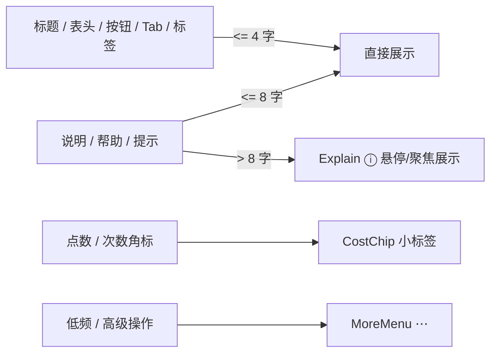

# GeoMix 控制台极简交互规范（v1）

## 1. 设计目标与五项约束

为降低控制台界面的视觉密度与使用认知负载，所有控制台工作区（`/home`、`/brands`、`/visibility`、`/studio`、`/publish`、`/account` 及控制台外壳）统一遵循以下约束：

| 约束 | 执行标准 |
|---|---|
| YAGNI | 低频、重复或偏工程实现的界面入口从控制台移除或收进「⋯ 更多」；仅裁剪前端交互，后端 API 与公开报告契约保持兼容。 |
| Linear 极简风 | 去掉装饰性徽标与工程实现术语；每个内容区块只保留标题、主体内容与单一操作区。 |
| 单一主操作 | 每个独立视图（页面 / Tab / 弹窗）同一时刻**最多 1 个**可见的 `type="primary"` 实心主按钮；列表/表格行内操作统一使用文本按钮；主按钮随业务状态机切换。 |
| 解释性 UI | 说明、帮助、空状态描述与告警提示 **超过 8 字不常驻**，统一收敛到标题旁的 `<Explain>`（ⓘ 按钮，悬停、聚焦或点击查看）。 |
| 文案锁定 2–4 字 | 标题、表头、按钮、Tab、筛选器与状态标签**统一锁定 2–4 字**；点数/次数等数字提示拆入独立的 `<CostChip>`。 |

---

## 2. 字数统计口径（`apps/web/lib/copy-length.ts`）

- **控件文案上限**：`CONTROL_LABEL_MAX_CHARS = 4`
- **内联说明上限**：`EXPLAIN_INLINE_MAX_CHARS = 8`
- 计分规则：
  1. 每个汉字（CJK 统一表意文字）及全角标点（如 `（`、`）`、`：`、`、`）计 **1 字**。
  2. 常见产品/技术缩写（`GEO`、`AI`、`ROI`、`URL`、`SKU`、`API`、`PR`、`CN`、`MD`、`CSV`、`PDF`、`FAQ`、`DiD`、`SoV`、`TBD`、`L1`、`L2`、`L3`、`HTML`、`JSON`、`JSON-LD`、`llms.txt`、`XLSX`、`DOCX`、`GLOBAL`、`Schema`、`SSE`、`KOL`、`HTTP`、`T+0`/`T+7`/`T+14`/`T+30` 等）整体计 **1 字**。
  3. 其余连续英文字母按每 **2 个字母计 1 字**（每个字母 `0.5`）。
  4. 阿拉伯数字、空格、半角连字符/斜杠/箭头等 ASCII 符号与 `<CostChip>` 中的点数数字**不计入**控件字数，但点数括号写在按钮文本内部（如 `生成（10 点）`）会因全角括号与汉字超限并触发守卫。
  5. 用户业务数据（品牌名、文章标题、第三方渠道产品名如 `WordPress` / `Shopify`）不受本规则限制。

---

## 3. 单一主操作状态机

| 工作区 / 视图 | 状态 | 唯一实心主按钮 |
|---|---|---|
| `/home` | 有待写建议 / 无待写建议 | `去写作` / `发起监测` |
| `/brands` | 默认 / 身份或事实存在未保存更改 | `保存`（事实卡）/ `保存修改`（`新建品牌` 降为普通入口并收进 `⋯`） |
| `/visibility` 总览 | 已有监测数据 / 暂无监测数据 | `批量写作` / `发起监测` |
| `/studio` | 写作前 / 已生成成稿 | `生成` / `去发布` |
| `/publish` 分发 | 有合规阻断 / 无任务 / 有任务 | `去补填` / `生成变体` / 当前任务唯一主动作（L1 为 `推草稿`） |
| `/publish` 追踪 | 尚未登记外链 / 已登记外链 | `登记` / `复测` |

---

## 4. 解释性 UI 与无障碍规范

- **原语自动收敛**：`PageHeader`、`Section`、`FormField`、`EmptyState`、`KpiStrip` 对字符串型的 `description` / `help` / `caption` 自动判断长度：
  - `copyLength <= 8`：保持行内弱化文本显示。
  - `copyLength > 8`：自动收进标题或标签旁边的 `<Explain>`（ⓘ 图标按钮）。
- **DOM 语义安全**：`<Explain>` **严禁嵌套**在 `<h1>`、`<h2>` 或 `<label>` 内部，必须作为兄弟节点渲染；内部通过 `.gm-sr-only` + `aria-describedby` 保留完整读屏说明。
- **WCAG 2.5.3（Label in Name）与 DOM 契约**：
  - 缩短按钮可见文案时，保留 `data-testid`；若保留 `aria-label`，须确保包含或以可见文案开头（避免语音控制与无障碍读屏错位）。
  - 自动化测试统一优先使用 `data-testid` 或语义 Role 定位。

---

## 5. Web 短标签映射（不修改共享业务常量）

`@geomix/shared` 中的 `BRAND_FACT_SLOT_LABELS`、`GEO_RECIPE_LABELS`、`GEO_TARGET_FORMAT_LABELS`、`GEO_REWRITE_ACTION_LABELS`、`GEO_BRIEF_SOURCE_LABELS`、`NEAR_MISS_TIER_LABELS`、`CHANNEL_PROVIDER_LABELS` 等同时服务于服务端提示词组装、月度 ROI 报告渲染与公开分享页。控制台前端界面统一通过 `apps/web/lib/short-labels.ts` 映射为 2–4 字短标签展示，不得直接改短共享常量影响后端及导出文案。

---

## 6. 适用范围与白名单

- **受控范围**：`apps/web/components/{home,brands,visibility,studio,publish,account,shell,briefs,geo,distribution,crud,ui}/**`（不含 `*.spec.tsx`）。
- **明确排除**：营销官网 `(marketing)`、公开免登录分享页（`/share/pr/[token]`、`/share/report/[token]`、`components/reports/**`）与内部运营后台（`/admin/**`、`components/admin/**`）。

---

## 7. 分批实施与 YAGNI 收敛清单（已确认 Y1–Y39）

实施节奏：**PR1**（规范 + 公共组件 + `copy-guard` 棘轮）→ **PR2**（外壳与 2 字导航 `首页 / 品牌 / 诊断 / 写作 / 发布`）→ **PR3**（`/brands`）→ **PR4**（`/studio`）→ **PR5**（`/visibility`）→ **PR6**（`/publish`，承接 `/home` 分发追踪）→ **PR7**（`/home`）→ **PR8**（`/account` + 守卫清零）。

- **Y1–Y4（外壳）**：下线死代码 `GeoSignalStrip` / `WorkspacePlaceholder`；移除侧栏 `⋯` 重复账号项；公告铃铛仅在有公告时显示；⌘K 按钮改为纯图标（保留快捷键与 `aria-label`）。
- **Y5–Y11（品牌）**：下线 `/brands` 重复的扩展配对（保留 `/account` 入口，更新深链与 E2E）；合并 3 个 AI 入口为「AI 补全」；下线重复开启市场胶囊与 Tips；对照组与复测上限收进「对照组」高级折叠区；移除纯工程徽标；产品线排序权重收进高级；`新建品牌` 降级并收进页头「⋯」。
- **Y12–Y21（写作）**：下线分发抽屉分支；下线工具栏独立「去广告」按钮；下线 `/studio` 重复「反制」入口；下线分栏视图；下线字数偏好；租户高级偏好收进设置；专注模式改为纯图标；配图弹窗 AI 生成退居次级 Tab；下线 `/studio` 右栏状态与标签；批量复选框默认隐藏，点「批量」展开。
- **Y22–Y27（发布）**：下线推荐阵地框；交付包 Tab 转为头部「导出」菜单（`llms.txt`/爬虫清单收进 ⓘ）；DiD / 3× 采样 / 预算上限收进「高级」；抓取体检明细默认折叠（异常时自动展开）；L2 扩展渠道仅在已配对时展示；IndexNow / `media_id` / Canonical 等工程字段收进 ⓘ。
- **Y28–Y32（诊断）**：Near-Miss 移除信源 Tab 重复副本、总览页默认折叠；监测详情移除「明细/拓扑」切换（保留信源 Tab 拓扑）；情感分布图收进「更多」；AnswerLens 命中跳转与 `[ ]` 快捷键收进「更多」；拆解词表与「合并意见」收进「更多」。
- **Y33–Y35（首页）**：分发追踪（DiD/预算/提醒/渠道表）迁回 `/publish`，首页仅保留 1 行汇总；移除重复 ROI 报告按钮，仅留 1 个入口收进「⋯」；首页页头保留 1 个主按钮，其余动作收进「⋯」。
- **Y36–Y39（账户）**：下线实名认证 Tab；下线「模型收录」重复展示；积分流水移除 XLSX 导出，保留 CSV；积分筛选取消「查询」主按钮，筛选改动自动生效。
