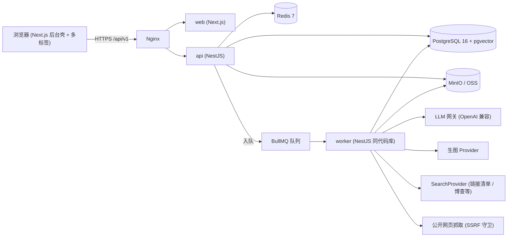

# F01 范围与原则（终版）

## 1. 一期范围

### 1.1 包含

| 区域 | 页面或能力 | 说明 |
|---|---|---|
| 底座 | 登录 / 退出 / 修改密码；有效期守卫（到期后只读） | 账号由管理员开通，替代原站的「充值请联系客服」 |
| 底座 | 后台壳：顶栏（站名、滚动公告、有效期徽章、头像菜单）、分组侧栏（角标、折叠）、**多标签页**、右侧布局面板 | 多标签页是用户明确要求的，默认开启，可在布局面板关闭 |
| 底座 | 通用列表（工具栏、列显隐、导出、搜索行、空状态）、通用弹层（最小化、最大化、关闭、底部操作栏、价格按钮） | 还原原站的 layer 交互 |
| 底座 | 首页（简化版）：余额卡、点数卡、功能入口卡、近 5 日 AI 创作趋势 | 二期功能的卡片显示「即将上线」 |
| 底座 | 个人中心：点数明细、余额明细、账号权益、实名认证（占位表单） | |
| 底座 | 计费与配额服务（可开关，默认影子计费）；管理员后台（开户、加点、配额、有效期、价格表、计费开关、公告、系统模板、模型配置） | |
| 模块一 | 关键词（AI蒸馏、手动批量组合、拓词工具弹窗）、写作标题、企业画像图库（分类和图片）、企业知识库（细分 / 汇总、说明弹窗、承诺协议） | |
| 模块二 | 写作指令（系统模板只读 + 克隆、我的指令）、文章分类、AI写作任务（队列）、文章列表（富文本、审核、导出） | |
| 模块三 | 全网爆文复刻（单篇）、批量爆文复刻（可插拔寻源） | 有合规约束，见第 3 节 |
| 模块四 | AI生图（推测版，受功能开关控制） | 原站还没开放，按最小可用版做 |
| 增强 | 文章批量导出（Markdown / HTML / Docx 压缩包） | 一期没有发布模块，用导出给文章一个出口 |

### 1.2 不含（二期或不做）

- 文章发布全部 5 个渠道，以及本地客户端 GEO助手 → 二期。
- AI数据（报表、查收录）、AI可见度诊断 → 二期。一期只保留「收录状态」「已收录」「模型收录」的展示位和字段。
- AI工具菜单（关键词指数、AI拓词） → 二期。关键词弹窗里的「拓词工具」一期做成轻量弹窗，复用组合逻辑。
- 视频发布（TDK分组、混剪、矩阵视频） → **不做**；生图模块里的“视频”部分也不做。
- 在线充值和支付 → 不做，由管理员加点。
- 代理商多级体系 → 不做，但数据层保留 `tenantId`。

## 2. 复刻原则

1. **功能和交互对齐，品牌和资源全部自制。** 页面结构、字段、默认值、校验、按钮位置、弹层行为、价格展示方式要对齐原站截图；站名、Logo、公告、协议正文、说明示例、系统模板正文、图标、配色一律自制。
2. **实测优先，推测要标注。** 需求文档里每个字段都要标来源：截图 / site-map / docs / 推测。推测项在实现里做成可配置，等 F06 实测后再改。
3. **截图和 site-map 不一致时，以截图为准**（例如按钮文案「10点数/篇」）。
4. **菜单中文名称照原站。** URL 用英文语义路径，同时提供原站路径的跳转映射表（见 F02）。
5. **价格、配额、天数、上限全部放进配置。** 原站的值作为种子默认值。
6. **偏离原站的地方要登记。** 凡是为了合规或可用性而改动原站行为的地方，都记在下面的决策表里，界面上不说明。

## 3. 合规边界

| 主题 | 规则 |
|---|---|
| 调研和实测 | 不反编译、不分析原站接口和网络请求、不绕过鉴权。实测只看界面，耗点操作要用户批准（见 F06） |
| 网页抓取 | 只抓无需登录的公开页面；遵守 robots；有 SSRF 防护（DNS 解析后校验 IP、每次重定向复检）；超时 10 秒，响应不超过 5MB；遇到验证码、登录墙、付费墙立即失败并退点；不携带第三方 Cookie，不逆向签名 |
| 复刻内容 | 删除原图；系统默认复刻模板定位为「参考原文重新创作，自然融入我方品牌」，**不内置**「把原文推荐的品牌替换成我方品牌」这种冒用他人内容的指令（`docs/03-sop.md` 第 984–997 行的写法）；改写稿与原文相似度超过阈值时自动重写一次；提供「粘贴原文」兜底；用户协议写明内容责任由用户承担 |
| 广告法 | 系统提示词附加禁用极限词的约束；生成后用极限词表扫描，命中的降级替换或标黄；知识库协议和写作指令保留原站同类的真实性提醒（文案自写） |
| 禁做行业 | 关键词、知识库、写作任务、复刻、生图的入口统一做禁做行业词表拦截（依据 docs/01 第 7–9 行、第 630 行），并记审计日志 |
| 知识库承诺 | 协议滚动到底才能勾选；签署记录包含版本号、时间、IP；保存知识库前必须有有效签署记录 |
| 隐私和安全 | 租户隔离（所有查询强制按 tenantId 过滤）；密码用已落地的 scrypt 格式 `scrypt$N$r$p$salt$hash`；上传图片去除 EXIF |

## 4. 决策记录（两份报告的分歧逐项拍板）

| # | 议题 | A | B | **终版决定** | 理由 |
|---|---|---|---|---|---|
| D1 | 原站是否带多标签页 | 有 | 有 | 原站截图里**没有**；一期照做，默认开启，可关闭 | 截图为证；用户需求明确列了多标签导航 |
| D2 | 前端 UI 库 | Ant Design 5 + Pro | Tailwind + shadcn | **Ant Design 5 + ProComponents** | 原站是表格加弹层的后台；ProTable 和 ModalForm 还原最快；AI 代理熟悉度最高 |
| D3 | 富文本编辑器 | wangEditor 5 | TipTap | **wangEditor 5** | 原站是 UEditor 风格工具栏，wangEditor 开箱即用、最接近 |
| D4 | 租户模型 | user 维度 | tenant 维度 | **Tenant（账户）+ User**，一期一个账户一个用户 | 钱包和配额属于付费主体，以后扩展子账号或代理成本很低 |
| D5 | 计费默认模式 | 影子计费 | STRICT | **`BILLING_MODE=SHADOW` 为默认**，可切换到 `STRICT`，支持租户级覆盖 | 用户原话“前期可不实收”；影子模式不拦截、不实扣，但完整记录原价 |
| D6 | 写作任务扣点时机 | 逐篇预扣 | 整单冻结 | **整单冻结、逐篇结算、失败逐篇退还**；保留暂停 / 继续 / 终止 | 防止并发透支，账目清楚 |
| D7 | 预扣实现 | 条件 UPDATE | 行锁 + CHECK | **条件 UPDATE 原子扣减 + CHECK 兜底 + 唯一键幂等** | 性能好，可以防超卖 |
| D8 | AI蒸馏扣点 | 预扣、成功提交、失败释放 | 成功后才扣 | 统一走 reserve → commit / release；有效问题少于 5 条（可配置）视为失败 | 和其他动作共用一套账本 |
| D9 | 蒸馏结果交互 | 追加到 textarea | 两种都写 | **先出勾选预览列表（默认全选），确认后追加到 textarea** | 同时满足 docs/05 第 223 行的“勾选”和截图里的 textarea |
| D10 | 组合上限 | 2000 | 500 | **1000**，可配置 | 折中 |
| D11 | 知识库加价 | 每篇 15 | 每篇 15 | 按 `ai_write`=10 加 `kb_addon`=5 两个价格项计算，账本记**一条**（备注里拆分），实测后再调整 | 文案里有“可能”，规则待确认 |
| D12 | 汇总知识库全量注入的阈值 | 6000 字 | 4000 字 | **6000 字以内全量注入**；超过则切片（600 字，重叠 80），检索 Top-5 | 主流模型上下文足够，全量注入效果更稳 |
| D13 | 创作方向和文案类型的抽取 | 随机 | 轮询 | **组合轮询 + 任务级随机偏移** | 覆盖率最好，批次之间又不完全相同 |
| D14 | 配图 K=0 时的封面 | 仍取 1 张 | 不取 | **不插图；封面也取 1 张（可配置，默认开）** | 二期发布普遍需要封面；有开关可以随时改 |
| D15 | 抽图策略 | 随机不放回 | 最少使用优先 | **最少使用优先，再随机**；同一篇内不重复 | 图少时更均衡 |
| D16 | 系统模板数量 | 10+6+1 | 13+7+2 | **10 篇文章 + 7 个标题 + 1 个复刻**，按 SOP 结构自写；带【品牌N】手工槽位的模板不进随机池 | 和 SOP 结构对应，种子数据成本可控 |
| D17 | 单篇复刻的分类 | 待实测 | 加一个可选字段 | 表单**加可选「文章分类」**，默认自动归入「爆文复刻」分类；实测后再定是否保留 | 列表有分类列，需要闭环 |
| D18 | 批量寻源 | 搜索 API + 链接清单 | 博查优先 | `SearchProvider` 接口：**默认「链接清单」适配器**（零成本），博查 / Bing 等适配器在有密钥时启用；**不用**搜索摘要当正文 | 合规、零依赖，用户有密钥时可以直接升级 |
| D19 | 批量上限和单价 | 无上限，5 点 | 50 篇，5 点 | **单次最多 50 篇，5 点/篇**，按成功篇数结算，差额退还 | 待实测，配置化 |
| D20 | 图片校验 | 长边 1600，≤500KB | 宽 <500 拒绝，≤900KB | 接受 jpg/png/webp，**宽度小于 500 只警告**；长边缩到 1600；输出不超过 1MB | 依据 SOP 的“建议”和 FAQ 的“1M 以内” |
| D21 | AI 生图存入图库 | 存入图库 | 零拷贝引用计数 | 生图结果直接作为 `MediaAsset`（分类为空），**「存入图库」只改分类** | 不用引用计数，存储只算一次 |
| D22 | 自动删除天数 | 30 天 | 15 / 30 天（自相矛盾） | **30 天**，一期不会触发 | 二期有发布回执后才生效 |
| D23 | 配额口径 | 存量 + 累计 | 同左 | 主词、问题、存储按**存量**；AI写作按**累计**（写作和复刻都计入）；实测后可调整 | 待 F06 验证 |
| D24 | URL 风格 | 英文 | 拼音 | **英文语义路径**，加原路径跳转表 | 可维护性更好，又兼容原路径习惯 |
| D25 | 进度刷新 | 轮询 / SSE | 轮询 | **列表每 5 秒轮询**；详情抽屉用 SSE（可选） | 简单、可靠 |
| D26 | 「夸张方式」「情感煽动」两个选项 | 建议去掉 | 保留 | **保留选项**（为了功能对齐），提示词里映射成合规的写法（例如“情感煽动”转为“情感共鸣，不夸大”） | 交互一致，又满足合规 |
# F02 技术栈与架构（终版）

## 1. 技术栈决策

| 层 | 选型 | 理由 / 备选 |
|---|---|---|
| 语言与工程 | TypeScript 5（strict），pnpm workspace + Turborepo，ESLint + Prettier + Husky，GitHub Actions | 前后端共用类型和 zod schema；多个 AI 代理并行开 PR 时冲突少 |
| 前端 | Next.js 15（App Router，后台页面全部客户端渲染）+ React 19 + **Ant Design 5 + ProComponents** + TanStack Query + Zustand | 原站是表格加弹层的后台，ProTable / ModalForm / DrawerForm 最接近；Zustand 管理标签栈和布局偏好 |
| 富文本 | wangEditor 5 | 工具栏与原站（UEditor 风格）接近；支持源码模式和图片上传钩子 |
| 图表 | ECharts | 首页近 5 日趋势 |
| 后端 | NestJS 10（Node 22 LTS）+ Prisma 5 | 模块化，依赖注入方便抽出计费服务；**一个代码库，两个入口**：`api`（HTTP）和 `worker`（BullMQ 消费者），共享 service 层，避免重复实现 |
| 数据库 | PostgreSQL 16 + pgvector | 关系数据和知识库向量放在一个库里；`CHECK` 约束和条件更新保证账本正确 |
| 队列与缓存 | Redis 7 + BullMQ（+ bull-board 管理页） | 长任务、限流、重试、延迟任务、定时任务 |
| 对象存储 | S3 协议：开发用 MinIO，生产用阿里云 OSS 或腾讯 COS | 图库、生图、编辑器上传 |
| 图片处理 | sharp | 压缩、缩略图、去 EXIF |
| 抓取与提取 | undici + 自研 SSRF 守卫 + cheerio（站点专用选择器）+ jsdom + @mozilla/readability | 只做公开页面的常规 GET，不用无头浏览器 |
| LLM | OpenAI 兼容客户端 + 自研路由（DeepSeek / 通义 / 豆包 / 智谱可切换），embedding 用 bge-m3 或厂商接口（1024 维） | 按场景路由：蒸馏和标题用便宜模型，正文和改写用高质量模型；主备切换；记录 token 成本 |
| 生图 | `ImageProvider` 接口（豆包 Seedream / 通义万相 / OpenAI 兼容 images 接口） | 由功能开关控制 |
| 测试 | Vitest（单元）、Supertest（接口）、Playwright（端到端）、MSW 加假 LLM / 假搜索 / 假生图 Provider | CI 里不调用真实外部服务 |
| 部署 | Docker Compose：web、api、worker、postgres(pgvector)、redis、minio、nginx | 单机就能跑，后续可以拆成 K8s |

**不选 PHP / FastAdmin**：交互虽然能做到几乎一模一样，但不利于多个代理并行开发和类型安全，也容易被误认为照搬原站。如果用户坚持，需要重新评估（见 F06 问题 Q5）。

## 2. 系统架构



### 2.1 后端模块（NestJS）

| 模块 | 职责 |
|---|---|
| `auth` | 登录、刷新令牌、修改密码、有效期守卫 `TenantActiveGuard`（到期后写接口返回 403） |
| `tenant-context` | 从 JWT 取 tenantId，用 Prisma extension 自动注入查询过滤条件 |
| `billing` | 价格表、计费模式、`reserve / settle / release`、冻结单、对账定时任务、点数和余额明细 |
| `quota` | 配额检查与增减（存量型 / 累计型） |
| `compliance` | 禁做行业拦截、极限词扫描、敏感词 |
| `material` | 关键词、问题、图库分类、素材、知识库、协议签署 |
| `prompt` | 系统模板和用户指令、占位符渲染、随机池 |
| `writing` | 文章分类、写作任务、单篇流水线、文章、导出 |
| `rewrite` | 单篇复刻、批量复刻、抓取提取、相似度检查 |
| `image` | 生图任务、存入图库 |
| `llm` / `search` / `storage` | 外部能力的适配层 |
| `dashboard` / `account` / `admin` | 首页聚合、个人中心、管理员后台 |

### 2.2 队列

| 队列 | 粒度 | 并发 | 说明 |
|---|---|---|---|
| `write-article` | 单篇 | 全局 N（按 LLM 配额配置），**每租户 2** | 由「任务驱动 job」控制节奏：每次只领下一篇，暂停 / 终止时即时生效 |
| `rewrite-single` | 单篇 URL | 全局 5 | 抓取 → 提取 → 改写 → 插图 → 落库 |
| `rewrite-batch` | 批量任务编排 | 每租户 1 | 先寻源，再逐条执行单篇流程，凑满数量后短路结束 |
| `kb-index` | 知识库 | 2 | 汇总模式超过阈值时切片并向量化 |
| `image-gen` | 单次生图 | 按配额 | 生成结果立即转存 |
| `maintenance`（定时） | — | 1 | 每 15 分钟对账孤儿冻结单；每天 03:00 清理已发布超期文章（一期不触发）；清理孤儿文件 |

## 3. 仓库结构

```
geomix/
├─ apps/
│  ├─ web/                        # Next.js 后台
│  │  ├─ app/(auth)/login
│  │  ├─ app/(console)/layout.tsx           # 顶栏 + 侧栏 + 标签栏 + 布局面板
│  │  ├─ app/(console)/dashboard
│  │  ├─ app/(console)/material/{keywords,questions,gallery,gallery/[id],knowledge}
│  │  ├─ app/(console)/writing/{prompts,categories,tasks,articles}
│  │  ├─ app/(console)/rewrite/{single,batch}
│  │  ├─ app/(console)/image
│  │  ├─ app/(console)/me/{points,money,rights,verify}
│  │  ├─ app/admin/...                       # 管理员后台
│  │  ├─ components/{shell,crud,price-button,image-picker,rich-editor,agreement-modal}
│  │  └─ lib/{route-map.ts,api.ts}           # 旧入口 → 英文路径映射，不记录具体旧路径
│  └─ server/                     # NestJS：main.api.ts 和 main.worker.ts 两个入口
│     └─ src/{modules/*,infra/{llm,search,storage,fetcher,queue},common}
├─ packages/
│  ├─ db/          # prisma/schema.prisma、migrations（含 CHECK、HNSW）、seed
│  ├─ shared/      # zod schema、枚举（创作方向29、文案类型15）、价格/配额默认值、路由常量
│  ├─ prompts/     # 系统模板正文（自写）、提示词渲染器（纯函数，便于单测）
│  └─ config/      # eslint / tsconfig 预设
├─ e2e/            # Playwright 用例
├─ docs/           # 需求说明（本路线）、截图对照清单、ADR
├─ docker-compose.yml   docker-compose.prod.yml   .env.example
└─ .github/workflows/{ci.yml,e2e.yml}
```

### 3.1 前端路由

英文语义路径是正式入口。参考系统的旧后台入口只做跳转对照，具体旧路径不写入仓库。

| 菜单 | 新路由 | 旧入口对照 |
|---|---|---|
| 首页 | `/dashboard` | 后台首页 |
| 关键词 | `/material/keywords` | 关键词列表 |
| 写作标题 | `/material/questions?keywordId=` | 写作标题列表 |
| 企业画像图库 | `/material/gallery`、`/material/gallery/:id` | 图库分类与图片列表 |
| 企业知识库 | `/material/knowledge` | 知识库 |
| 写作指令 | `/writing/prompts` | 写作指令 |
| 文章分类 | `/writing/categories` | 文章分类 |
| AI写作任务 | `/writing/tasks` | 写作任务 |
| 文章列表 | `/writing/articles?categoryId=&taskId=` | 文章列表 |
| 全网爆文复刻 | `/rewrite/single` | 单篇复刻 |
| 批量爆文复刻 | `/rewrite/batch` | 批量复刻 |
| AI生图 | `/image` | 生图 |
| 点数明细 / 余额明细 | `/me/points`、`/me/money` | 点数明细、余额明细 |
| 账号权益 / 实名认证 | `/me/rights`、`/me/verify` | 权益页与实名页（参考系统未记录具体入口） |

### 3.2 接口约定
- 前缀 `/api/v1`。返回格式 `{code, msg, data}`。列表参数统一为 `page, pageSize, sort, order, filter(JSON), export=csv|xlsx`。
- 所有写接口带 `Idempotency-Key`（可选）；耗点接口必须带，用于防止重复提交。
- 错误码：`40001` 参数错误，`40201` 点数不足，`40301` 账号到期，`40302` 禁做行业，`40901` 配额不足，`42201` 外部内容无法获取。

## 4. 部署

| 环境 | 形态 | 要点 |
|---|---|---|
| 本地开发 | `docker compose up` 起依赖，`pnpm dev` 起 web、api、worker | LLM、搜索、生图默认用假 Provider，可以离线开发 |
| 测试 / 预发 | 单机 Docker Compose + Nginx + HTTPS | 用 seed 建管理员和演示账号；配真实 LLM 密钥 |
| 生产 | 云主机（国内部署要备案）+ 托管 PostgreSQL（需要 pgvector 扩展）+ 托管 Redis + OSS | 计费默认 SHADOW；数据库每天备份；worker 可以水平扩容 |

- 配置项（`.env.example`）：`DATABASE_URL`、`REDIS_URL`、`S3_*`、`JWT_*`、`LLM_PROVIDERS`（JSON）、`EMBEDDING_*`、`IMAGE_PROVIDER`、`SEARCH_PROVIDER`、`BILLING_MODE=SHADOW|STRICT`、`FEATURE_AI_IMAGE=true`、`ARTICLE_RETENTION_DAYS=30`。
- 可观测性：pino 结构化日志、bull-board、每个任务记录模型、token 数、耗时、成本；在管理员后台查看 LLM 成本日报。
# F03a 数据模型（一）：设计说明与底座、计费模型

> 终版 Prisma schema 分三段，放在 F03a / F03b / F03c，三段按顺序拼起来就是完整的 `packages/db/prisma/schema.prisma`。
> **已在本地用 `prisma@5.22.0 validate` 校验通过**（`The schema at schema.prisma is valid`），并用 `prisma format` 格式化过。校验用的文件在本会话 scratch 目录。

## 1. 设计要点

1. **租户维度**：所有业务表都有 `tenantId`，API 层通过 Prisma extension 自动注入 `where tenantId`。`User` 属于 `Tenant`，一期一个租户只有一个用户（见 F01 D4）。
2. **钱包**：`points` 是账面点数（含冻结部分），`pointsReserved` 是冻结中的点数，**可用点数 = points − pointsReserved**。迁移脚本追加 `CHECK`，从数据库层防止超扣。
3. **整单冻结**：异步任务（写作、批量复刻、生图）提交时创建一条 `PointReservation`。每个结算单元（单篇或单张）结算成功写一条 `PointLog`，以 `unitKey + action` 唯一约束保证幂等。任务结束时把剩余冻结点数释放掉，冻结单结单。同步动作（蒸馏、单篇复刻）也走同一套流程，只是冻结单只有一个单元。
4. **影子计费**：`Tenant.billingMode` 为空时取全局配置。影子模式下不检查余额、不改变钱包；`PointLog.delta=0`，`listPrice` 记原价；冻结单的 `shadow=true`。**配额在影子模式下照常检查和计数**。
5. **配额**：`Quota(tenantId, key)` 记录上限和已用量。存量型（主关键词、问题、存储字节）在删除时回退；累计型（AI写作）只增不减。账号权益页直接读这张表。
6. **素材**：AI 生图的结果直接存成 `MediaAsset`（`origin=AI_IMAGE`，`categoryId` 为空）。「存入图库」只是改分类，所以不需要引用计数，存储也不会重复计算（见 F01 D21）。
7. **删除策略**：关键词、问题、分类都是物理删除，避免“软删 + 唯一索引”冲突。如果有写作任务或复刻任务引用它们，接口层拒绝删除并提示。文章的自动清理留给二期（`firstPublishedAt` 加天数配置）。
8. **命名**：英文语义命名，不沿用原站的拼音表名。
9. **种子数据**：价格表（distill=10、ai_write=10、kb_addon=5、rewrite_single=5、rewrite_batch=5、image_gen=5）；默认配额（100 / 10000 / 10000 / 100MB / 10000 / 100）；创作方向 29 项、文案类型 15 项（放在 `packages/shared`）；自写的系统模板 10 + 7 + 1；管理员账号；演示租户（1000 点，有效期一年）。

## 2. 迁移脚本追加的 SQL

```sql
CREATE EXTENSION IF NOT EXISTS vector;
ALTER TABLE "Wallet" ADD CONSTRAINT chk_wallet_nonneg
  CHECK (points >= 0 AND "pointsReserved" >= 0 AND points >= "pointsReserved");
ALTER TABLE "Quota" ADD CONSTRAINT chk_quota_nonneg CHECK (used >= 0);
ALTER TABLE "PointReservation" ADD CONSTRAINT chk_resv
  CHECK (settled >= 0 AND released >= 0 AND settled + released <= frozen);
CREATE INDEX idx_kb_chunk_embedding ON "KnowledgeChunk"
  USING hnsw (embedding vector_cosine_ops);
```

## 3. Schema 第一段：生成器、枚举、底座与计费

```prisma
generator client {
  provider        = "prisma-client-js"
  previewFeatures = ["postgresqlExtensions"]
}

datasource db {
  provider   = "postgresql"
  url        = env("DATABASE_URL")
  extensions = [vector]
}

// ===================== 枚举 =====================
enum UserRole {
  MERCHANT
  ADMIN
}

enum BillingMode {
  SHADOW // 影子计费：不拦截、不实扣，完整记账原价
  STRICT // 正式计费：校验余额并实扣
}

enum LedgerStatus {
  RESERVED
  SETTLED
  RELEASED
}

enum ReservationStatus {
  OPEN
  CLOSED
}

enum QuotaKey {
  MAIN_KEYWORD
  QUESTION
  AI_WRITE
  STORAGE_BYTES
  PUBLISH
  SOCIAL_AUTH
}

enum KeywordOptStatus {
  NONE
  OPTIMIZING
  INCLUDED
}

enum QuestionSource {
  AI
  MANUAL
  COMBO
}

enum KbMode {
  DETAIL
  SUMMARY
}

enum KbIndexStatus {
  NONE
  INDEXING
  READY
  FAILED
}

enum PromptKind {
  ARTICLE
  TITLE
  REWRITE
}

enum ArticleStatus {
  PENDING
  NORMAL
  DISABLED
}

enum ArticleSource {
  AI_TASK
  MANUAL
  REWRITE_SINGLE
  REWRITE_BATCH
}

enum TaskStatus {
  QUEUED
  RUNNING
  PAUSED
  COMPLETED
  PARTIAL
  FAILED
  CANCELLED
}

enum ItemStatus {
  PENDING
  RUNNING
  SUCCESS
  FAILED
  SKIPPED
}

enum MediaOrigin {
  UPLOAD
  AI_IMAGE
  EDITOR
}

// ===================== 底座 =====================
model Tenant {
  id          String       @id @default(cuid())
  name        String
  billingMode BillingMode? // 为空时取全局 BILLING_MODE
  expiresAt   DateTime
  isActive    Boolean      @default(true)
  createdAt   DateTime     @default(now())
  updatedAt   DateTime     @updatedAt

  users             User[]
  wallet            Wallet?
  quotas            Quota[]
  reservations      PointReservation[]
  pointLogs         PointLog[]
  moneyLogs         MoneyLog[]
  verification      Verification?
  agreements        AgreementSignature[]
  keywords          Keyword[]
  questions         Question[]
  mediaCategories   MediaCategory[]
  mediaAssets       MediaAsset[]
  knowledgeBases    KnowledgeBase[]
  prompts           PromptTemplate[]
  articleCategories ArticleCategory[]
  aiTasks           AiTask[]
  articles          Article[]
  rewriteBatches    RewriteBatch[]
  rewriteRecords    RewriteRecord[]
  aiImages          AiImageJob[]
}

model User {
  id           String    @id @default(cuid())
  tenantId     String
  tenant       Tenant    @relation(fields: [tenantId], references: [id], onDelete: Cascade)
  username     String    @unique
  passwordHash String
  nickname     String?
  role         UserRole  @default(MERCHANT)
  uiPrefs      Json? // 多标签开关、菜单折叠等
  lastLoginAt  DateTime?
  createdAt    DateTime  @default(now())

  @@index([tenantId])
}

model Wallet {
  tenantId       String   @id
  tenant         Tenant   @relation(fields: [tenantId], references: [id], onDelete: Cascade)
  points         Int      @default(0) // 账面点数（含冻结）
  pointsReserved Int      @default(0) // 冻结中
  money          Decimal  @default(0) @db.Decimal(12, 2)
  updatedAt      DateTime @updatedAt
  // 迁移追加：CHECK (points >= 0 AND "pointsReserved" >= 0 AND points >= "pointsReserved")
}

model Quota {
  tenantId String
  tenant   Tenant   @relation(fields: [tenantId], references: [id], onDelete: Cascade)
  key      QuotaKey
  limit    BigInt
  used     BigInt   @default(0)

  @@id([tenantId, key])
}

model PricingItem {
  action     String   @id // distill | ai_write | kb_addon | rewrite_single | rewrite_batch | image_gen
  unitPoints Int
  enabled    Boolean  @default(true)
  updatedAt  DateTime @updatedAt
}

// 异步任务整单冻结单
model PointReservation {
  id        String            @id @default(cuid())
  tenantId  String
  tenant    Tenant            @relation(fields: [tenantId], references: [id], onDelete: Cascade)
  refType   String // ai_task | rewrite_batch | image_job | distill | rewrite_single
  refId     String
  shadow    Boolean           @default(false)
  frozen    Int
  settled   Int               @default(0)
  released  Int               @default(0)
  status    ReservationStatus @default(OPEN)
  createdAt DateTime          @default(now())
  closedAt  DateTime?
  logs      PointLog[]

  @@unique([refType, refId])
  @@index([status, createdAt])
}

// 点数明细（每个结算单元一条，幂等）
model PointLog {
  id            String            @id @default(cuid())
  tenantId      String
  tenant        Tenant            @relation(fields: [tenantId], references: [id], onDelete: Cascade)
  reservationId String?
  reservation   PointReservation? @relation(fields: [reservationId], references: [id])
  action        String // 同 PricingItem.action，或 admin_topup / refund
  title         String // 展示用「项目」，如「AI写作-任务名」
  unitKey       String // 幂等键，如 ai_task_item:<id>
  delta         Int // 实际变动（影子模式为 0）
  listPrice     Int // 原价（影子模式用于核算）
  detail        Json? // {base:10, kbAddon:5}
  balanceAfter  Int?
  status        LedgerStatus      @default(SETTLED)
  createdAt     DateTime          @default(now())

  @@unique([unitKey, action])
  @@index([tenantId, createdAt])
}

model MoneyLog {
  id        String   @id @default(cuid())
  tenantId  String
  tenant    Tenant   @relation(fields: [tenantId], references: [id], onDelete: Cascade)
  title     String
  amount    Decimal  @db.Decimal(12, 2)
  remark    String?
  createdAt DateTime @default(now())

  @@index([tenantId, createdAt])
}

model Verification {
  tenantId    String   @id
  tenant      Tenant   @relation(fields: [tenantId], references: [id], onDelete: Cascade)
  companyName String
  creditCode  String
  contact     String?
  phone       String?
  licenseUrl  String?
  status      String   @default("SUBMITTED") // SUBMITTED | APPROVED | REJECTED
  updatedAt   DateTime @updatedAt
}

model AgreementSignature {
  id       String   @id @default(cuid())
  tenantId String
  tenant   Tenant   @relation(fields: [tenantId], references: [id], onDelete: Cascade)
  userId   String
  kind     String   @default("kb_truthfulness")
  version  String
  ip       String?
  signedAt DateTime @default(now())

  @@index([tenantId, kind, version])
}

model Announcement {
  id      String  @id @default(cuid())
  content String
  enabled Boolean @default(true)
  sort    Int     @default(0)
}

model AuditLog {
  id        String   @id @default(cuid())
  tenantId  String?
  userId    String?
  action    String // forbidden_blocked | admin_topup | billing_mode_change ...
  payload   Json?
  createdAt DateTime @default(now())

  @@index([tenantId, createdAt])
}

```
# F03b 数据模型（二）：素材源力与文章写作

> 接在 F03a 第三段之后。

## 1. 关键关系说明

| 实体 | 对应页面 | 说明 |
|---|---|---|
| `Keyword` 1—N `Question` | 关键词 → 写作标题 | 「问题数量」列实时 `count`；同一个主词下问题文本唯一，重复的跳过并返回跳过条数 |
| `Keyword.brands` | 公司(品牌) | 逗号拆分（中英文逗号都识别）；用来替换 `{转化词占位符}`，二期查收录时作为品牌命中词表 |
| `Question.usedCount` | 写作选题 | 选题时按使用次数最少的优先，相同时随机 |
| `MediaCategory` 1—N `MediaAsset` | 企业画像图库 | 「素材数量」实时 `count`；「素材」列显示前 3 张缩略图 |
| `KnowledgeBase.signatureId` | 承诺协议 | 必须引用当前租户最新版本的有效签署 |
| `KnowledgeBase.fields` | 细分模式 7 个字段 | 每个字段不超过 1000 字，zod 校验；`summaryText` 不超过 20000 字 |
| `KnowledgeChunk` | 汇总模式长文 | 超过 6000 字才切片并写入向量 |
| `PromptTemplate.tenantId = null` | 系统模板 | 只读；可以克隆，克隆时记录 `clonedFrom` |
| `AiTask.unitPrice` / `seed` | 写作任务 | 提交时快照单价；`seed` 用于洗牌袋和方向组合的随机偏移 |
| `AiTaskItem` | 单篇子任务 | 结算和重试的幂等单元；详情抽屉的数据来源 |
| `Article` 索引 `[tenantId, categoryId, status, sendCount]` | 文章分类 | 用一条 SQL 聚合出「文章数量」和「文章剩余量」 |

## 2. 文章分类统计 SQL

```sql
SELECT c.id, c.name, c."createdAt",
  COUNT(a.id)::int AS total,
  COUNT(a.id) FILTER (WHERE a.status='NORMAL' AND a."sendCount"=0)::int AS remaining
FROM "ArticleCategory" c LEFT JOIN "Article" a ON a."categoryId"=c.id
WHERE c."tenantId"=$1 GROUP BY c.id ORDER BY c."createdAt" DESC;
```

## 3. Schema 第二段

```prisma
// ===================== 模块一：素材源力 =====================
model Keyword {
  id        String           @id @default(cuid())
  tenantId  String
  tenant    Tenant           @relation(fields: [tenantId], references: [id], onDelete: Cascade)
  main      String // 主关键词（训练主词）
  brands    String[] // 公司(品牌)/转化词，逗号拆分
  optStatus KeywordOptStatus @default(NONE)
  createdAt DateTime         @default(now())
  questions Question[]
  aiTasks   AiTask[]

  @@unique([tenantId, main]) // 物理删除，避免软删唯一冲突
}

model Question {
  id          String         @id @default(cuid())
  tenantId    String
  tenant      Tenant         @relation(fields: [tenantId], references: [id], onDelete: Cascade)
  keywordId   String
  keyword     Keyword        @relation(fields: [keywordId], references: [id], onDelete: Cascade)
  text        String
  source      QuestionSource @default(MANUAL)
  usedCount   Int            @default(0)
  lastUsedAt  DateTime?
  included    Boolean        @default(false) // 收录状态（二期回写）
  createdAt   DateTime       @default(now())
  aiTaskItems AiTaskItem[]

  @@unique([keywordId, text])
  @@index([tenantId, keywordId, usedCount])
}

model MediaCategory {
  id        String          @id @default(cuid())
  tenantId  String
  tenant    Tenant          @relation(fields: [tenantId], references: [id], onDelete: Cascade)
  type      Int             @default(1) // 1=画像图库，2=视频素材(预留)
  name      String
  createdAt DateTime        @default(now())
  assets    MediaAsset[]
  aiTasks   AiTask[]
  batches   RewriteBatch[]
  records   RewriteRecord[]

  @@unique([tenantId, type, name])
}

model MediaAsset {
  id         String         @id @default(cuid())
  tenantId   String
  tenant     Tenant         @relation(fields: [tenantId], references: [id], onDelete: Cascade)
  categoryId String? // 为空=未入库（如 AI 生图未存入）
  category   MediaCategory? @relation(fields: [categoryId], references: [id], onDelete: SetNull)
  origin     MediaOrigin    @default(UPLOAD)
  aiImageId  String?
  aiImage    AiImageJob?    @relation(fields: [aiImageId], references: [id], onDelete: SetNull)
  objectKey  String         @unique
  url        String
  thumbUrl   String?
  width      Int
  height     Int
  bytes      Int
  mime       String
  usedCount  Int            @default(0)
  createdAt  DateTime       @default(now())

  @@index([tenantId, categoryId, usedCount])
}

model KnowledgeBase {
  id          String           @id @default(cuid())
  tenantId    String
  tenant      Tenant           @relation(fields: [tenantId], references: [id], onDelete: Cascade)
  name        String
  mode        KbMode           @default(DETAIL)
  companyName String?
  brandShort  String?
  directions  String[] // 29 选 N
  copyTypes   String[] // 15 选 M
  fields      Json? // {productService, productFeature, brandStory, painPoint, trust, cases, other}
  summaryText String?
  indexStatus KbIndexStatus    @default(NONE)
  signatureId String // 保存时引用的有效签署
  createdAt   DateTime         @default(now())
  updatedAt   DateTime         @updatedAt
  chunks      KnowledgeChunk[]
  aiTasks     AiTask[]

  @@index([tenantId])
}

model KnowledgeChunk {
  id        String                       @id @default(cuid())
  kbId      String
  kb        KnowledgeBase                @relation(fields: [kbId], references: [id], onDelete: Cascade)
  idx       Int
  content   String
  embedding Unsupported("vector(1024)")?
  // 迁移追加：CREATE INDEX ... USING hnsw (embedding vector_cosine_ops)

  @@unique([kbId, idx])
}

// ===================== 模块二：文章写作 =====================
model PromptTemplate {
  id           String          @id @default(cuid())
  tenantId     String? // null = 系统模板（只读）
  tenant       Tenant?         @relation(fields: [tenantId], references: [id], onDelete: Cascade)
  kind         PromptKind
  name         String
  content      String
  randomPool   Boolean         @default(true) // 含【品牌N】槽位的系统模板置 false
  sort         Int             @default(0)
  clonedFrom   String?
  createdAt    DateTime        @default(now())
  updatedAt    DateTime        @updatedAt
  contentTasks AiTask[]        @relation("ContentTpl")
  titleTasks   AiTask[]        @relation("TitleTpl")
  batches      RewriteBatch[]
  records      RewriteRecord[]

  @@index([tenantId, kind])
}

model ArticleCategory {
  id        String          @id @default(cuid())
  tenantId  String
  tenant    Tenant          @relation(fields: [tenantId], references: [id], onDelete: Cascade)
  name      String
  createdAt DateTime        @default(now())
  articles  Article[]
  aiTasks   AiTask[]
  batches   RewriteBatch[]
  records   RewriteRecord[]

  @@unique([tenantId, name])
}

model AiTask {
  id              String          @id @default(cuid())
  tenantId        String
  tenant          Tenant          @relation(fields: [tenantId], references: [id], onDelete: Cascade)
  name            String
  categoryId      String
  category        ArticleCategory @relation(fields: [categoryId], references: [id])
  keywordId       String
  keyword         Keyword         @relation(fields: [keywordId], references: [id])
  mediaCategoryId String
  mediaCategory   MediaCategory   @relation(fields: [mediaCategoryId], references: [id])
  imageCount      Int             @default(1) // 0..5
  kbId            String?
  kb              KnowledgeBase?  @relation(fields: [kbId], references: [id], onDelete: SetNull)
  contentTplId    String? // null = 随机生成文章
  contentTpl      PromptTemplate? @relation("ContentTpl", fields: [contentTplId], references: [id], onDelete: SetNull)
  titleTplId      String? // null = 不重写标题
  titleTpl        PromptTemplate? @relation("TitleTpl", fields: [titleTplId], references: [id], onDelete: SetNull)
  resultStatus    ArticleStatus   @default(PENDING)
  target          Int // 1..100
  doneCount       Int             @default(0)
  failCount       Int             @default(0)
  unitPrice       Int // 提交时快照 10 / 15
  seed            Int // 随机偏移（洗牌袋、方向组合）
  status          TaskStatus      @default(QUEUED)
  lastError       String?
  lastWrittenAt   DateTime?
  createdAt       DateTime        @default(now())
  items           AiTaskItem[]
  articles        Article[]

  @@index([tenantId, createdAt])
}

model AiTaskItem {
  id         String     @id @default(cuid())
  taskId     String
  task       AiTask     @relation(fields: [taskId], references: [id], onDelete: Cascade)
  seq        Int
  questionId String?
  question   Question?  @relation(fields: [questionId], references: [id], onDelete: SetNull)
  templateId String?
  direction  String?
  copyType   String?
  brand      String?
  title      String?
  status     ItemStatus @default(PENDING)
  attempts   Int        @default(0)
  model      String?
  tokensIn   Int?
  tokensOut  Int?
  error      String?
  articleId  String?    @unique
  startedAt  DateTime?
  finishedAt DateTime?

  @@unique([taskId, seq])
}

model Article {
  id               String           @id @default(cuid())
  tenantId         String
  tenant           Tenant           @relation(fields: [tenantId], references: [id], onDelete: Cascade)
  categoryId       String?
  category         ArticleCategory? @relation(fields: [categoryId], references: [id], onDelete: SetNull)
  title            String
  contentHtml      String
  contentText      String
  coverUrl         String?
  status           ArticleStatus    @default(NORMAL)
  source           ArticleSource
  aiTaskId         String?
  aiTask           AiTask?          @relation(fields: [aiTaskId], references: [id], onDelete: SetNull)
  rewriteRecord    RewriteRecord?
  sourceUrl        String?
  complianceFlags  Json?
  sendCount        Int              @default(0) // 发送次数（二期）
  videoCount       Int              @default(0) // 转视频次数（预留）
  firstPublishedAt DateTime?
  createdAt        DateTime         @default(now())
  updatedAt        DateTime         @updatedAt

  @@index([tenantId, categoryId, status, sendCount])
  @@index([tenantId, aiTaskId])
}

```
# F03c 数据模型（三）：流量复刻与 AI 生图

> 接在 F03b 第二段之后。

## 1. 说明

- `RewriteRecord` 同时承担两类记录：单篇复刻（`batchId` 为空）和批量复刻里的单条候选。单篇复刻列表只查 `batchId IS NULL` 的记录；批量任务的「查看任务」抽屉列出它下面的全部记录。
- `urlHash` 用来做租户级去重：批量寻源时跳过已经成功复刻过的链接；单篇提交同一链接时，24 小时内给出提示。
- `pastedText=true` 表示用的是「粘贴原文」兜底入口。这种情况下 `url` 可以为空串，`urlHash` 用正文哈希代替。
- `RewriteBatch.linkList` 是「链接清单」寻源适配器的输入；其他适配器在运行时写入候选记录。
- `AiImageJob` 生成成功后，每张图写一条 `MediaAsset(origin=AI_IMAGE)`。如果填了 `saveCategoryId`，生成后直接挂到对应分类。

## 2. Schema 第三段

```prisma
// ===================== 模块三：流量复刻 =====================
model RewriteBatch {
  id              String          @id @default(cuid())
  tenantId        String
  tenant          Tenant          @relation(fields: [tenantId], references: [id], onDelete: Cascade)
  name            String
  keyword         String
  maxCount        Int // 1..50
  doneCount       Int             @default(0)
  sourceType      String          @default("link_list") // link_list | bocha | bing ...
  linkList        String[]
  categoryId      String
  category        ArticleCategory @relation(fields: [categoryId], references: [id])
  mediaCategoryId String
  mediaCategory   MediaCategory   @relation(fields: [mediaCategoryId], references: [id])
  templateId      String
  template        PromptTemplate  @relation(fields: [templateId], references: [id])
  status          TaskStatus      @default(QUEUED)
  note            String? // 如「候选不足」
  createdAt       DateTime        @default(now())
  records         RewriteRecord[]

  @@index([tenantId, createdAt])
}

model RewriteRecord {
  id              String           @id @default(cuid())
  tenantId        String
  tenant          Tenant           @relation(fields: [tenantId], references: [id], onDelete: Cascade)
  batchId         String?
  batch           RewriteBatch?    @relation(fields: [batchId], references: [id], onDelete: Cascade)
  url             String
  urlHash         String
  pastedText      Boolean          @default(false) // 粘贴原文兜底
  sourceTitle     String?
  newTitle        String?
  categoryId      String?
  category        ArticleCategory? @relation(fields: [categoryId], references: [id], onDelete: SetNull)
  mediaCategoryId String
  mediaCategory   MediaCategory    @relation(fields: [mediaCategoryId], references: [id])
  templateId      String
  template        PromptTemplate   @relation(fields: [templateId], references: [id])
  status          ItemStatus       @default(PENDING)
  error           String?
  similarity      Float?
  articleId       String?          @unique
  article         Article?         @relation(fields: [articleId], references: [id], onDelete: SetNull)
  rewrittenAt     DateTime?
  createdAt       DateTime         @default(now())

  @@index([tenantId, urlHash])
  @@index([tenantId, batchId, createdAt])
}

// ===================== 模块四：AI生图 =====================
model AiImageJob {
  id             String       @id @default(cuid())
  tenantId       String
  tenant         Tenant       @relation(fields: [tenantId], references: [id], onDelete: Cascade)
  prompt         String
  style          String?
  ratio          String       @default("1:1")
  count          Int          @default(1) // 1..4
  refAssetId     String?
  saveCategoryId String?
  status         TaskStatus   @default(QUEUED)
  successCount   Int          @default(0)
  error          String?
  model          String?
  createdAt      DateTime     @default(now())
  assets         MediaAsset[]

  @@index([tenantId, createdAt])
}
```

> 三段拼接：`sed` 去掉 Markdown 包裹后依次合并即可得到完整 schema（已验证通过）。
# F04a 关键实现设计（一）：素材与写作

## 1. AI 蒸馏（关键词弹窗，10 点/次）

**接口**：`POST /api/v1/keywords/distill {main, brands[], region?}`，同步返回，超时 45 秒。前端按钮显示 loading，防止重复点击；请求带 `Idempotency-Key`。

**流程**
1. 校验：主词去掉首尾空格后至少 3 个字，不含逗号或换行；先过禁做行业拦截（命中返回 40302，不扣点）。
2. `billing.reserveSync(tenant, 'distill', unitKey='distill:'+idemKey)`。STRICT 模式下余额不足返回 40201；SHADOW 模式不拦截。
3. 调用便宜快速的模型，`temperature=0.8`，要求输出 JSON 数组。提示词要点（自写）：
   - 角色：中文 AI 搜索用户行为分析师；
   - 围绕【主词】生成 30 条潜在客户会向 AI 提出的**咨询类**问题，覆盖推荐类、价格类、对比类、地域类、厂家 / 服务商类；
   - 每条都要包含主词，长度 8–30 字，不含极限词，**不出现品牌名**（品牌只作为业务背景提供，避免生成“某品牌怎么样”这类问题）；
   - 只输出 JSON。
4. 后处理：抽取 JSON → 规范化（去空格、全角转半角、去掉末尾问号再比较）→ 去重（同批次内，以及和该主词已有的问题比）→ 过滤（不含主词的、超长的、命中敏感词或含品牌名的）→ 最多保留 50 条。
5. 有效条数 ≥ `DISTILL_MIN_VALID`（默认 5）时 `settle`，写点数明细「AI蒸馏拓展-{主词}」−10；否则 `release`，返回错误原因。
6. 返回 `{questions[], charged}`。前端弹出**勾选预览列表**（默认全选，可以反选或单删），点「添加到问题框」后追加到 textarea，用户还能继续编辑（见 F01 D9）。

**保存**（`POST /keywords {main, brands, questionsText}`）：一个事务内完成。主词配额 +1；问题按行拆分、去重；`QUESTION` 配额检查 `used + n ≤ limit`，超出时返回还能添加的条数；批量插入 `Question(source=AI|MANUAL|COMBO)`（前端在预览时按来源打标记，提交时一并带上）。

## 2. 手动批量组合（免费）

- 子弹窗分三栏：前缀、主词（默认预填当前主关键词）、后缀，一行一个。提示里给出文档中的示例分类（服务词、地域词、品牌词；疑问词、通义词、推荐词），示例文案自写。
- 校验：主词栏每一行都必须包含主关键词（忽略大小写），否则标出具体行号；前缀和后缀至少填一栏。
- 组合：`P × M × S`（空栏按空串处理）。在前端计算，超过 `COMBO_MAX`（1000）就截断并提示。结果进入勾选预览，确认后追加到 textarea。逻辑写成纯函数，放在 `packages/shared/combo.ts`，前后端共用并做单测。
- **拓词工具**：原站打开的是一个空的内嵌面板。一期做成轻量弹窗，内置几组可编辑的「前缀 / 后缀词包」（地域、服务、疑问、推荐），选中后回填到组合弹窗。不调用 LLM，不扣点。

## 3. 企业知识库注入

### 3.1 保存
- 签署流程：点「查看必读承诺协议」→ 弹窗内容滚动到底（`scrollTop + clientHeight ≥ scrollHeight − 8`）后才能勾选 → 勾选后确认按钮才可用 → `POST /agreements/sign {kind, version}` 记录 IP 和时间。保存知识库时如果没有当前版本的签署，前端自动弹出协议窗口，后端返回 400（F06 实测后再对齐原站行为）。
- 细分模式：公司名称、品牌简称、创作方向、文案类型必填；7 个文本框每个不超过 1000 字。汇总模式：汇总信息必填，不超过 20000 字。切换模式时前端暂存已填内容，提交时只保存当前模式的字段。
- 汇总文本超过 `KB_FULL_INJECT_MAX`（6000 字）时，投递 `kb-index` 任务：按段落切分（每块 600 字，重叠 80）→ 向量化 → 写入 `KnowledgeChunk`，状态显示「索引中」，完成后变为「可用」。

### 3.2 写作时注入（每篇）
| 模式 | 注入内容 |
|---|---|
| 细分 | 「企业事实卡」：公司全称（品牌简称）、产品服务、产品特点、品牌故事、用户痛点、信任背书、客户案例、其他信息。只放非空字段，原文照录，开头加一句“只能使用以下事实，不得编造参数、资质或案例” |
| 汇总 ≤6000 字 | 整段作为【企业背景资料】注入 |
| 汇总 >6000 字 | 用「问题 + 主词」做查询向量，取余弦相似度 Top-5 片段，按原顺序拼接 |
| 不挂知识库 | 不注入事实段；system 里加一句“不要编写具体数据、资质、客户案例和联系方式” |

### 3.3 创作方向和文案类型（细分模式）
- 记 D 为已选方向数组、C 为已选类型数组、s 为任务种子 `task.seed`、i 为篇序号：
  `dir = D[(i + s) % |D|]`，`ct = C[(⌊i / |D|⌋ + s) % |C|]`。这样前 |D|×|C| 篇里每种组合都出现一次，不同任务之间的起点又不一样。
- 合规映射：「夸张方式」→“使用生动的比喻，但不夸大事实”；「情感煽动」→“引发情感共鸣，不制造焦虑”；「热点宣传」→“结合行业热点，不蹭敏感事件”。

## 4. 写作任务流水线

### 4.1 提交 `POST /ai-tasks`
1. 校验：引用的主词、图库、知识库、指令都属于当前租户；主词下至少有 1 个问题；`imageCount > 0` 时图库至少有 1 张图；数量 1–100；`AI_WRITE` 配额要满足 `used + n ≤ limit`（只检查，结算时才累加）。
2. 「自动创建」分类：按任务名查找同名分类，有就用，没有就新建（见 F06 Q 实测后确认重名时的规则）。
3. `unitPrice = price(ai_write) + (kbId ? price(kb_addon) : 0)`；`reserve(tenant, 'ai_task', taskId, n × unitPrice)`。STRICT 模式下可用点数不足返回 40201，提示「本任务需要预扣 X 点，当前可用 Y 点」。
4. 创建 `AiTask(status=QUEUED, seed=random)` 和 `n` 条 `AiTaskItem(PENDING)`，往 `write-article` 投一个「驱动 job」。

### 4.2 驱动 job
每次领取一篇 `PENDING` 的子任务（同一租户最多同时跑 2 篇），执行单篇流程；完成后再投下一次。任务被暂停时停止领取，继续时重新投递；被终止时，剩余子任务标记为 `SKIPPED` 并释放对应冻结点数。

### 4.3 单篇流程（`AiTaskItem`）
1. **选题**：用 `SELECT … FOR UPDATE SKIP LOCKED` 选该主词下 `usedCount` 最小的问题，相同时随机；`usedCount + 1`。
2. **品牌**：`brand = brands[(i + s) % |brands|]`；品牌为空时用知识库的品牌简称，再没有就用主词。
3. **内容模板**：选「随机生成文章」时，候选池＝`randomPool=true` 的系统模板加上用户自己的文章指令；用种子打乱（Fisher-Yates）后按 `pool[i % |pool|]` 取，避免连续两篇相同。
4. **组装提示词**：见第 5 节；调用正文模型（`temperature=0.8`，max_tokens 约 3500）。
5. **标题**：选「不重写标题」时，标题＝问题原文；否则用标题模板，输入「核心概念＝问题＋主词」加正文前 300 字，生成一行标题；去掉引号和书名号，长度控制在 15–35 字（可配置），过一遍极限词。
6. **后处理**：去掉开场白（“好的，以下是…”）和开头重复的一级标题；Markdown 转 HTML（白名单清洗）；去掉手机号、微信号、网址（可配置）；极限词扫描（可替换的替换，不能替换的写入 `complianceFlags`）；纯文本少于 `MIN_CHARS`（500）时重试一次。
7. **插图**：见第 6 节。
8. **落库**：写 `Article(source=AI_TASK, status=task.resultStatus)`，记录 `contentText`，回填子任务的模板、方向、类型、模型、token 等字段。
9. **结算**：`settle(unitKey='ai_task_item:'+id, unitPrice)`，点数明细标题「AI写作-{任务名}」；`AI_WRITE` 配额 +1；`doneCount + 1`；更新 `lastWrittenAt`。
10. **失败**：LLM 超时或 5xx 时指数退避重试 2 次；仍失败就 `releaseUnit`，子任务记为 FAILED，写 `task.lastError`；连续失败 3 篇时任务暂停，并提示「模型服务异常」。
11. **收尾**：所有子任务都结束后，按成功和失败篇数把任务置为 `COMPLETED / PARTIAL / FAILED`，冻结单结单（未用部分释放）。

## 5. 提示词组装（`packages/prompts`，纯函数）

```text
[system]
你是资深中文内容编辑。硬性要求：不编造数据、资质和案例；不使用极限词（最、第一、顶级、100%等）；
不违反《广告法》；不输出与正文无关的说明；不写电话、微信、网址；不贬低其他品牌。
{无知识库时：不要编写具体数据、资质、客户案例。}
[user]
{内容模板，已替换 {训练词占位符}→主词、{转化词占位符}→品牌、{问题}→问题}
—— 本篇写作参数 ——
围绕的用户问题：{question}
写作角度：{dir}　文案体裁：{ct}　（仅细分知识库）
—— 企业事实（只能使用以下内容）——
{事实卡 / 背景资料 / Top-5 片段}
—— 输出要求 ——
Markdown；不要输出一级标题；字数遵循模板，模板没写时 800–1500 字；自然提及「{brand}」，次数遵循模板。
```

- 占位符同时支持 `{训练词占位符}`、`{转化词占位符}`、`{问题}`、`{标题}`、`{公司名称}`。识别不了的占位符原样保留，并在子任务上记一条警告。
- 文章模板里没有 `{转化词占位符}` 时，保存时给出黄色警告；保存标题模板时如果内容明显是正文指令（字数要求超过 300 字之类），也给出提示（对应 FAQ 里“把内容指令写成标题指令”导致写作失败的原因）。
- 系统模板带【品牌1】这类手工槽位时，`randomPool=false`，只能手动选；选中时前端提示“请先克隆并填写对标品牌”。

## 6. 插图算法

1. K 为滑块值（0–5）。在图库分类里按 `usedCount ASC, random()` 取 min(K, 图片总数) 张，同一篇内不重复，取出的图片 `usedCount + 1`。
2. 把 HTML 按块级元素（`p`、`h2`、`h3`、`ul`、`ol`、`blockquote`）切成 n 段，跳过第一段。第 j 张图（j=1..K）插在第 ⌈n·j/(K+1)⌉ 段后面；如果插入点紧跟在标题后面，就顺延一段。
3. 插入 `<p style="text-align:center"></p>`。
4. 封面：取第一张插图；K=0 且 `COVER_WHEN_NO_IMAGE=true` 时，额外取 1 张只当封面（不插进正文）。
5. 图片 URL 用自有存储的永久地址；二期发布时再按各平台要求裁剪。
# F04b 关键实现设计（二）：复刻、生图、计费与后台壳

## 1. 爆文抓取与改写（单篇，5 点/篇）

**接口**：`POST /api/v1/rewrites {url | pastedText, mediaCategoryId, templateId, categoryId?}`。异步执行：提交后列表新增一行「处理中」，每 5 秒轮询。

**流程**
1. 校验：URL 必须是 http/https，端口只能是 80 或 443；同一链接 24 小时内重复提交时给出提示；先过禁做行业拦截（检查用户填的品牌和模板）。
2. `reserveSync('rewrite_single', unitKey='rewrite:'+recordId)`。
3. **抓取（SSRF 守卫）**：DNS 解析后检查所有 A/AAAA 记录，拒绝 127/8、10/8、172.16/12、192.168/16、169.254/16、100.64/10、::1、fc00::/7、元数据地址；每次重定向都重新检查，最多 3 次；超时 10 秒，响应不超过 5MB；只接受 `text/html`；遵守 robots.txt（缓存 1 小时）；UA 标明本系统；**不带任何 Cookie**。遇到 401/403、登录页或验证页特征（例如“请完成验证”）时，直接以「无法公开访问」失败。
4. **正文提取**：先用站点专用选择器（公众号用 `#activity-name` / `#js_content`；知乎专栏、搜狐、网易、百家号、CSDN、简书各自的文章节点），没命中再用 Readability。删除 `img`、`svg`、`video`、`iframe`、二维码、关注引导、图注、作者签名、联系方式。纯文本少于 200 字视为失败；超过 8000 字时截断（保留标题和前文）。
5. **改写提示词**：system 是通用合规约束（同 F04a 第 5 节）加上本条：“以原文为参考**重新创作**：重组结构、改写论述，不逐句同义替换；不保留原作者、原品牌的推荐结论；不贬低他人；可以自然融入「{brand}」”。user 是用户选的复刻模板（占位符已替换）加原标题和原文。输出 JSON `{title, markdown}`。
   - **系统默认复刻模板不内置**“把原文推荐的第一个品牌换成我方品牌”这一条（见 F01 合规边界）。用户在自定义指令里自己写了的，保存时提示合规风险，但不拦截。
6. **相似度检查**：中文按字做 5-gram，算 Jaccard 相似度；超过 `REWRITE_SIM_MAX`（0.35）时，带上“差异化更大”的要求重写一次；仍然超过就标黄，不拦截。
7. **插图与落库**：按 F04a 第 6 节插图（正文超过 600 字插 2 张，否则 1 张，可配置）→ 写 `Article(source=REWRITE_SINGLE, sourceUrl, status=PENDING)`；分类用表单所选，没选就归入「爆文复刻」分类（不存在就自动创建）→ 写入 `RewriteRecord`。
8. **结算**：成功后 `settle`，点数明细「全网爆文复刻」−5；`AI_WRITE` 配额 +1。任何一步失败都 `release`，失败原因显示在这一行，并给出「粘贴原文」入口。
9. **粘贴原文兜底**：同一个弹窗里加一个「粘贴原文」开关（这是对原站的增强，默认关闭）；打开后跳过抓取，其余流程相同。

## 2. 批量寻源（批量爆文复刻，5 点/篇，待实测）

1. 提交 `POST /rewrite-batches {name, maxCount(1–50), keyword, mediaCategoryId, templateId, sourceType, linkList?}` → 创建或找到分类「{name}（复刻）」→ `reserve('rewrite_batch', batchId, maxCount × 5)` → 投递编排 job。
2. **SearchProvider 接口**：`search(keyword, limit) → {url, title, snippet}[]`。
   - `link_list`（默认）：直接使用用户粘贴的链接清单，一行一个。
   - `bocha`、`bing`、`serpapi`：配了密钥才在下拉框里出现，管理员可以设置哪个是默认。搜索时只用标题和 URL，**不拿摘要当正文**。
3. **候选处理**：URL 规范化（去掉 utm 参数）→ 排除视频页、电商页、登录页、本租户已经成功复刻过的 `urlHash` → 按排名取 `maxCount × 3` 条。
4. **逐条执行**（并发 2）：每条走单篇流程的第 3–7 步。成功一条就按 `unitKey='rewrite_batch_item:'+recordId` 结算 5 点，`doneCount + 1`；失败的记为 SKIPPED 并写明原因，**不扣点**。凑满 `maxCount` 就停止。
5. **收尾**：候选用完还没凑满时，任务状态为 PARTIAL，备注「候选不足（实际 x/N）」，冻结单释放剩余点数。用户可以暂停或终止任务；终止时立即释放剩余冻结点数。
6. 「查看任务」打开抽屉，列出每条记录的链接、原标题、状态、原因、生成的文章（点击后在新标签打开文章编辑弹层）。

## 3. AI 生图（推测版，`FEATURE_AI_IMAGE` 开关，默认开）

- **表单**（ModalForm）：提示词（必填，5–500 字）+「AI 优化提示词」按钮（免费，用文本模型扩写；可选择带入主词或知识库的产品服务字段）；风格（写实摄影 / 产品静物 / 商务科技 / 生活场景 / 扁平插画 / 3D）；比例（1:1、4:3、3:4、16:9、9:16）；张数（1 / 2 / 4）；参考图（可选，从图库选）；生成后存入（可选，选图库分类）。提交按钮「生成图片（{单价}点数/张）」，按张数实时显示合计。
- **列表**：表格视图，和其他列表风格一致（序号、缩略图、提示词、风格 / 比例、张数、状态、消耗点数、创建时间、操作：下载 / 存入图库 / 删除）。画廊视图放到二期。
- **执行**：`reserve('image_job', jobId, count × price)` → `image-gen` 队列 → 调用 Provider → **立即下载结果**，用 sharp 转成长边 1600、不超过 1MB 的图片 → 检查存储配额（超出时这一张失败并退点）→ 写入 `MediaAsset(origin=AI_IMAGE, categoryId=saveCategoryId)` → 按成功张数逐张结算，失败的张数释放。
- **合规**：提示词过敏感词和禁做行业检查；system 约束不生成真人肖像、名人、他人商标或 logo、带文字的海报。

## 4. 计费与配额一致性（含开关）

### 4.1 统一接口（`BillingService`，api 和 worker 共用）
| 方法 | 作用 |
|---|---|
| `reserve(tenant, refType, refId, amount)` | 创建冻结单。STRICT 模式：`UPDATE "Wallet" SET "pointsReserved"="pointsReserved"+$n WHERE "tenantId"=$t AND points-"pointsReserved" >= $n`，影响 0 行就是点数不足；SHADOW 模式：不动钱包，冻结单 `shadow=true` |
| `settle(resvId, unitKey, action, amount, title, detail)` | 一个事务内完成：插入 `PointLog`（唯一键冲突说明已处理过，直接返回）→ STRICT 模式下 `points -= n, pointsReserved -= n` → `resv.settled += n` → 写 `balanceAfter` |
| `releaseUnit(resvId, amount)` / `close(resvId)` | 释放失败单元或剩余未用部分：`pointsReserved -= n`、`resv.released += n`；结单 |
| `reserveSync` | 同步动作（蒸馏、单篇复刻）的简化封装：一个单元的冻结单 |
| `adminAdjust(tenant, delta, remark)` | 管理员加点或扣点；写明细「管理员充值」，并写审计日志 |

- **模式解析**：`tenant.billingMode ?? env.BILLING_MODE`（默认 SHADOW）。影子模式下明细照常写：`delta=0`、`listPrice=原价`，项目名后面加「（免费期）」。切换模式时写审计日志；**已经提交的任务按提交时的模式结算到底**（冻结单上记了 `shadow`）。
- **配额**：`QuotaService.consume(key, n)` 执行 `UPDATE … SET used=used+n WHERE used+n<=limit`，和业务写入放在同一个事务里。存量型配额删除时回退，累计型不回退。存储配额在上传或生图结算时累加，删除素材时扣减。
- **对账**：每 15 分钟扫描创建超过 2 小时、还是 OPEN、并且队列里已经没有活跃 job 的冻结单，按已结算单元结单，其余释放。每天校验一次恒等式：`Σ结算 + 可用 + 冻结 = 初始 + 充值`，不平就告警。
- **价格展示**：前端价格按钮读 `/pricing`（单价随配置变化），按钮文案格式是「动作（X点数/篇）」，和原站一致。
- **测试要求**：50 个并发 reserve 不超扣；同一个 unitKey 重放 10 次只扣一次；worker 中途被杀掉后，对账任务能正确释放冻结点数。

## 5. 多标签页后台壳

- **布局**：顶栏（站名和 Logo 可配置、公告跑马灯、有效期徽章、头像菜单）；左侧分组菜单（分组小标题、二级菜单展开收起、「新上」「火热」角标、当前项高亮）；内容区上方是标签栏（多标签开启时）；右侧布局面板（多标签开关、菜单折叠、常显子菜单；偏好保存在 `User.uiPrefs`，本地也缓存一份）。
- **标签栈**（Zustand）：点菜单时，如果标签已经打开就激活它，没打开就新开；支持关闭、刷新当前、右键关闭其他 / 关闭全部 / 关闭右侧；首页标签固定不可关闭；最多同时开 15 个，超出时关闭最早的那个。
- **状态保持**：每个标签对应一个页面实例。不活跃的标签用 `display:none` 保留，不卸载（React 19 稳定后可以换成 `<Activity>`）；弹层里的表单草稿存在标签作用域的 store 里，切换标签后不丢失。
- **URL 同步**：当前标签的路由写进地址栏；页面刷新后从 localStorage 恢复标签栈；参考系统的旧后台入口通过 `route-map` 重定向到上表的英文路径，具体旧路径不写入仓库。
- **下钻**：「查看问题」「查看文章」「详情」这类入口用带参数的新标签打开（例如 `questions?keywordId=`），标签标题加上参数说明；「返回上一级」关闭当前标签，回到来源标签（没有来源时就去上级菜单页）。
- **通用组件**：`CrudTable`（基于 ProTable：刷新 / 添加 / 删除 / 返回上一级插槽；右侧是切换 / 列 / 导出 / 搜索四个按钮；空状态文案「没有找到匹配的记录」；分页大小 10 / 25 / 50）；`CrudModal`（渐变标题栏；最小化收到右下角、最大化铺满；底部灰色操作栏；按钮默认是「确定 / 重置」，可以替换成价格按钮）。
- **多标签关闭时**：退化成单页模式，和原站当前截图的形态一致。
# F05 里程碑与 GitHub Issue 拆分（终版）

## 1. 里程碑

| 里程碑 | 预计时间 | 内容 | 出口验收 |
|---|---|---|---|
| M0 底座 | 第 1 周 | 工程骨架、数据库与种子、认证、后台壳与多标签、通用 CRUD、计费配额、LLM / 队列 / 存储适配层、个人中心、管理员后台 | 能登录；多标签切换不丢草稿；管理员加点后明细和权益页正确；并发计费测试通过 |
| M1 素材源力 | 第 2 周 | 关键词（蒸馏、组合、拓词）、写作标题、图库、知识库 | 主词能蒸馏并保存；能上传图片；两种模式的知识库都能保存；协议锁有效 |
| M2 文章写作 | 第 3 周 | 指令与系统模板、文章分类、写作任务流水线、文章列表与导出 | 5 篇的任务全部完成，带知识库正确扣 75 点（影子模式下记原价）；有部分失败时能退点；分类剩余量正确 |
| M3 复刻 + 生图 | 第 4 周 | 单篇复刻、批量复刻（链接清单 + 搜索适配器）、AI 生图 | 公开测试页面能复刻，原图被去掉；批量凑满就停、不足会退点；生图结果能存入图库并被写作任务抽到 |
| M4 收尾 | 第 4.5–5 周 | 首页、维护任务、端到端测试、截图对照验收、部署 | 端到端主流程通过；截图对照差异清单清零；预发环境可以用 |

## 2. Issue 清单

> 标签约定：`area:*` 表示所属模块；`size:S/M/L`。每个 issue 在 PR 里都要附「截图对照」（页面类）或测试报告（服务类）。依赖写在“依赖”列。

### 第 0 批（基础，按顺序合并）

| # | 标题 | 范围 | 验收标准 | 依赖 |
|---|---|---|---|---|
| 1 | [infra] 初始化 monorepo 与 CI | pnpm + turbo；apps/web、apps/server（api 和 worker 两个入口）；packages/db、shared、prompts、config；docker-compose（pgvector、redis、minio）；CI 跑 lint、typecheck、test | `pnpm dev` 能起 web、api、worker；CI 通过 | — |
| 2 | [db] Prisma schema v1 + 迁移 + 种子 | F03a–c 的 schema；追加 CHECK 约束和 HNSW 索引；种子：价格、配额、29 个方向、15 个类型、自写系统模板 10+7+1、管理员、演示租户 | `migrate dev` 成功；种子能重复执行；`prisma validate` 通过 | 1 |
| 3 | [server] 认证、租户上下文、有效期守卫 | 登录（图形验证码）、刷新、退出、修改密码；Prisma extension 自动注入 tenantId；`TenantActiveGuard` | 到期账号调用写接口返回 403、读接口返回 200；跨租户访问返回 404 | 2 |
| 4 | [server] 计费与配额服务 | 按 F04b 第 4 节实现 reserve/settle/releaseUnit/close/adminAdjust、模式解析、QuotaService、对账定时任务 | 50 个并发不超扣；unitKey 重放 10 次只扣一次；SHADOW 模式下 delta=0 且 listPrice 正确；杀掉 worker 后能对账释放 | 2 |
| 5 | [server] 外部适配层 | LLM 路由（主备、按场景选模型、token 成本）、Embedding、ImageProvider、SearchProvider（link_list）、Fetcher（SSRF 守卫）、Storage + sharp、Compliance（禁做行业、极限词）；全部配假 Provider | SSRF 测试集（内网、重定向、IPv6）全部被拦；3MB 的 PNG 压缩后不超过 1MB；假 LLM 能跑通 | 1 |
| 6 | [server] 队列框架 | BullMQ 基类（重试、进度、取消）、驱动 job 模式、bull-board、维护定时任务骨架 | 假任务能完成暂停、继续、终止的流转 | 1、5 |
| 7 | [web] 后台壳与多标签 | 顶栏、分组侧栏、标签栈、右键菜单、keep-alive、布局面板、原路径跳转表、登录页 | 打开 5 个标签来回切换，草稿不丢；刷新后标签恢复；关闭多标签后变成单页模式 | 3 |
| 8 | [web] 通用 CrudTable / CrudModal / PriceButton | 工具栏插槽、四个右侧按钮、导出、空状态文案；弹层最小化和最大化；价格按钮读取价格表 | 示例页面跑通增删改查；样式和截图 01、04 对照一致 | 7 |

### 第 1 批（可以并行）

| # | 标题 | 范围 | 验收标准 | 依赖 |
|---|---|---|---|---|
| 9 | [account] 个人中心 + 管理员后台 | 点数明细、余额明细（没有复选框和序号）、账号权益（10 张卡片和 8 个模型卡）、实名认证占位；管理员：租户增改、加点、配额、有效期、计费模式、价格、公告、系统模板 | 管理员加 500 点后，明细显示「+500 管理员充值」，权益页同步更新 | 4、8 |
| 10 | [material] 关键词 + AI蒸馏 + 组合 + 拓词 | 列表（添加 / 刷新 / 删除）、弹窗、蒸馏接口（按 F04a 第 1 节）、勾选预览、组合纯函数、拓词词包弹窗、保存事务 | 组合 3×2×4 得 24 条；某行主词不含主关键词时报出行号；蒸馏失败会退点；空主词时提示「请输入主训练词」 | 4、5、8 |
| 11 | [material] 写作标题 | 列表（含「返回上一级」）、按主词筛选、批量添加并去重、编辑、删除、配额回退 | 带 keywordId 打开时自动筛选并预选主词；删除后问题配额减少 | 10 |
| 12 | [material] 企业画像图库 | 分类增删改；图片列表子页（新标签）；多图上传（预签名或直传）；压缩和缩略图；存储配额；有引用时禁止删除 | 宽度小于 500 只警告；超过 100MB 拒绝上传；「素材」列显示前 3 张缩略图 | 4、5、8 |
| 13 | [material] 企业知识库 | 双模式表单、5 个字段的说明弹窗（文案自写）、协议弹窗（滚动锁和签署接口）、kb-index 任务 | 没签协议不能保存；20000 字汇总文本能切片，状态变为「可用」；切换模式时已填内容不丢 | 5、6、8 |
| 14 | [writing] 写作指令 | 我的指令增删改、系统模板只读抽屉和克隆、占位符插入按钮、缺少转化词占位符时警告、randomPool 标记 | 三种类型能分别筛选；克隆后可以编辑；带槽位的模板不进入随机池 | 8 |
| 15 | [writing] 文章分类 | 增删改、SQL 聚合数量和剩余量、「查看文章」新标签下钻、「返回上一级」 | 剩余量等于“状态正常且发送次数为 0”的文章数 | 8 |

### 第 2 批（可以并行）

| # | 标题 | 范围 | 验收标准 | 依赖 |
|---|---|---|---|---|
| 16 | [writing] 写作任务后端流水线 | 按 F04a 第 4–6 节：提交校验、整单冻结、驱动 job、选题、品牌轮换、洗牌袋、方向组合、知识库注入、标题、后处理、插图、结算、失败处理、暂停 / 继续 / 终止 | 假 LLM 跑 10 篇：问题覆盖均匀，配图数量正确；带知识库预扣 150；第 3 篇失败时状态为 PARTIAL 并退还 15；终止后剩余点数被释放 | 4、6、10、12、13、14、15 |
| 17 | [writing] 写作任务前端 | 列表 11 列和提示文案、10 个字段的表单（默认值和截图一致）、滑块、勾选知识库时价格联动、预扣提示、5 秒轮询、详情抽屉 | 表单默认值逐项对照截图 17；按钮在「开始写作（10点数/篇）」和「15点数/篇」之间切换 | 8、16 |
| 18 | [writing] 文章列表与导出 | 列表（含返回上一级、文章分类按钮）、手动添加（wangEditor、红字提示、封面选择）、双击编辑、状态切换、批量设为正常、Markdown / HTML / Docx 压缩包导出 | 手动添加的文章默认状态为「正常」；批量审核后分类剩余量同步变化；导出压缩包能正常打开 | 8、12、15 |
| 19 | [rewrite] 单篇爆文复刻 | 按 F04b 第 1 节：抓取、站点专用提取、改写、相似度检查、插图、落库、退点、粘贴原文、可选分类 | 3 个本地测试页面（公众号、知乎、通用页面）提取正确；内网地址被拦截；失败会退点；输出里没有原图 | 4、5、6、12、14 |
| 20 | [rewrite] 批量爆文复刻 | SearchProvider（link_list 和 bocha 适配器）、候选处理、逐条执行、凑满就停、差额退还、查看任务抽屉 | 链接清单 5 条里 1 条失败：成功 4 条，结算 20 点；maxCount=3 时凑满 3 条就停 | 19 |
| 21 | [image] AI 生图 | 按 F04b 第 3 节：表单、优化提示词、队列、转存、逐张结算、存入图库、功能开关 | 假 Provider 生成 2 张图并存入图库；写作任务能抽到这些图；关闭开关后菜单隐藏 | 4、5、6、12 |

### 第 3 批

| # | 标题 | 范围 | 验收标准 | 依赖 |
|---|---|---|---|---|
| 22 | [dashboard] 首页 | 余额卡和点数卡（本月消耗、充值提示）、功能入口卡（二期功能显示「即将上线」）、近 5 日趋势（写作和复刻）、播报条（文案自写） | 数据和明细一致；趋势按天统计 | 9、16、19 |
| 23 | [qa] 端到端测试与截图对照 | Playwright 主流程：登录 → 图库 → 主词蒸馏 → 签协议建知识库 → 克隆指令 → 写作任务 → 审核 → 复刻 → 核对明细和权益；把 28 张截图逐页对照的清单写进 `docs/` | 端到端全部通过；对照清单没有未关闭的差异 | 9–22 |
| 24 | [ops] 部署与运维 | 生产环境 compose、Nginx、HTTPS、备份脚本、环境变量文档、LLM 成本日报 | 预发环境一键部署成功，恢复演练通过 | 1–23 |

## 3. 建议的并行批次与分派

- **第 0 批**：#1 → #2 → (#3 ‖ #4 ‖ #5) → #6 → #7 → #8。#1 和 #2 必须先合并；#3、#4、#5 可以由 3 个代理并行。
- **第 1 批**：#9–#15 最多 7 个代理并行。冲突热点是 `packages/shared` 的枚举和路由常量，约定：每个 issue 只追加自己的常量文件，不改别人的文件。
- **第 2 批**：#16 → #17；#18、#19、#21 和 #16 并行；#20 在 #19 之后。
- **第 3 批**：#22、#23、#24。#23 需要等其他 issue 都合并。
- **每个 PR 都要满足**：有单元测试；页面类 PR 附截图对照；不得引入原站的文案或图片资源；新增配置项要同步写进 `.env.example`。
# F06 剩余在线实测计划与待确认问题

> [!IMPORTANT]
> 以下所有在线实测**必须先得到用户书面批准**才能执行。本轮评审没有访问原站，也没有消耗任何点数。
> 总耗点上限 **50 点**（账户现有 1000 点）。执行时只看界面，不分析网络请求和接口，不绕过任何限制。所有测试数据用中性内容（“测试主词甲”“测试品牌乙”），图片用自制的纯色图。

## 1. 实测纪律

1. **先做免费步骤**，耗点步骤每类只做 1 次，数量类字段一律填 1。
2. 每做完一个耗点步骤，立即到「点数明细」核对，记录实际扣点和「项目」文案，并截图。
3. **熔断规则**：任何一步实际扣点比预计多出 5 点以上，或者累计扣点达到 45 点，立即停止，先向用户汇报。
4. 不点击任何发布、支付、诊断、查收录相关功能；不改动账号设置。
5. 实测结束后要不要删除测试数据（删除本身也是数据改动），由用户决定，默认保留。

## 2. 免费步骤（0 点）

| 步骤 | 页面 | 操作 | 要确认的问题（对应决策） | 预计耗点 |
|---|---|---|---|:-:|
| S1 | 企业画像图库 | 新建分类「测试分类」→ 进入图片列表 → 上传 2 张 800×600 的纯色 JPG | 图片列表页结构、上传组件、大小 / 格式提示、「素材」列的展示方式、操作列按钮；账号权益里存储空间的显示是否变化（D20、D23） | 0 |
| S2 | 关键词 | 主词「测试主词甲」、品牌「测试品牌乙,测试乙」→ 点「手动批量添加」（前缀 2 × 主词 1 × 后缀 2）→ 点「拓词工具」→ 保存 | 组合弹窗样式、预览和勾选交互（D9、D10）；主词非空时拓词工具面板的内容；保存后「问题数量」和「优化状态」的取值；操作列按钮 | 0 |
| S3 | 写作标题 | 从关键词行下钻（如果有入口）；手动添加 2 条；编辑 1 条；删除 1 条 → 看账号权益 | 下钻方式和「返回上一级」的行为；收录状态默认值；**删除后「写作问题」的分子会不会减少**（D23） | 0 |
| S4 | 企业知识库 | 汇总模式填写 300 字中性内容，**先不签协议**直接点保存 → 再阅读协议、签署后保存 → 再看「查看说明」 | 没签协议时的真实行为（F04a 第 3.1 节）；签署后保存是否还要再签；列表「类型」「公司名」两列的显示 | 0 |
| S5 | 写作指令 | 再点一次「系统默认指令」（只看界面）；打开写作任务表单，抄录内容指令和标题指令下拉的全部名称；新建 1 条「流量复刻」类型的指令（中性内容） | 系统模板的展示方式（D16）；模板名称清单（只记名称，不复制正文） | 0 |
| S6 | 文章分类 / 文章列表 | 新建分类「测试分类A」；手动添加 1 篇文章，状态选「待审核」→ 看分类剩余量 → 双击文章改成「正常」→ 再看剩余量 | 剩余量口径（V02 #15）；双击后的审核界面；操作列按钮 | 0 |
| S7 | AI生图 | 再点一次「添加」 | 是否已经开放；如果有表单，记录字段和价格，**不提交** | 0 |

## 3. 耗点步骤（需要用户批准，预计合计 35 点，上限 50 点）

| 步骤 | 页面 | 操作 | 要确认的问题 | 预计耗点 | 累计 |
|---|---|---|---|:-:|:-:|
| P1 | 关键词 | 对 S2 的主词点 1 次「AI蒸馏拓展（10点/次）」 | 返回多少条、耗时多久；结果是直接填进文本框还是弹出勾选窗（D9）；点数明细的项目文案 | 10 | 10 |
| P2 | AI写作任务 | 分类选「自动创建」，训练词选 S2 的主词，图库选 S1 的分类，配图拉到 2 张，**挂 S4 的知识库**，标题指令选 1 个系统模板，结果状态选「待人工审核」，**数量填 1** | 知识库加价是一条 15 点还是 10+5 两条，或者不加价（D11）；任务状态的流转文案；「详情」列的内容；插图位置和封面（D14）；自动创建的分类名（重名时如何处理）；「AI写作数量」配额是否 +1 | 15 | 25 |
| P3 | 全网爆文复刻 | 选 1 篇公开可访问的政府或新闻类文章链接，选 S1 的图库和 S5 的复刻指令 | 同步还是异步；归到哪个分类（D17）；新插了几张图；在文章列表里怎么标记；「AI写作数量」是否 +1（D23） | 5 | 30 |
| P4 | 批量爆文复刻 | 最大改写量填 **1**，关键词用中性行业词，选图库和复刻指令 | **真实单价**（D19）；分类命名；「查看任务」跳到哪里；结果来源属于哪类平台（只看结果，不探究实现） | 预计 5（熔断线 10） | 35（最坏 40） |
| P5 | 点数明细 / 账号权益 | 截图核对全部明细和配额变化 | 明细「项目」的命名格式、正负号；各项配额口径 | 0 | **35（上限 50）** |

**预留**：最坏情况下 P4 扣 10 点，合计 40 点，仍然留有 10 点余量。余量不用于任何额外的耗点操作，除非用户再次批准。

## 4. 待用户确认的问题（每题附推荐默认答案）

| # | 问题 | 推荐默认答案 |
|---|---|---|
| Q1 | 是否批准第 3 节的实测计划？ | 先执行 S1–S7（0 点）；批准 P1–P5，预计 35 点，上限 50 点，按熔断规则执行 |
| Q2 | AI 生图一期是做推测版，还是只做占位页？ | 做最小推测版（表单、生成、存入图库），由功能开关控制；原站上线后再对齐 |
| Q3 | 计费默认模式？ | 默认 **SHADOW**（不实扣，完整记账原价），正式商用前由管理员切到 STRICT；新租户种子 1000 点 |
| Q4 | 用哪家大模型？API 密钥和费用谁出？ | 正文和改写用 DeepSeek，备用通义或豆包；向量用 bge-m3（1024 维）；密钥和费用由用户提供，开发期用假 Provider |
| Q5 | 技术栈是否同意？ | 同意 Next.js 15 + Ant Design 5 + NestJS + Prisma + PostgreSQL / pgvector + BullMQ，不采用 PHP / FastAdmin |
| Q6 | 批量复刻的寻源方式？ | 默认「粘贴链接清单」（零成本）；如果提供博查等搜索 API 密钥，就启用自动搜索 |
| Q7 | 是否内置 SOP 里「把原文推荐的第一个品牌换成我方品牌」的复刻指令？ | **不内置**；系统模板改成“参考原文重新创作，自然融入品牌”；用户自定义时提示风险但不拦截 |
| Q8 | 创作方向里的「夸张方式」「情感煽动」怎么处理？ | 保留选项，提示词内部映射成合规写法 |
| Q9 | 多标签页默认开还是关？（原站截图里是关的） | **默认开启**，布局面板里可以关闭 |
| Q10 | 是否需要代理商或多级账号？ | 一期只做「单站点 + 管理员开户」，数据层预留 tenantId |
| Q11 | 一个租户需要多个子账号吗？ | 一期一个租户一个账号 |
| Q12 | 站点名称、Logo、公告文案用什么？ | 用户提供新品牌；在那之前用占位名「GeoMix」，原站文案一律不用 |
| Q13 | 系统模板和知识库说明示例由我们按 SOP 的结构自己写，可以吗？ | 可以，一律自写，不复制原文 |
| Q14 | 一期是否增加文章批量导出（Markdown / HTML / Docx）？ | 增加，作为一期文章的出口 |
| Q15 | URL 用英文路径还是原站拼音路径？ | 英文语义路径，同时提供原路径跳转 |
| Q16 | 部署在哪里？需要域名吗？ | 先部署到测试服务器做单机预发；国内生产环境要提前准备 ICP 备案和域名 |
| Q17 | SOP 里两张飞书表格没读到，要补读吗？ | 暂不补读；介绍文档的文字版已覆盖相关内容 |
| Q18 | 实测后的测试数据要删除吗？ | 保留（删除也是数据改动）；如果需要删除，再单独批准 |
