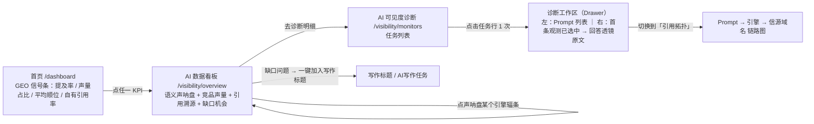
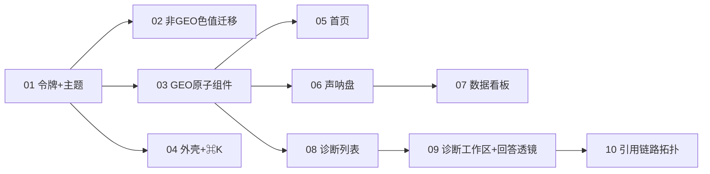

# GeoMix 全站体验重构：设计系统 + 原子化 Issue 清单

> **文档状态**：本文档规划的 `ISSUE-01`–`ISSUE-10` 均已合并落地。Part 0 执行铁律与 Part 1 设计令牌仍为现行视觉规范，运行时唯一真值请以 [`apps/web/lib/design-tokens.ts`](../apps/web/lib/design-tokens.ts) 与 [`apps/web/app/globals.css`](../apps/web/app/globals.css) 为准；前端静态守卫与复用底座见 [开发约定与迭代手册](./AGENTS.md)。
>
> 代号 **Sonar Ink（声呐墨）**：近黑偏绿的墨色底，加上磷光示波器那种荧光黄绿信号色。整体意象是「AI 语义雷达 / 精密信号捕获」。
> 适用仓库：`yexiu700/geomix`，`apps/web`（Next.js 15 + **Ant Design 5**，**仓库内没有 Tailwind**）。

---

## Part 0：执行铁律（所有 Issue 通用，弱模型必须先读）

1. **技术栈锁定**：只用 AntD 5、原生 CSS（写在 `apps/web/app/globals.css`）和手写 SVG。**不要新增任何 npm 依赖**，包括 Tailwind、图表库、图标库、字体包。所有令牌以 CSS 变量 `var(--gm-*)` 和 TS 常量 `GM` 两种形式提供。
2. **DOM 契约冻结**：所有现有 `aria-label`、`data-testid`、按钮文案、表头 `title`、空态文案、Modal `title` **一个字都不能改**，因为单测（`*.spec.tsx`）和 `e2e/` 依赖它们。只允许做三件事：①改样式；②改布局容器；③在现有节点外面**新增**包裹层或节点。
3. **业务逻辑冻结**：不改 `lib/*.ts` 的请求函数，不改 `packages/shared` 的已有文件。如果需要新常量，只追加 `packages/shared/src/ui-tokens.ts`（新文件）或者写在 `apps/web/lib/design-tokens.ts`。
4. **合规**：站名固定为「GeoMix」。不得写入任何原站文案、图片、Logo、地址。本文出现的中文文案都是新写的，可以直接用。
5. **动效降级**：所有 `animation` 和 `transition` 都必须被 `@media (prefers-reduced-motion: reduce)` 关掉（ISSUE-01 已提供全局规则，不要绕过它）。
6. **交付**：每个 Issue 单独开一个分支，例如 `feat/ui-01-tokens`，通过 PR 交付。本地 `pnpm lint && pnpm typecheck && pnpm test` 全部通过，GitHub Actions 全绿。PR 里附改造前后的截图。**不推 main，不合并，不部署。**
7. **禁止项**：不准用 `#5E6AD2`、`#8B5CF6`、`#6366F1` 等靛紫色，不准用 `filter: blur()` 做光晕背景，不准用渐变大色块铺满背景。

---

## Part 1：设计令牌（唯一真值表）

### 1.1 色彩系统

#### A. 背景层级（面积占比约 85%）

| 令牌 | 值 | 用途 | 面积 |
|---|---|---|---|
| `--gm-bg-base` | `#0A0C0B` | 页面底色、侧栏、顶栏 | ≈55% |
| `--gm-bg-surface` | `#111413` | 卡片、表格、面板 | ≈25% |
| `--gm-bg-elevated` | `#171B1A` | 输入框、表头、Hover 卡片、Drawer/Modal 主体 | ≈5% |
| `--gm-bg-overlay` | `#1D2220` | Tooltip、Dropdown、⌘K 面板 | <2% |
| `--gm-bg-hover` | `rgba(255,255,255,0.035)` | 行/菜单 Hover | — |
| `--gm-bg-selected` | `rgba(197,240,74,0.07)` | 选中行、选中菜单 | — |
| `--gm-mask` | `rgba(4,6,5,0.72)` | Modal/Drawer 遮罩 | — |

#### B. 线条（1px 细线）

| 令牌 | 值 | 用途 |
|---|---|---|
| `--gm-line-1` | `rgba(255,255,255,0.06)` | 默认分割线、卡片边框、表格行线 |
| `--gm-line-2` | `rgba(255,255,255,0.10)` | 输入框边框、表头下边线、声呐盘最外环 |
| `--gm-line-strong` | `rgba(255,255,255,0.16)` | Hover 边框、激活 Tab 边框 |

> 规则：所有边框统一写 `1px solid var(--gm-line-*)`。**禁止出现 2px 灰色边框**。2px 只允许用于「选中左边条」，而且颜色必须是品牌色或语义色。

#### C. 文字

| 令牌 | 值 | 用途 |
|---|---|---|
| `--gm-fg-1` | `#E8ECEA` | 标题、主要数值、正文 |
| `--gm-fg-2` | `#A4ADAA` | 次级文字、表格正文 |
| `--gm-fg-3` | `#6E7774` | 说明、表头、占位 |
| `--gm-fg-4` | `#464E4B` | 禁用 |

#### D. 品牌强调色「磷光 Phosphor」（面积不超过 5%）

| 令牌 | 值 |
|---|---|
| `--gm-phosphor` | `#C5F04A`（主色） |
| `--gm-phosphor-hover` | `#D4F772` |
| `--gm-phosphor-active` | `#A9D62F` |
| `--gm-phosphor-a08` | `rgba(197,240,74,0.08)` |
| `--gm-phosphor-a16` | `rgba(197,240,74,0.16)` |
| `--gm-phosphor-a40` | `rgba(197,240,74,0.40)` |
| `--gm-on-phosphor` | `#0A0C0B`（磷光底上的文字，**必须是深色**） |

**使用范围（白名单，其他地方一律不准用）**：①Primary 按钮背景；②焦点环；③侧栏/列表选中项左边 2px 指示条；④声呐盘扫描扇面；⑤⌘K 当前项指示条；⑥「新上」徽标；⑦Tabs 墨条。**禁止**用作大面积背景、正文颜色或图表的主数据系列。

#### E. GEO 语义信号色（核心业务色，全站统一含义）

| 语义 | 令牌 | 值 | 弱底（背景/高亮） | 对应数据 |
|---|---|---|---|---|
| **AI 正向引用 / 品牌被提及** | `--gm-sig-cited` | `#3DE0C8` | `rgba(61,224,200,0.14)` | `brandMentioned=true`、`OWNED`、`positive` |
| **中性提及** | `--gm-sig-mention` | `#9AA6B2` | `rgba(154,166,178,0.14)` | `neutral` |
| **竞品抢占** | `--gm-sig-competitor` | `#FF7A59` | `rgba(255,122,89,0.14)` | `COMPETITOR`、`competitorHits[].mentioned=true` 而本品牌未被提及 |
| **未收录 / 未出现** | `--gm-sig-absent` | `#59625F`（描边，`stroke-dasharray:3 3`） | `rgba(89,98,95,0.12)` | `brandMentioned=false` 且没有竞品命中，或 `completedChecks=0` |

情感色：`positive #3DE0C8`、`neutral #9AA6B2`、`mixed #F2B84B`、`negative #F0605D`。

信源分类色（`CitationSourceKind`）：`OWNED #3DE0C8`、`COMPETITOR #FF7A59`、`SOCIAL #6FA8FF`、`AUTHORITY #E9C46A`、`OTHER #7C8683`。

状态色：`success #3DE0C8`、`info #6FA8FF`、`warning #F2B84B`、`danger #F0605D`。
- 任务状态 `TaskStatusName`：QUEUED `#9AA6B2`、RUNNING `#6FA8FF`、PAUSED `#F2B84B`、COMPLETED `#3DE0C8`、PARTIAL `#E9C46A`、FAILED `#F0605D`、CANCELLED `#6E7774`。
- 观测状态 `ItemStatusName`：PENDING `#9AA6B2`、RUNNING `#6FA8FF`、SUCCESS `#3DE0C8`、FAILED `#F0605D`、SKIPPED `#6E7774`。

非 GEO 图表色板：`--gm-chart-1 #8BD3FF`、`--gm-chart-2 #F2B84B`、`--gm-chart-3 #3DE0C8`、`--gm-chart-grid rgba(255,255,255,0.06)`、`--gm-chart-axis #6E7774`。

> **徽标/Pill 的统一画法**：`background: <弱底>; color: <主色>; border: 1px solid <主色 + 不透明度 0.32>; height: 20px; padding: 0 8px; border-radius: 4px; font-size: 11px; font-weight: 500;`

### 1.2 排版与数据规范

```css
--gm-font-sans: "Inter", -apple-system, BlinkMacSystemFont, "Segoe UI", "PingFang SC", "Hiragino Sans GB", "Microsoft YaHei", sans-serif;
--gm-font-mono: "JetBrains Mono", "SF Mono", ui-monospace, Menlo, Consolas, monospace;
```
（只用系统字体栈，**不要**通过 `next/font` 下载字体。）

| 令牌 | 字号/行高 | 字重 | 字距 | 用途 |
|---|---|---|---|---|
| `--gm-text-micro` | 11px / 16px | 500 | 0.06em | 分组标题、KPI 标签、徽标 |
| `--gm-text-caption` | 12px / 18px | 400 | 0 | 辅助说明、Tab 栏 |
| `--gm-text-body-sm` | 13px / 20px | 400 | 0 | **默认正文**、表格、菜单 |
| `--gm-text-body` | 14px / 22px | 400 | 0 | 长文阅读（回答透镜） |
| `--gm-text-h4` | 16px / 24px | 600 | -0.01em | 卡片标题 |
| `--gm-text-h3` | 20px / 28px | 600 | -0.015em | 页面标题 |
| `--gm-text-kpi` | 28px / 34px | 600 | -0.02em | KPI 数值（等宽数字） |
| `--gm-text-hero` | 40px / 44px | 600 | -0.03em | 声呐盘中心数值 |

**数字强制规则**：
1. 所有数值、百分比、点数、金额、日期、Token 数都要加类名 `gm-num`，即 `font-variant-numeric: tabular-nums; font-feature-settings: "tnum" 1;`。
2. 表格中的数值列一律 `align: 'right'`。
3. 百分比固定保留 1 位小数，例如 `42.0%`。顺位写作 `#1.8`。空值统一显示 `—`（U+2014），颜色 `--gm-fg-3`。
4. ≥10000 的数字用 `Intl.NumberFormat('zh-CN',{notation:'compact',maximumFractionDigits:1})`，Tooltip 里显示完整值。
5. 域名、URL、Token 数、ID 一律用 `--gm-font-mono` 12px。

### 1.3 空间、圆角、阴影、动效

- **间距（4px 基准）**：`--gm-space-1:4px` `2:8px` `3:12px` `4:16px` `5:20px` `6:24px` `8:32px` `10:40px`。卡片内边距 16px，卡片间距 12px，页面内容区内边距 20px（<768px 时 12px）。
- **框架尺寸**：侧栏 232px（收起后为 0，沿用现有逻辑）、顶栏 48px、标签栏 36px、控件高 32px、小控件 26px、表格行最小高度 44px。
- **圆角**：`--gm-radius-xs:4px`（徽标、Chip）、`--gm-radius-sm:6px`（按钮、输入框、菜单项）、`--gm-radius-md:8px`（卡片、表格容器）、`--gm-radius-lg:12px`（Modal、Drawer、⌘K）、`--gm-radius-pill:999px`。
- **阴影**（暗色界面只给浮层用）：
  - `--gm-shadow-pop: 0 0 0 1px rgba(255,255,255,0.08), 0 12px 32px rgba(0,0,0,0.56);`（Dropdown、Tooltip、⌘K、Modal）
  - `--gm-glow-active: inset 0 0 0 1px rgba(197,240,74,0.32);`（选中卡片的内描边）
  - `--gm-focus-ring: 0 0 0 2px #0A0C0B, 0 0 0 4px rgba(197,240,74,0.55);`（所有 `:focus-visible`）
- **动效**：
  - `--gm-ease-out: cubic-bezier(0.16, 1, 0.3, 1)`；`--gm-ease-in-out: cubic-bezier(0.65, 0, 0.35, 1)`
  - `--gm-dur-fast: 120ms`（Hover、颜色）；`--gm-dur-mid: 180ms`（展开、位移）；`--gm-dur-slow: 240ms`（Drawer、Modal）
  - 标准写法：`transition: background-color 120ms var(--gm-ease-out), border-color 120ms var(--gm-ease-out), color 120ms var(--gm-ease-out);` **禁止 `transition: all`**。
  - 签名动画：`gm-sweep`（声呐扫描，4000ms linear infinite）、`gm-flow`（链路流动，900ms linear infinite）、`gm-draw`（连线绘制，600ms ease-out）、`gm-shimmer`（骨架屏，1200ms ease-in-out infinite）。

### 1.4 全局色值迁移表（ISSUE-01、02、05、07、08 共用）

| 旧硬编码 | 新值 |
|---|---|
| `#ffffff` `#fff` `#fafafa` | `var(--gm-bg-surface)` |
| `#f8fafc` `#f1f5f9` `#f0f2f5` `#f4f6fa` `#eef2f6` `#edf2f7` `#f0f5ff` `#e6f4ff` | `var(--gm-bg-elevated)` |
| `#e6eaf0` `#f0f0f0` `#e2e8f0` `#d9e2ef` `#d9d9d9` | `var(--gm-line-1)`（输入框边框用 `--gm-line-2`） |
| `#1f2937` `#0f172a` `#10233a` `#262626` `#1f1f1f` `#334155` | `var(--gm-fg-1)` |
| `#475569` `#595959` `#666` | `var(--gm-fg-2)` |
| `#64748b` `#5c6b80` `#8c8c8c` | `var(--gm-fg-3)` |
| `#1677ff` `#0958d9` `#1d39c4`（作为链接或数值强调色时） | `var(--gm-info)`（`#6FA8FF`） |
| `#1677ff`（作为 primary 按钮或选中态时） | 删掉内联色，交给 AntD 主题 |
| `#722ed1` | `var(--gm-chart-1)` |
| `#0f766e` `#006d75` `#0891b2` `#15803d` | `var(--gm-sig-cited)` |
| `#ff4d4f` `#cf1322` `#fff1f0`/`#ffa39e`（底/边） | `var(--gm-danger)` / `rgba(240,96,93,0.08)` / `rgba(240,96,93,0.32)` |
| `#d97706` `#d46b08` `#fff7e6`/`#ffd591` | `var(--gm-warning)` / `rgba(242,184,75,0.08)` / `rgba(242,184,75,0.32)` |
| `#93c5fd` `#91caff` `#adc6ff` `#d6e4ff` | `rgba(111,168,255,0.32)` |

---

## Part 2：核心体验流与标志性交互

### 2.1 首屏信息架构：用户 3 秒内能看到什么



- **0–1 秒（首页顶部）**：GEO 信号条显示 4 个 KPI，每个都带「提及/观测」等分子分母。用户第一眼就能回答「AI 到底有没有推荐我」。
- **1–3 秒（看板首屏）**：左边是**语义声呐盘**，13 个引擎辐条一眼看出「在哪个 AI 里看不见我」；右边是**竞品声量排行**，回答「为什么推荐竞品」。
- **下钻（我该改哪段话）**：在诊断列表点一次任务行，打开工作区。左侧 Prompt 列表**默认选中第一条**，右侧直接显示 **AI 回答透镜**：品牌和竞品在原文中高亮，引用标记 `[n]` 可点击跳到信源。所以从任务列表到 AI 引用原文只需**一次点击**。
- 首页原有的余额、点数、5 日创作趋势、功能入口**全部保留**，整体下移一层。

### 2.2 标志性交互一：语义声呐盘（Sonar Coverage Dial）
- **数据**：`VisibilityOverviewResponse.byEngine[]`（`visibilityPct`、`mentionedChecks`、`completedChecks`、`avgPosition`），引擎全集取自 `VISIBILITY_ENGINES`（13 个）。
- **形态**：圆形雷达，13 条辐条按 `VISIBILITY_ENGINES` 顺序顺时针排列（国内 8 个在前，海外 5 个在后）。每个引擎的提及率映射成半径上的一个点，所有点连成「覆盖多边形」（青色 `--gm-sig-cited`）。没有观测的引擎显示虚线空心点（`--gm-sig-absent`）。一条 30° 的磷光扇面每 4 秒扫一圈。
- **交互**：Hover 某引擎扇区时，扇区底色提亮，并弹出引擎卡片（提及率 / 提及次数 / 有效观测 / 平均顺位）。点击后把看板的「AI 引擎」筛选设为该引擎并重新查询，再点一次取消。键盘 `Tab` 依次聚焦辐条，`Enter` 选中。鼠标悬停在盘上时扫描暂停。

### 2.3 标志性交互二：AI 回答透镜（Answer Lens）
- **数据**：`VisibilityObservationRecord.answerText / brandPassage / competitorHits / citations`，以及档案的 `brandName / brandAliases / competitors[].aliases`。
- **形态**：AI 原文按段落排版。品牌词显示青色底加下划线，竞品词显示珊瑚色底，`brandPassage` 所在段落加 2px 青色左边条。`[1]`、`【1】` 这类引用标记渲染成可点击的等宽小芯片。右侧有一条 8px 宽的**提及热区条**（类似迷你地图），把每个命中按「在全文中的位置」画成刻度。
- **交互**：工具栏的「品牌 / 竞品 / 引用标记」三个开关控制对应高亮的显示。`[` / `]` 跳到上一个 / 下一个命中，命中闪烁 600ms。点击热区刻度直接滚到对应位置。点击引用芯片，滚到下方信源列表并高亮该条 1200ms。
- **诚实标注**：热区来自**文本命中位置**，不是模型注意力权重。界面固定文案写「提及热区」，不写「注意力」。

### 2.4 标志性交互三：引用链路拓扑（Citation Trace）
- **数据**：当前任务详情 `observations[]`（`promptText`、`engine`、`brandMentioned`、`competitorHits`、`citations[].domain/sourceKind`）。
- **形态**：三列节点「Prompt → 引擎 → 信源域名」，节点之间用贝塞尔曲线连接。Prompt→引擎这一段的颜色表示该次回答的结果（青色=提及我，珊瑚色=竞品抢占，灰色虚线=未出现）；引擎→域名这一段的颜色表示信源分类。首次渲染时连线用 `gm-draw` 动画逐条画出来。
- **交互**：Hover 任一节点时，相关链路变为不透明并显示「流动虚线」动画，其他链路淡到 0.08。点击 Prompt 节点，切回「观测明细」并选中对应观测，直接打开回答透镜。

### 2.5 键盘优先：⌘K 指令面板
`⌘K`（mac）或 `Ctrl+K` 打开。面板内可以：跳转到任意有权限的页面、切换到已打开的标签、执行外壳操作（布局设置 / 收起菜单 / 修改密码 / 退出登录）。`↑/↓` 选择，`Enter` 执行，`Esc` 关闭。

---

## Part 3：原子化开发 Issue 清单（按依赖顺序排列）



---

### [ISSUE-01] 设计令牌与 AntD 主题：把 Sonar Ink 令牌写入 globals.css 和 ConfigProvider，并完成全局暗色化
* **依赖前置**：无
* **目标文件路径**：`apps/web/app/globals.css`（修改）、`apps/web/lib/design-tokens.ts`（新建）、`apps/web/components/providers.tsx`（修改）、`apps/web/lib/design-tokens.spec.ts`（新建）
* **功能与数据契约（Strict）**：
  * `globals.css` 顶部新增 `:root { color-scheme: dark; ... }`，按原样写入 Part 1 的**全部** `--gm-*` 变量。`html, body` 改为 `background: var(--gm-bg-base); color: var(--gm-fg-1); font-family: var(--gm-font-sans); font-size: 13px; line-height: 20px; -webkit-font-smoothing: antialiased;`。
  * 把 `globals.css` 里现有 545 行中的所有硬编码色值，按 Part 1.4 迁移表替换成变量。类名一个都不能删。
  * 新增工具类：`.gm-num`、`.gm-mono`（`font-family: var(--gm-font-mono); font-size: 12px;`）、`.gm-clamp-1`、`.gm-clamp-2`、`.gm-clamp-3`（`display:-webkit-box; -webkit-box-orient:vertical; -webkit-line-clamp:N; overflow:hidden; word-break:break-word;`）、`.gm-skeleton`、`.gm-hairline`（`border:1px solid var(--gm-line-1)`）。
  * 新增 keyframes：
    ```css
    @keyframes gm-sweep { to { transform: rotate(360deg); } }
    @keyframes gm-flow { from { stroke-dashoffset: 8; } to { stroke-dashoffset: 0; } }
    @keyframes gm-draw { from { stroke-dashoffset: 1; } to { stroke-dashoffset: 0; } }
    @keyframes gm-shimmer { 0% { background-position: 200% 0; } 100% { background-position: -200% 0; } }
    @keyframes gm-blink { 0%,100% { background-color: transparent; } 30% { background-color: rgba(197,240,74,0.24); } }
    .gm-skeleton { background: linear-gradient(90deg, rgba(255,255,255,0.04) 0%, rgba(255,255,255,0.08) 50%, rgba(255,255,255,0.04) 100%); background-size: 200% 100%; animation: gm-shimmer 1200ms ease-in-out infinite; border-radius: 4px; }
    :focus-visible { outline: none; box-shadow: var(--gm-focus-ring); }
    @media (prefers-reduced-motion: reduce) { *, *::before, *::after { animation-duration: 0.001ms !important; animation-iteration-count: 1 !important; transition-duration: 0.001ms !important; } }
    ```
  * 原生 `select, textarea, input:not([class*="ant-"])` 统一样式：`background: var(--gm-bg-elevated); color: var(--gm-fg-1); border: 1px solid var(--gm-line-2); border-radius: 6px; height: 32px (textarea 除外); padding: 0 10px; font-size: 13px;`。Hover 时 `border-color: var(--gm-line-strong)`。
  * `design-tokens.ts` 导出 `export const GM = { bg:{base,surface,elevated,overlay}, line:{l1,l2,strong}, fg:{f1,f2,f3,f4}, phosphor, onPhosphor, sig:{cited,mention,competitor,absent}, sigSoft:{...}, sentiment:{positive,neutral,mixed,negative}, sourceKind: Record<CitationSourceKind,string>, taskStatus: Record<TaskStatusName,string>, itemStatus: Record<ItemStatusName,string>, chart:{c1,c2,c3,grid,axis} } as const;`。值必须和 CSS 变量逐一相同，SVG 组件用它取色。
  * 同文件导出三个工具函数：`formatPct(v:number|null|undefined):string`（null/NaN 返回 `—`，否则返回 `v.toFixed(1)+'%'`）、`formatCompact(n:number):string`、`truncateMiddle(s:string, max=56):string`（长度 ≤ max 时原样返回，否则返回前 `max-21` 个字符 + `…` + 末尾 20 个字符）。
  * `providers.tsx` 的 `ConfigProvider` 增加 `theme={GM_ANTD_THEME}`（在 `design-tokens.ts` 中导出），内容如下：
    ```ts
    import { theme } from 'antd';
    export const GM_ANTD_THEME = {
      algorithm: theme.darkAlgorithm,
      token: {
        colorPrimary: '#C5F04A', colorInfo: '#6FA8FF', colorSuccess: '#3DE0C8', colorWarning: '#F2B84B', colorError: '#F0605D', colorLink: '#6FA8FF',
        colorBgBase: '#0A0C0B', colorBgLayout: '#0A0C0B', colorBgContainer: '#111413', colorBgElevated: '#171B1A', colorBgMask: 'rgba(4,6,5,0.72)',
        colorBorder: 'rgba(255,255,255,0.10)', colorBorderSecondary: 'rgba(255,255,255,0.06)', colorSplit: 'rgba(255,255,255,0.06)',
        colorText: '#E8ECEA', colorTextSecondary: '#A4ADAA', colorTextTertiary: '#6E7774', colorTextQuaternary: '#464E4B',
        fontFamily: 'var(--gm-font-sans)', fontFamilyCode: 'var(--gm-font-mono)', fontSize: 13,
        borderRadius: 6, borderRadiusSM: 4, borderRadiusLG: 8, controlHeight: 32, controlHeightSM: 26,
        motionDurationFast: '0.12s', motionDurationMid: '0.18s', motionDurationSlow: '0.24s', motionEaseOut: 'cubic-bezier(0.16, 1, 0.3, 1)',
        boxShadow: '0 0 0 1px rgba(255,255,255,0.08), 0 12px 32px rgba(0,0,0,0.56)', boxShadowSecondary: '0 0 0 1px rgba(255,255,255,0.08), 0 12px 32px rgba(0,0,0,0.56)',
      },
      components: {
        Button: { primaryColor: '#0A0C0B', primaryShadow: 'none', defaultShadow: 'none', dangerShadow: 'none', defaultBg: '#171B1A', defaultBorderColor: 'rgba(255,255,255,0.10)', fontWeight: 500 },
        Checkbox: { colorWhite: '#0A0C0B' },
        Radio: { buttonSolidCheckedColor: '#0A0C0B' },
        Layout: { bodyBg: '#0A0C0B', headerBg: '#0A0C0B', siderBg: '#0A0C0B', headerHeight: 48, headerPadding: '0 16px' },
        Menu: { darkItemBg: '#0A0C0B', darkSubMenuItemBg: '#0A0C0B', darkItemColor: '#A4ADAA', darkItemHoverColor: '#E8ECEA', darkItemHoverBg: 'rgba(255,255,255,0.035)', darkItemSelectedBg: 'rgba(197,240,74,0.07)', darkItemSelectedColor: '#E8ECEA', darkGroupTitleColor: '#6E7774', itemHeight: 32, itemBorderRadius: 6, itemMarginInline: 8, iconSize: 14 },
        Table: { headerBg: '#171B1A', headerColor: '#6E7774', headerSplitColor: 'transparent', borderColor: 'rgba(255,255,255,0.06)', rowHoverBg: 'rgba(255,255,255,0.035)', rowSelectedBg: 'rgba(197,240,74,0.07)', rowSelectedHoverBg: 'rgba(197,240,74,0.10)', cellPaddingBlock: 12, cellPaddingInline: 12, cellFontSize: 13 },
        Tabs: { inkBarColor: '#C5F04A', itemSelectedColor: '#E8ECEA', itemColor: '#6E7774', itemHoverColor: '#A4ADAA' },
        Tooltip: { colorBgSpotlight: '#1D2220', colorTextLightSolid: '#E8ECEA' },
        Modal: { contentBg: '#171B1A', headerBg: '#171B1A', footerBg: '#171B1A' },
        Drawer: { colorBgElevated: '#111413' },
        Tag: { defaultBg: 'rgba(255,255,255,0.04)', defaultColor: '#A4ADAA' },
        Select: { optionSelectedBg: 'rgba(197,240,74,0.10)', optionActiveBg: 'rgba(255,255,255,0.05)' },
        Input: { activeShadow: '0 0 0 2px rgba(197,240,74,0.20)', hoverBorderColor: 'rgba(255,255,255,0.16)' },
        Pagination: { itemActiveBg: 'transparent' },
      },
    } as const;
    ```
* **布局与视觉精确规格（UI Spec）**：本 Issue 不改布局。验收方式是逐一检查登录页 `/login`、`/dashboard` 和任意 CRUD 页：背景为 `#0A0C0B`，卡片为 `#111413`，Primary 按钮为磷光底配深色字。
* **全状态机与边界处理（Edge Cases）**：
  * `Default`：所有 AntD 组件随主题统一变为暗色。
  * `Hover/Focus`：键盘 Tab 聚焦时出现 `--gm-focus-ring`（2px 墨色间隙 + 4px 磷光环）。
  * `Loading`：AntD `Spin` 颜色为 `#C5F04A`（由 colorPrimary 自动带出）。`.gm-skeleton` 可以独立使用。
  * `Empty`：AntD `Empty` 组件默认文字为 `--gm-fg-3`。
  * `Error/Overflow`：`Alert type=error` 背景 `rgba(240,96,93,0.08)`，边框 `rgba(240,96,93,0.32)`（交给 darkAlgorithm 自动生成，不要手写内联样式）。
* **弱模型验收清单（DoD）**：
  * [ ] `grep -nE "#(fff|ffffff|f8fafc|e6eaf0|64748b|1677ff)\b" apps/web/app/globals.css` 返回 0 行。
  * [ ] `design-tokens.spec.ts` 覆盖：`formatPct(null)==='—'`、`formatPct(42)==='42.0%'`、`truncateMiddle('a'.repeat(100)).length===56`、`GM.sourceKind` 的键与 `CITATION_SOURCE_KINDS` 完全一致。
  * [ ] Primary 按钮文字颜色是 `#0A0C0B`，Checkbox 勾选后的对勾是深色。
  * [ ] Tooltip 是深底 `#1D2220` 配浅字 `#E8ECEA`。
  * [ ] 开启系统「减少动态效果」后，骨架屏不再闪动。
  * [ ] `pnpm lint && pnpm typecheck && pnpm test` 全部通过，且没有修改任何 spec 断言。

---

### [ISSUE-02] 非 GEO 模块暗色迁移：清理写作、复刻、生图、素材、账户、管理后台中的硬编码浅色
* **依赖前置**：需先完成 ISSUE-01
* **目标文件路径**（仅限以下文件的 `style={{}}` 内联色值）：`components/rewrite/rewrite-batch-screen.tsx`、`components/writing/article-manage-screen.tsx`、`components/image/ai-image-screen.tsx`、`components/material/knowledge-screen.tsx`、`components/material/gallery-screen.tsx`、`components/rewrite/rewrite-single-screen.tsx`、`components/writing/ai-task-screen.tsx`、`components/writing/prompt-screen.tsx`、`components/material/question-screen.tsx`、`components/material/keyword-screen.tsx`、`components/admin/*.tsx`、`components/account/*.tsx`
* **功能与数据契约（Strict）**：
  * 只做**字符串替换**：按 Part 1.4 迁移表，把内联 `style` 中的 Hex 换成 `'var(--gm-xxx)'`。**不改**任何 JSX 结构、事件、文案或 props。
  * 所有表格、按钮、筛选、导出、分页、批量操作保持原样（零功能变化）。
* **布局与视觉精确规格（UI Spec）**：
  * 页面内的「说明框 / 提示框」（原来 `#f8fafc` 底 + `#e6eaf0` 边）统一改为 `background: var(--gm-bg-elevated); border: 1px solid var(--gm-line-1); border-radius: 8px; padding: 12px; color: var(--gm-fg-2);`。
  * 金额、点数、计数这类数值节点额外加 `className="gm-num"`（只允许新增 className，不改文本）。
  * 图片缩略图容器：`background: var(--gm-bg-elevated); border: 1px solid var(--gm-line-1); border-radius: 6px;`。
* **全状态机与边界处理（Edge Cases）**：
  * `Default`：没有任何白底残留。
  * `Hover/Focus`：交给 AntD 主题处理，不手写。
  * `Loading`：保留现有 `Spin`/`loading` 属性，不改。
  * `Empty`：保留现有空态文案，颜色改为 `var(--gm-fg-3)`。
  * `Error/Overflow`：红色文本统一为 `var(--gm-danger)`。长标题如果原本没有截断，**不要新增**截断（避免影响测试）。
* **弱模型验收清单（DoD）**：
  * [ ] `grep -rnE "'#(fff|ffffff|fafafa|f8fafc|e6eaf0|f0f0f0|d9d9d9)'" apps/web/components/{rewrite,writing,image,material,admin,account}` 返回 0 行。
  * [ ] 依次打开 17 个菜单页面截图，确认没有白色大块，也没有黑字落在黑底上（文字对比度 ≥ 4.5:1）。
  * [ ] `git diff --stat` 中，上述文件的删除行数 = 新增行数 ±10%（证明是纯替换）。
  * [ ] 所有既有单测与 e2e 不改断言即可通过。

---

### [ISSUE-03] GEO 原子组件库：KPI 卡、信号徽标、引擎芯片、骨架、空态、错误态
* **依赖前置**：需先完成 ISSUE-01
* **目标文件路径**：`apps/web/components/geo/primitives.tsx`（新建）、`apps/web/components/geo/primitives.spec.tsx`（新建）、样式追加到 `globals.css` 的 `/* === geo primitives === */` 区块
* **功能与数据契约（Strict）**：
  ```ts
  export type SignalTone = 'cited' | 'mention' | 'competitor' | 'absent' | 'info' | 'warning' | 'danger' | 'neutral';
  export function SignalKpiCard(p: { label: string; value: string; tone?: SignalTone; numerator?: number; denominator?: number; caption?: string; testId?: string; onClick?: () => void; loading?: boolean }): JSX.Element;
  export function SignalPill(p: { tone: SignalTone; children: ReactNode; title?: string }): JSX.Element;
  export function SourceKindChip(p: { kind: CitationSourceKind }): JSX.Element;      // 文案用 CITATION_SOURCE_LABELS
  export function SentimentDot(p: { sentiment: VisibilitySentiment | null }): JSX.Element; // 文案用 VISIBILITY_SENTIMENT_LABELS，null 显示「—」
  export function EngineChip(p: { engine: string }): JSX.Element;                    // 文案用 VISIBILITY_ENGINE_LABELS，未知 key 原样显示
  export function EngineChipList(p: { engines: string[]; max?: number }): JSX.Element; // 默认 max=3，超出部分显示 +N 并加 Tooltip
  export function StatusPill(p: { status: TaskStatusName | ItemStatusName; kind: 'task' | 'item' }): JSX.Element;
  export function SignalSkeleton(p: { variant: 'kpi' | 'row' | 'block'; rows?: number; height?: number }): JSX.Element;
  export function SignalEmpty(p: { title: string; description?: string; actionText?: string; onAction?: () => void }): JSX.Element;
  export function SignalError(p: { message: string; onRetry?: () => void }): JSX.Element;
  export function TruncText(p: { text: string; lines?: 1 | 2 | 3; mono?: boolean; middle?: boolean }): JSX.Element;
  ```
* **布局与视觉精确规格（UI Spec）**：
  * **SignalKpiCard**：`.gm-kpi { background: var(--gm-bg-surface); border: 1px solid var(--gm-line-1); border-radius: 8px; padding: 16px; min-height: 112px; display: flex; flex-direction: column; gap: 6px; position: relative; overflow: hidden; }`
    * label：11px/16px，500，`letter-spacing: 0.06em`，`--gm-fg-3`。
    * value：28px/34px，600，`.gm-num`，颜色 `--gm-fg-1`（**数值不上色**）。
    * 顶部 2px 信号条：`::before { content:''; position:absolute; left:0; top:0; height:2px; width: var(--gm-kpi-ratio, 0%); background: <tone 主色>; transition: width 600ms var(--gm-ease-out); }`。其中 `--gm-kpi-ratio = numerator/denominator*100%`，没有分母时为 0%。
    * caption：12px，`--gm-fg-3`，`gm-clamp-1`。分子分母写成 `<span class="gm-num">{numerator}</span> / <span class="gm-num">{denominator}</span>`。
    * `onClick` 存在时：`cursor:pointer; role="button"; tabIndex=0`，Hover 时 `border-color: var(--gm-line-strong); background: var(--gm-bg-elevated);`，Enter/Space 触发点击。
  * **SignalPill / SourceKindChip / StatusPill**：按 Part 1.1 的「徽标/Pill 统一画法」，左侧加一个 6px 圆点（`border-radius:50%`，颜色为主色），圆点与文字间距 6px。
  * **SentimentDot**：8px 圆点 + 12px 文字，`--gm-fg-2`。
  * **EngineChip**：`height:20px; padding:0 6px; border-radius:4px; border:1px solid var(--gm-line-2); background: transparent; font-size:11px; color: var(--gm-fg-2);`。海外引擎（`domestic:false`）在文字前加 4px 空心圆 `border:1px solid var(--gm-fg-3)`，国内引擎用实心圆 `--gm-fg-3`。
  * **SignalEmpty**：`padding: 40px 16px; text-align:center;`。图标是 40×40 SVG，三个同心圆 r=6/12/18，`stroke: var(--gm-line-2)`，最内圈 `stroke: var(--gm-phosphor-a40)`。title 14px/600/`--gm-fg-1`，description 13px/`--gm-fg-3`/`max-width:360px; margin: 6px auto 16px`，按钮为 `type="primary" size="small"`。
  * **SignalError**：`border:1px solid rgba(240,96,93,0.32); background: rgba(240,96,93,0.06); border-radius:8px; padding:12px 16px; color: var(--gm-danger); font-size:13px; display:flex; justify-content:space-between; align-items:center;`，「重试」按钮 `size="small"`。
  * **TruncText**：`lines` 对应 `.gm-clamp-N`，`middle=true` 时用 `truncateMiddle`。只有文本被截断时（`scrollHeight > clientHeight` 或长度 > 56）才包 AntD `Tooltip`。Tooltip 样式 `max-width: 480px; word-break: break-all;`，`mono` 时加 `.gm-mono`。
* **全状态机与边界处理（Edge Cases）**：
  * `Loading`：`SignalSkeleton variant="kpi"` = 一个 112px 高的卡片，内含 3 条骨架，尺寸为 64×10、96×24、140×10，纵向间距 10px。`row` = 44px 高，左边 16×16 方块，右边宽 60% 的 10px 条，循环 `rows` 次（默认 5）。`block` = 宽 100%，高 `height`（默认 240px）。
  * `Empty`：`SignalKpiCard` 的 value 为 `—`，信号条宽度为 0。
  * `Error`：由调用方渲染 `SignalError`。
  * `Overflow`：KPI label 超长时 `gm-clamp-1`；value 超过 8 个字符时字号降到 22px。
  * `Hover/Focus`：所有可点击元素都要有 focus ring。
* **弱模型验收清单（DoD）**：
  * [ ] spec 覆盖：`EngineChipList` 传入 5 个引擎、max=3 时，渲染 3 个芯片和文字「+2」。
  * [ ] spec 覆盖：`SentimentDot sentiment={null}` 渲染「—」。
  * [ ] spec 覆盖：`SignalKpiCard numerator={3} denominator={4}` 时，style 中 `--gm-kpi-ratio` 为 `75%`。
  * [ ] spec 覆盖：可点击的 KPI 卡按 Enter 会触发 `onClick`。
  * [ ] 所有数值节点都带 `gm-num`。
  * [ ] 文件总行数 ≤ 300，不引入新依赖。

---

### [ISSUE-04] 外壳框架与 ⌘K：侧栏、顶栏、多标签栏改为 Sonar Ink，并新增指令面板
* **依赖前置**：需先完成 ISSUE-01
* **目标文件路径**：`components/shell/shell-frame.tsx`、`components/shell/side-menu.tsx`、`components/shell/tab-bar.tsx`、`components/shell/module-screen.tsx`（只改便签区域的 className）、`components/admin/admin-frame.tsx`（只改颜色）、**新建** `components/shell/command-palette.tsx`、`components/shell/command-palette.spec.tsx`
* **功能与数据契约（Strict）**：
  * 保留现有全部功能：菜单分组与折叠、`soon` 项（即将上线，禁用）、`new` 徽标、跑马灯公告、有效期徽标（含 `warn`）、管理后台入口、多标签开关、布局面板、收起/展开菜单、头像下拉（修改密码 / 退出）、移动端（≤768px）抽屉菜单、标签关闭与切换、本页草稿便签。
  * `CommandPalette` props：`{ open: boolean; onClose(): void; role: AccountProfile['role']; tabs: ShellSnapshot['tabs']; activeId: string; onDispatch(a: ShellAction): void; onOpenLayout(): void; onToggleMenu(): void; onChangePassword(): void; onLogout(): void }`。
  * 指令来源（只用已有能力，**不新增任何业务动作**）：
    1. 「页面」组：遍历 `STATIC_ROUTES`，过滤掉 `isConsoleRouteAccessible(href, role)===false` 的路由。执行时 `onDispatch({ type: 'open', href })`。
    2. 「已打开标签」组：`tabs`，执行时派发与 TabBar 点击相同的 action。
    3. 「操作」组：布局设置、收起/展开菜单、修改密码、退出登录，分别调用对应回调。
  * 快捷键：在 `shell-frame.tsx` 注册 `keydown`，条件是 `(e.metaKey||e.ctrlKey) && e.key.toLowerCase()==='k'` 且 `!e.isComposing`，然后 `preventDefault` 并切换 open。面板内 `↑/↓` 循环移动，`Enter` 执行并关闭，`Esc` 关闭。
  * 搜索：`query.trim().toLowerCase()`，对 `title` 和 `href` 做 `includes` 匹配。
  * 顶栏新增按钮：`aria-label="打开指令面板"`，文字「搜索」+ 一个 `⌘K` 键帽（在 Windows 上显示 `Ctrl K`，用 `navigator.platform` 判断）。
* **布局与视觉精确规格（UI Spec）**：
  * **Sider**：`width={232}`（原来是 248）。背景 `--gm-bg-base`，右边框 `1px solid var(--gm-line-1)`。
    * 分组标题（section）：`padding: 16px 16px 6px; font-size: 11px; line-height: 16px; letter-spacing: 0.06em; color: var(--gm-fg-3); font-weight: 500;`。
    * 菜单项：32px 高、6px 圆角、左右外边距 8px（已由主题 Menu token 实现）。**选中项**额外加 CSS：`.gm-sider .ant-menu-item-selected { position: relative; } .gm-sider .ant-menu-item-selected::before { content:''; position:absolute; left:-8px; top:8px; bottom:8px; width:2px; border-radius:2px; background: var(--gm-phosphor); }`。
    * `new` 徽标：`height:16px; padding:0 5px; border-radius:4px; background: var(--gm-phosphor-a16); color: var(--gm-phosphor); font-size:10px; font-weight:600; margin-left:6px;`。
    * `soon` 项：颜色 `--gm-fg-4`，`cursor: not-allowed`。
  * **Header**：48px 高，`border-bottom: 1px solid var(--gm-line-1)`，`gap: 12px`。品牌名「GeoMix」14px/600/`--gm-fg-1`，前面放 20×20 的 SVG 标记（同心圆 r=3/6/9，外两圈 `stroke: var(--gm-fg-3)`，圆心 `fill: var(--gm-phosphor)`）。跑马灯 12px `--gm-fg-3`。有效期徽标改为 SignalPill 风格（tone=`warning`，warn 时 tone=`danger`）。
  * **⌘K 按钮**：`height:28px; padding:0 8px 0 10px; border:1px solid var(--gm-line-2); border-radius:6px; background: var(--gm-bg-surface); color: var(--gm-fg-3); font-size:12px; gap:16px;`。键帽 `kbd`：`font-family: var(--gm-font-mono); font-size:10px; padding:1px 4px; border:1px solid var(--gm-line-2); border-radius:4px;`。
  * **TabBar**：36px 高，`padding: 0 12px; gap: 4px; border-bottom: 1px solid var(--gm-line-1); background: var(--gm-bg-base); overflow-x: auto; scrollbar-width: none;`。
    * Tab：`height:26px; padding:0 8px 0 10px; border-radius:6px; font-size:12px; color: var(--gm-fg-3); border:1px solid transparent;`。Hover 时 `color: var(--gm-fg-1); background: var(--gm-bg-hover)`。激活时 `color: var(--gm-fg-1); background: var(--gm-bg-surface); border-color: var(--gm-line-2)`。
    * 关闭 ×：14×14，`border-radius:4px`，`--gm-fg-3`，Hover 时 `background: rgba(255,255,255,0.08)`。
    * 左右边缘渐隐：`mask-image: linear-gradient(90deg, transparent 0, #000 16px, #000 calc(100% - 16px), transparent 100%)`。
  * **内容区**：`.gm-content { padding: 20px; }`，`.gm-page { background: transparent; padding: 0; border-radius: 0; }`。页面卡片交给各页面自己定义（不再套白底大卡）。
  * **便签 textarea**：`background: var(--gm-bg-surface); border: 1px dashed var(--gm-line-2); border-radius: 8px; min-height: 56px; padding: 10px 12px; color: var(--gm-fg-2); font-size: 12px;`。
  * **CommandPalette**：AntD `Modal` 参数 `footer={null} closable={false} width={640} styles={{ body:{padding:0}, content:{padding:0, borderRadius:12, background:'var(--gm-bg-overlay)', boxShadow:'var(--gm-shadow-pop)'} }} style={{ top: '15vh' }}`。
    * 输入框：48px 高，`padding: 0 16px; font-size: 15px; border:0; border-bottom:1px solid var(--gm-line-1); background: transparent;`，placeholder「搜索页面或操作…」，打开后自动聚焦。
    * 列表：`max-height: 360px; overflow-y: auto; padding: 6px;`。组标题 11px `--gm-fg-3`，`padding: 8px 10px 4px`。
    * 条目：36px 高，`padding: 0 10px; border-radius: 6px; font-size: 13px; color: var(--gm-fg-2); display:flex; justify-content: space-between`，右侧显示 `href`（`.gm-mono` 11px `--gm-fg-4`）。当前项：`background: rgba(255,255,255,0.05); color: var(--gm-fg-1); box-shadow: inset 2px 0 0 var(--gm-phosphor);`。
    * 底栏：32px 高，`border-top:1px solid var(--gm-line-1)`，显示键帽提示「↑↓ 选择 · Enter 打开 · Esc 关闭」11px `--gm-fg-3`。
* **全状态机与边界处理（Edge Cases）**：
  * `Default`：面板打开时，当前项为第 1 条。
  * `Hover/Focus`：鼠标移入某条即把它设为当前项（`onMouseMove`，不用 `onMouseEnter`，避免滚动时误触）。当前项通过 `scrollIntoView({ block: 'nearest' })` 保持可见。
  * `Loading`：外壳原有的「正在确认登录」页改为居中显示：40px 声呐图标 + 文案（文案不变），图标外环做 `gm-sweep` 2s 旋转。
  * `Empty`：没有匹配时显示 `没有匹配「{query}」的页面或操作`，13px `--gm-fg-3`，`padding: 32px 0; text-align:center`。
  * `Error/Overflow`：Tab 标题超过 12 个汉字时 `max-width: 160px; overflow:hidden; text-overflow: ellipsis; white-space: nowrap;`，并加原生 `title` 属性。跑马灯保持滚动。面板中长标题 `gm-clamp-1`。离线页（「无法连接接口」）套用 `SignalError` 的视觉，文案不变。
* **弱模型验收清单（DoD）**：
  * [ ] 按 `Ctrl+K` 打开面板，输入「看板」只剩「AI数据看板」一条，回车后跳转到 `/visibility/overview` 并新开标签。
  * [ ] 非管理员账号在面板中看不到 `/workbench/samples`。
  * [ ] `↑` 在第一条时跳到最后一条（循环）。
  * [ ] 中文输入法组字过程中按 `Ctrl+K` 不会触发面板。
  * [ ] 侧栏选中项左侧出现 2px `#C5F04A` 指示条。
  * [ ] 在 <768px 下，侧栏仍是抽屉形式，顶栏没有横向滚动条，⌘K 按钮只显示放大镜图标（隐藏文字和键帽）。
  * [ ] `shell-frame.spec.tsx`、`console-shell.spec.tsx` 不改断言即可通过。新 spec 覆盖过滤、键盘循环和空态。

---

### [ISSUE-05] 首页工作台：新增 GEO 信号条，暗色化账户卡、5 日趋势和功能入口
* **依赖前置**：需先完成 ISSUE-03
* **目标文件路径**：`components/dashboard/dashboard-screen.tsx`（修改）、**新建** `components/geo/geo-signal-strip.tsx`、`components/geo/geo-signal-strip.spec.tsx`
* **功能与数据契约（Strict）**：
  * `GeoSignalStrip` props：`{ load: () => Promise<VisibilityOverviewResponse>; onOpenOverview: () => void }`。`load` 默认使用 `lib/visibility.ts` 中已有的看板请求，参数为 `{ days: 14 }`（不传 profileId）。**不新增 API**。
  * 渲染 4 张 `SignalKpiCard`，字段与看板一一对应：
    1. 「品牌提及率」`formatPct(metrics.visibilityPct)`，numerator=`mentionedChecks`，denominator=`completedChecks`，tone=`cited`。
    2. 「声量占比」`formatPct(shareOfVoice.brandSharePct)`，numerator=`brandMentions`，denominator=`totalMentions`，tone=`cited`。
    3. 「平均推荐顺位」`avgPosition===null ? '—' : '#'+avgPosition.toFixed(1)`，tone=`info`，caption「越靠前越好」。
    4. 「自有域名引用率」`formatPct(ownedCitationRatePct)`，numerator=`ownedCitations`，denominator=`totalCitations`，tone=`cited`。
    点击任一卡片都调用 `onOpenOverview`（派发打开 `/visibility/overview` 标签）。
  * 信号条右上角有一个链接按钮「进入 AI 数据看板 →」（`type="link" size="small"`）。
  * 首页原有区块**全部保留且顺序不变**，只是整体排在信号条下方：标题 + 刷新数据、公告条、余额卡、点数卡（含 SHADOW 徽标、余额明细 / 点数明细 / 账号权益链接）、5 日趋势（图例、合计、查看文章明细、逐日对账条）、功能入口卡片（含「即将上线」）。
* **布局与视觉精确规格（UI Spec）**：
  * 信号条容器：`display:grid; grid-template-columns: repeat(4, minmax(0,1fr)); gap:12px; margin-bottom:16px;`；1024px 以下为 `repeat(2, …)`，<768px 为 `1fr`。容器上方有一行标题：「AI 可见度信号 · 近 14 日」11px/500/`letter-spacing:0.06em`/`--gm-fg-3`，`margin-bottom: 8px`。
  * 余额卡、点数卡：`grid-template-columns: 1fr 1fr; gap:12px`（<768px 时变为单列）。卡片样式同 `.gm-kpi`，但 `min-height: 0`。金额和点数用 28px `.gm-num`，SHADOW 徽标用 `SignalPill tone="warning"`，提示文本框按迁移表处理。
  * 公告条：`height: 36px; padding: 0 12px; border:1px solid var(--gm-line-1); border-radius:8px; background: var(--gm-bg-surface); font-size:12px; color: var(--gm-fg-2);`，前缀标签用 `SignalPill tone="info"`。
  * 5 日趋势 SVG：网格线 `GM.chart.grid` 1px，轴文字 `GM.chart.axis` 11px。「AI 写作」柱 `GM.chart.c1`，「爆文复刻」柱 `GM.chart.c2`，柱宽 12px，`rx=2`。合计折线 `GM.fg.f2` 1.5px，`stroke-dasharray: 4 3`，节点 r=3、填充 `GM.bg.surface`、描边 `GM.fg.f2`。柱子 Hover 时 `opacity` 从 0.85 变为 1。逐日对账条：5 列 grid，`gap:8px`，每格 `padding:8px; border:1px solid var(--gm-line-1); border-radius:6px; text-align:center; font-size:12px;`，数字加 `.gm-num`。
  * 功能入口卡：`grid-template-columns: repeat(auto-fill, minmax(220px,1fr)); gap:8px;`。卡片 `padding:12px; border:1px solid var(--gm-line-1); border-radius:8px; background: var(--gm-bg-surface);`，Hover 时 `border-color: var(--gm-line-strong); background: var(--gm-bg-elevated)`。标题 13px/600，右上角计数 `.gm-num` 12px `--gm-info`，说明 12px `--gm-fg-3` `gm-clamp-2`。「即将上线」卡 `opacity:0.5; cursor:not-allowed`。分组标题 11px `--gm-fg-3` `margin: 16px 0 8px`。
* **全状态机与边界处理（Edge Cases）**：
  * `Loading`：信号条显示 4 个 `SignalSkeleton variant="kpi"`；趋势区显示 `variant="block" height={220}`。
  * `Empty`：`metrics.completedChecks===0` 时，信号条替换为一个整宽 `SignalEmpty`：title「还没有 AI 可见度数据」，description「创建品牌档案并发起一次监测，即可在这里看到你在各大 AI 引擎中的提及率」，actionText「去发起诊断」，点击打开 `/visibility/monitors`。
  * `Error`：信号条请求失败时显示 `SignalError message="AI 可见度信号加载失败"` 并带重试。**首页其余部分照常渲染**（错误隔离）。
  * `Overflow`：金额超过 9 位时用 `formatCompact`，Tooltip 显示完整值。入口卡说明固定 `gm-clamp-2`。
  * `Hover/Focus`：KPI 卡和入口卡都可以用键盘聚焦，并显示 focus ring。
* **弱模型验收清单（DoD）**：
  * [ ] `dashboard-screen.spec.tsx` 原有断言全部通过（如需在测试里 mock 新增的 `load`，只**新增** mock，不改已有断言）。
  * [ ] `geo-signal-strip.spec.tsx` 覆盖 loading、empty、error（含重试再次调用 load）、正常四种状态。
  * [ ] 4 个 KPI 数值都应用了 `tabular-nums`，`avgPosition=null` 时显示「—」。
  * [ ] 宽度 1440px 时信号条为 4 列，1000px 时为 2 列，375px 时为 1 列，且无横向滚动条。
  * [ ] `data-testid` 中 `dashboard-*` 的 6 个值全部保留。

---

### [ISSUE-06] 语义声呐盘 SonarDial：可点击的引擎覆盖率雷达
* **依赖前置**：需先完成 ISSUE-03
* **目标文件路径**：`apps/web/components/geo/sonar-dial.tsx`（新建）、`apps/web/components/geo/sonar-dial.spec.tsx`（新建）
* **功能与数据契约（Strict）**：
  ```ts
  type Props = {
    byEngine: VisibilityEngineBreakdownItem[] | undefined;
    overallPct: number;                 // metrics.visibilityPct
    selectedEngine?: VisibilityEngineKey; // 当前看板筛选
    onSelectEngine: (engine: VisibilityEngineKey | undefined) => void; // 再次点击已选引擎时传 undefined
    loading?: boolean;
    error?: string | null;
    onRetry?: () => void;
  };
  ```
  * 辐条全集固定为 `VISIBILITY_ENGINES`（13 个，顺序不变）。`byEngine` 中缺少的引擎视为 `completedChecks=0`。
  * 必须同时输出一个**可访问的数据表**（视觉隐藏，`className="gm-sr-only"`，即 `position:absolute;width:1px;height:1px;overflow:hidden;clip:rect(0 0 0 0);`），列为：引擎 / 提及率 / 提及次数 / 有效观测 / 平均顺位。这样原有「按引擎拆分」的数据对读屏和测试仍然可用。
* **布局与视觉精确规格（UI Spec）**：
  * 容器：`.gm-sonar { position:relative; width:100%; max-width:360px; aspect-ratio:1/1; margin:0 auto; }`，SVG `viewBox="0 0 320 320"`，中心 (160,160)，最大半径 R=120。
  * **环**：r = 30/60/90/120（对应 25/50/75/100%），`fill:none; stroke: GM.line.l1; stroke-width:1`，最外环用 `GM.line.l2`。环的刻度文字「25%」「50%」「75%」放在 12 点方向辐条右侧 4px 处，10px `GM.fg.f4` `.gm-num`。
  * **辐条**：第 i 个辐条角度 `θ = -90° + i·(360/13)°`，从中心画线到 R，`stroke: GM.line.l1`。国内 8 个与海外 5 个交界处（第 0 和第 8 条辐条外侧）各画一段 6px 长的分隔刻度 `stroke: GM.fg.f3`。
  * **数据点**：`r_i = R · pct/100`（pct 限制在 0–100）。有数据时 `<circle r=3 fill=GM.sig.cited>`；`completedChecks===0` 时 `<circle r=3 fill="none" stroke=GM.sig.absent stroke-dasharray="2 2">`，并把该点放在 r=0（多边形也按 0 计算）。
  * **覆盖多边形**：`<polygon fill="rgba(61,224,200,0.12)" stroke=GM.sig.cited stroke-width="1.5" stroke-linejoin="round">`。挂载时用 `transform: scale(0)→scale(1)` 动画，`transform-origin:160px 160px; transition: transform 600ms var(--gm-ease-out)`。
  * **扫描扇面**：`<g class="gm-sonar-sweep">` 内放一个 30° 扇形 path（从 -90° 到 -60°，半径 R），填充为 `<linearGradient>`，从 `rgba(197,240,74,0.22)`（扇形前缘）过渡到 `rgba(197,240,74,0)`（尾部），外加一条前缘线 `stroke: rgba(197,240,74,0.6) 1px`。`.gm-sonar-sweep { transform-origin:160px 160px; animation: gm-sweep 4000ms linear infinite; } .gm-sonar:hover .gm-sonar-sweep { animation-play-state: paused; }`。
  * **标签**：放在 r = R+16 处，11px。`text-anchor` 规则：`cos θ > 0.2` 用 `start`，`< -0.2` 用 `end`，其余用 `middle`。国内引擎 `GM.fg.f2`，海外引擎 `GM.fg.f3`。选中引擎时标签变为 `GM.fg.f1` 加 600 字重，辐条变为 `stroke: GM.phosphor; stroke-width:1.5`。
  * **中心读数**：`<text>` 显示 `formatPct(overallPct)`，28px 600 `.gm-num` `GM.fg.f1`，居中于 y=158；下方 y=176 显示「整体提及率」10px `GM.fg.f3`。
  * **命中区**：每个引擎画一个透明扇形 path（角度宽 360/13°，半径 R+28），`fill: transparent; cursor:pointer`，`role="button" tabIndex=0 aria-label={`筛选引擎-${label}`} aria-pressed={selected}`。Hover 或 focus 时 `fill: rgba(255,255,255,0.03)`。
  * **Tooltip**：用 HTML 绝对定位卡片（不用 SVG foreignObject），位置取数据点坐标按容器宽度比例换算后 + (12,12)。样式 `background: var(--gm-bg-overlay); box-shadow: var(--gm-shadow-pop); border-radius:8px; padding:10px 12px; font-size:12px; min-width:168px; pointer-events:none;`。内容分 4 行：引擎名（13px/600）、提及率、提及 x / 观测 y、平均顺位（null 时显示 —）。
* **全状态机与边界处理（Edge Cases）**：
  * `Loading`：圆形骨架，即 `.gm-skeleton` 加 `border-radius:50%`，宽度 100%、`aspect-ratio:1`，`max-width:360px`；不渲染扫描。
  * `Empty`：`byEngine` 为 undefined/空，或所有 `completedChecks===0` 时，只画环和辐条（不画多边形和扫描），中心显示「—」，下方叠加 `SignalEmpty`：title「暂无引擎覆盖数据」，description「完成一次监测任务后，这里会显示各 AI 引擎的提及率分布」。
  * `Error`：渲染 `SignalError message={error} onRetry={onRetry}`，替换整个盘。
  * `Overflow`：标签超过 6 个字符（例如「Google AI Overviews」）时显示缩写「Google AIO」，Tooltip 显示全称。缩写映射写在组件内：`{ google_aio: 'Google AIO' }`。
  * `Hover/Focus`：键盘 `Tab` 按辐条顺序聚焦，`Enter`/`Space` 选中，`Esc` 取消选中（调用 `onSelectEngine(undefined)`）。
* **弱模型验收清单（DoD）**：
  * [ ] spec：传入 `byEngine=[{engine:'deepseek',visibilityPct:50,...}]` 时，DOM 中有 13 个 `aria-label^="筛选引擎-"` 的按钮。
  * [ ] spec：点击「筛选引擎-DeepSeek」时回调参数为 `'deepseek'`；在 `selectedEngine='deepseek'` 时再次点击，回调参数为 `undefined`。
  * [ ] spec：隐藏数据表包含 13 行，未观测引擎的平均顺位为「—」。
  * [ ] 开启「减少动态效果」后，扫描扇面静止。
  * [ ] 不使用任何紫色或靛色，扫描扇面颜色只用 `rgba(197,240,74,*)`。
  * [ ] 组件 ≤ 300 行，零依赖。

---

### [ISSUE-07] AI 数据看板页：KPI、声呐盘、趋势、竞品声量、情感、引用溯源、缺口机会，整页重排
* **依赖前置**：需先完成 ISSUE-06
* **目标文件路径**：`components/visibility/visibility-overview-screen.tsx`（修改），样式追加到 `globals.css` 的 `/* === overview === */` 区块
* **功能与数据契约（Strict）**：
  * 保留全部字段与操作：顶部「发起可见度诊断」，筛选（监测档案、AI 引擎、快捷天数胶囊、开始/结束日期、查询、重置），4 个 KPI（`data-testid` 为 `kpi-visibility / kpi-sov / kpi-position / kpi-owned-citation`，副文案原样保留），趋势图（`visibility-trend-svg` 和 `visibility-trend-empty`），竞品声量排行（`shareOfVoice.entries`），情感分布条（4 类情感及百分比），按引擎拆分，底部 Tabs（「引用溯源」：来源分类胶囊、域名/URL 分页排行、`topUrls`；缺口机会：目标主词选择、已选 x 条、清空勾选、一键加入写作标题、去创建写作任务、缺口问题表、搜索拆解词表），「去诊断明细查看更多」。
  * **唯一的结构变化**：把原来的「Per-Engine Breakdown」列表换成 `<SonarDial>`。`onSelectEngine` 写入现有 AI 引擎筛选 state，并触发与点击「查询看板数据」相同的查询函数。SonarDial 自带隐藏数据表，所以按引擎拆分的数据没有丢失。
  * KPI 卡改用 `SignalKpiCard` 渲染，但**外层 div 保留原 `data-testid` 与原 label 文案**（例如「品牌提及率（Visibility %）」）。
* **布局与视觉精确规格（UI Spec）**：
  * 页头：`display:flex; justify-content:space-between; align-items:flex-end; margin-bottom:16px;`，标题 20px/600，说明 12px `--gm-fg-3`。
  * 筛选栏：`.gm-filterbar { display:flex; flex-wrap:wrap; gap:8px; align-items:center; padding:8px; border:1px solid var(--gm-line-1); border-radius:8px; background: var(--gm-bg-surface); margin-bottom:16px; }`。快捷天数胶囊：`height:26px; padding:0 10px; border-radius:999px; border:1px solid var(--gm-line-2); font-size:12px; color: var(--gm-fg-2);`，激活时 `background: var(--gm-phosphor-a08); border-color: var(--gm-phosphor-a40); color: var(--gm-fg-1);`。
  * KPI 行：`grid-template-columns: repeat(4, minmax(0,1fr)); gap:12px; margin-bottom:12px;`（1024px 以下 2 列，<768px 1 列）。tone 依次为 `cited / cited / info / cited`。
  * **主分析区**：`display:grid; grid-template-columns: 360px minmax(0,1fr); gap:12px; margin-bottom:12px;`（1024px 以下变为单列）。
    * 左卡「引擎覆盖」：`.gm-panel { background: var(--gm-bg-surface); border:1px solid var(--gm-line-1); border-radius:8px; padding:16px; }`，内放 SonarDial；底部图例 11px：●青「已提及」、◌灰虚线「未观测」、▲磷光「扫描」。
    * 右侧上下两张卡，`gap:12px`：
      * 上卡「可见度与声量趋势」（原趋势图）：SVG 配色为网格 `GM.chart.grid`，观测柱 `rgba(255,255,255,0.08)`，提及柱 `rgba(61,224,200,0.32)`，可见度折线 `GM.sig.cited` 2px，SoV 折线 `GM.chart.c1` 1.5px `stroke-dasharray:4 3`，节点 r=3 填充 `GM.bg.surface`、描边同线色。Hover 节点时 r 从 3 变为 4.5（`transition: r 120ms`）。
      * 下卡分两栏 `grid-template-columns: 1fr 1fr; gap:16px`：
        * 「竞品声量」：每行 28px 高，依次为名称（13px，`gm-clamp-1`，宽 120px）、条形轨道（`height:6px; border-radius:3px; background: rgba(255,255,255,0.06)`）、填充（本品牌 `GM.sig.cited`，竞品 `GM.sig.competitor`，`width: sharePct%`，`transition: width 600ms var(--gm-ease-out)`）、右侧百分比 `.gm-num` 12px 右对齐、宽 48px。本品牌行名称后加 `SignalPill tone="cited"`「我方」。
        * 「回答情感」：一条 8px 高的分段堆叠条（`border-radius:4px; overflow:hidden; gap:2px`），4 段颜色按 Part 1 情感色。下方 2×2 图例，每项为圆点 + 标签 + `.gm-num` 计数和百分比。
  * **底部 Tabs 卡**：`.gm-panel`。Tab 标签文案不变。
    * 来源分类胶囊：用 `SourceKindChip` 加计数（`.gm-num`），选中时 `box-shadow: var(--gm-glow-active)`。
    * 域名排行表：列为 排名（`.gm-num` `--gm-fg-3` 宽 48）/ 域名（`.gm-mono`，`TruncText middle`）/ 分类（`SourceKindChip`）/ 引用次数（右对齐 `.gm-num`）/ 覆盖问题数（右对齐 `.gm-num`）/ Top URL（可展开，每行 `TruncText mono middle` + `.gm-num` 次数，链接 `target="_blank" rel="noopener noreferrer"`）。引用次数单元格背景加一条水平比例条：`background: linear-gradient(90deg, rgba(111,168,255,0.14) var(--p), transparent var(--p))`，其中 `--p = count/maxCount*100%`。
    * 缺口机会：顶部操作条保持原逻辑，`.gm-filterbar` 样式。「缺口问题」列用 `TruncText lines={2}`，「命中竞品」列用 `SignalPill tone="competitor"`（最多 3 个，超出显示 +N），「出现引擎」列用 `EngineChipList max={3}`，「出现次数」右对齐 `.gm-num`。拆解词表「品牌覆盖率」列为数值加 40px 迷你条（同上面的比例条画法，颜色 `rgba(61,224,200,0.24)`）。
* **全状态机与边界处理（Edge Cases）**：
  * `Loading`：KPI 显示 4 个 `SignalSkeleton kpi`，声呐盘显示圆形骨架，趋势 `block 220`，排行显示 `row rows=5`。
  * `Empty`：保留原有空态文案（例如「当前筛选周期内暂无命中顺位」和趋势空态节点），外观改为 `SignalEmpty`。没有任何档案时，页面级 Empty 的 actionText 为「发起可见度诊断」，复用原按钮处理函数。
  * `Error`：保留原 `Alert`（filterError/bannerError），不替换。排行加载失败（原「加载引用溯源排行榜失败」）在 Tab 内显示 `SignalError` 加重试。
  * `Overflow`：竞品名 `gm-clamp-1` 加 Tooltip；域名超过 40 字符时中间截断；缺口 Prompt 2 行截断加 Tooltip（`max-width:480px`）；Top URL 用 `truncateMiddle(url,56)`。
  * `Hover/Focus`：表格行 Hover 用主题 `rowHoverBg`；声量条 Hover 时该行背景 `var(--gm-bg-hover)`，Tooltip 显示 `提及 x 次`。
* **弱模型验收清单（DoD）**：
  * [ ] `visibility-screens.spec.tsx` 不改断言即可全部通过。
  * [ ] 点击声呐盘「筛选引擎-豆包」后，AI 引擎筛选显示「豆包」，并且发出一次看板请求（spec 断言请求参数 `engine=doubao`）。
  * [ ] 所有数值列右对齐并应用 `tabular-nums`。
  * [ ] 文件内 `grep -cE "'#[0-9a-fA-F]{3,6}'"` 结果为 0（颜色全部来自 `GM` 或 CSS 变量）。
  * [ ] 1440px 下主分析区左侧为 360px，900px 下堆叠成单列，375px 下没有横向滚动条（表格容器可以内部横向滚动，`overflow-x:auto`）。

---

### [ISSUE-08] AI 可见度诊断列表页：任务表、档案表、筛选栏和两个新建弹窗暗色重排
* **依赖前置**：需先完成 ISSUE-03
* **目标文件路径**：`components/visibility/visibility-monitors-screen.tsx`（只改第 1100–2460 行附近的列表、页头和弹窗渲染；**不改**诊断 Drawer，那部分归 ISSUE-09）
* **功能与数据契约（Strict）**：
  * 保留：页头 4 个按钮（「AI可见性监测（2点数/次）」价格按钮、新建品牌档案、新建监测任务、AI数据看板），Tab「监测任务 (n)」/「品牌与竞品档案 (n)」，筛选（档案、状态、搜索、查询、重置筛选），工具条（刷新、添加、删除、切换、列、导出、搜索），任务表 10 列（任务名称、监测档案 / 主品牌、关联主词、监测引擎、检测进度、品牌提及率、预冻 / 结算点数、状态、创建时间、操作），确认弹窗（终止、删除任务、删除档案），档案弹窗（从关键词/知识库预填、档案名称、主品牌名称、品牌别名、自有官网域名、竞品动态行最多 10 个、设为默认档案），新建任务弹窗（选择档案、任务名称、关联训练主词、问题勾选/全选/清空、自定义问题、引擎全选国内 8 大/全选全部/清空）。
* **布局与视觉精确规格（UI Spec）**：
  * 页头沿用 ISSUE-07 的页头规格。价格按钮在按钮文字后追加 `SignalPill tone="warning"`，内容为点数（价格文案不变）。
  * 筛选栏用 `.gm-filterbar`，工具条 `display:flex; justify-content:space-between; margin:12px 0;`。
  * 表格容器：`border:1px solid var(--gm-line-1); border-radius:8px; overflow:hidden;`，`size="middle"`。
  * 各列渲染规则：
    * 任务名称：13px/500 `--gm-fg-1`，`TruncText lines={1}`，`min-width:180px`。
    * 监测档案 / 主品牌：两行，上为档案名 13px，下为主品牌 12px `--gm-fg-3`。
    * 关联主词：`keywordMain ?? '—'`，`gm-clamp-1`。
    * 监测引擎：`EngineChipList max={3}`。
    * **检测进度**：宽 140px，先是文本 `done/total`（`.gm-num` 12px），下方 4px 高分段条：`display:flex; height:4px; border-radius:2px; overflow:hidden; background: rgba(255,255,255,0.06); gap:1px`，三段宽度分别为 `doneCount/totalChecks`（`GM.sig.cited`）、`failCount/total`（`GM.danger`）、`(skipCount??0)/total`（`GM.fg.f4`）。RUNNING 状态下，done 段右端加一个 6px 宽的 `rgba(197,240,74,0.8)` 光点，做 `opacity 0.4↔1` 1200ms 往复呼吸。
    * 品牌提及率：右对齐，`formatPct(visibilityPct)`，左侧 40×4px 迷你条（`GM.sig.cited`）。
    * 预冻 / 结算点数：右对齐 `.gm-num`，显示 `frozenPoints ?? 0` / `settledPoints ?? 0`，Tooltip 补充 `releasedPoints`。
    * 状态：`StatusPill kind="task"`，`lastError` 存在时 Pill 后加 12px 感叹号图标，Hover 显示错误（`max-width:360px`）。
    * 创建时间：`.gm-num` 12px `--gm-fg-3`。
    * 操作：`type="link" size="small"` 按钮组，`gap:4px`；删除类按钮 `danger`。
  * 档案表：竞品列用 `SignalPill tone="competitor"`（最多 3 个，超出显示 +N），自有域名用 `.gm-mono` 加 `TruncText middle`。
  * **新建任务弹窗** `width={720}`：引擎区按 `domestic` 分两组，组标题 11px `--gm-fg-3`；每组 `grid-template-columns: repeat(4, 1fr); gap:8px`。每个引擎是一张可勾选卡片：`height:36px; border:1px solid var(--gm-line-2); border-radius:6px; padding:0 10px; display:flex; align-items:center; gap:8px;`，勾选时 `border-color: var(--gm-phosphor-a40); background: var(--gm-phosphor-a08)`。卡片内部仍用原 Checkbox（保留 label 文案）。底部实时显示预估点数：`已选 x 问题 × y 引擎 × 单价 = z 点`（全部 `.gm-num`；如果原文案已存在则保留原文案，只加样式）。
  * **档案弹窗** `width={640}`：竞品行 `display:grid; grid-template-columns: 1fr 1fr 1fr 32px; gap:8px;`，删除行按钮为 32×32 icon button。
* **全状态机与边界处理（Edge Cases）**：
  * `Loading`：表格使用 AntD `loading`，同时 `locale.emptyText` 在加载中渲染 `SignalSkeleton variant="row" rows={5}`。
  * `Empty`：
    * 没有档案时：`SignalEmpty`，title「先建立品牌档案」，description **原样使用现有文案**「尚未创建品牌监测档案，请先点击「新建品牌档案」配置主品牌与竞品后再发起监测」，actionText「新建品牌档案」，复用原处理函数。
    * 有档案但没有任务时：title「还没有监测任务」，description「选择档案、问题和引擎，系统会逐一向各 AI 引擎提问并记录是否提及你的品牌」，actionText「新建监测任务」。
    * 筛选后无结果：「没有符合筛选条件的任务」+「重置筛选」按钮。
  * `Error`：保留原有错误提示逻辑与文案。
  * `Overflow`：任务名 1 行截断；档案名和主品牌各 1 行截断；自定义问题 textarea `max-height:160px; overflow:auto`；竞品别名输入超过 80 字符时沿用原校验提示。
  * `Hover/Focus`：行 Hover 用 `rowHoverBg`，点击任务名打开诊断工作区（与原「查看」逻辑相同）。
* **弱模型验收清单（DoD）**：
  * [ ] 10 个表头 `title` 字符串与改造前逐字一致（spec 已覆盖）。
  * [ ] 检测进度条三段宽度之和 ≤ 100%，`totalChecks=0` 时只显示空轨道和文本 `0/0`。
  * [ ] `visibilityPct` 为 undefined 时显示「—」。
  * [ ] 新建任务弹窗中「全选国内8大引擎」点击后，恰好勾选 8 张国内卡片，且卡片高亮。
  * [ ] 375px 下弹窗宽度为 `calc(100vw - 24px)`，引擎网格变为 2 列。
  * [ ] 本 Issue 的 diff 不触碰「Diagnostic Detail Drawer」注释块之后的代码。

---

### [ISSUE-09] 诊断工作区 + AI 回答透镜：Drawer 改为主从双栏，原文提及高亮与热区导航
* **依赖前置**：需先完成 ISSUE-08
* **目标文件路径**：**新建** `components/geo/answer-lens.tsx`、`components/geo/answer-lens.spec.tsx`、`components/geo/run-workspace.tsx`；修改 `visibility-monitors-screen.tsx` 中「Diagnostic Detail Drawer」块（约 2458–2888 行），改为渲染 `<RunWorkspace>`
* **功能与数据契约（Strict）**：
  * `AnswerLens` props：
    ```ts
    { answerText: string | null; brandPassage: string | null;
      brand: { name: string; aliases: string[] };
      competitors: Array<{ name: string; aliases: string[] }>; // 档案找不到时，用 competitorHits 的 name 构造，aliases 为 []
      citations: VisibilityCitationRecord[];
      status: ItemStatusName; error: string | null;
      onCitationClick: (citationId: string) => void; }
    ```
  * 命中计算：对品牌和每个竞品的 `[name, ...aliases]` 调用 shared 已导出的 `wholeWordPattern(term)`，在 `answerText` 上 `matchAll`，得到 `{start,end,type:'brand'|'competitor',label}[]`。按 start 排序；区间重叠时**品牌优先**，后出现的重叠项丢弃。引用标记正则为 `/\[(\d{1,2})\]|【(\d{1,2})】/g`，编号对应 `citations.find(c=>c.position===n)`，找不到对应信源的标记不渲染成芯片。
  * 计算函数必须抽成纯函数 `export function buildLensSegments(text, brand, competitors, citations)` 以便单测。
  * `RunWorkspace` props：`{ run: VisibilityRunDetailRecord; profile: VisibilityProfileRecord | undefined; filters 与原 Drawer 相同的 state 及 setter; 原 Drawer 中的终止/刷新等回调 }`。**原 Drawer 内的 3 个筛选 select（`aria-label`：筛选明细引擎 / 筛选提及状态 / 筛选情感倾向）、重置按钮、4 张汇总卡、状态条、每条观测的「品牌证据段落 / 竞品命中 / Query Fan-Out / 引用列表 / 原始回答折叠」全部保留**，只是重新布局。
  * 选择逻辑：`selectedId` 默认等于过滤后列表的第 1 条；过滤结果变化导致当前选中项消失时，重新选第 1 条。
  * 键盘：焦点在工作区内时，`↑/↓` 或 `K/J` 切换观测，`[`/`]` 跳到透镜中的上/下一个命中，`Esc` 关闭 Drawer（AntD 默认行为）。
* **布局与视觉精确规格（UI Spec）**：
  * Drawer：`width="min(1200px, 100vw)"`，`styles.body = { padding: 0, background: 'var(--gm-bg-base)' }`。
  * 顶部区（`padding:16px 20px; border-bottom:1px solid var(--gm-line-1)`）：任务名 16px/600、`StatusPill`、进度条（同 ISSUE-08），然后是 4 张 `SignalKpiCard`（`grid 4 列 gap:8px`，`min-height:88px`，value 22px），最后是筛选栏 `.gm-filterbar`。筛选栏右侧放 `Segmented`：「观测明细」|「引用拓扑」（「引用拓扑」由 ISSUE-10 实现，本 Issue 先渲染占位 `SignalEmpty title="引用拓扑即将接入"`）。
  * 主从区：`display:grid; grid-template-columns: 360px minmax(0,1fr); height: calc(100vh - 顶部区高度); min-height: 480px;`。
    * **左列表**：`border-right:1px solid var(--gm-line-1); overflow-y:auto;`。每项 `padding:10px 16px; border-bottom:1px solid var(--gm-line-1); cursor:pointer; position:relative;`：
      * 第 1 行（`display:flex; gap:6px; align-items:center`）：`EngineChip`、提及状态点（8px 圆，按 Part 1 GEO 信号色：提及=cited，未提及但有竞品命中=competitor，都没有=absent 空心虚线圈）、`brandPosition` 不为 null 时显示 `#n`（`.gm-num` 11px `--gm-fg-2`），最右侧是 `StatusPill kind="item"`（仅当状态不是 SUCCESS 时显示）。
      * 第 2 行：`promptText` 13px `--gm-fg-1` `gm-clamp-2`，`margin-top:6px`。
      * 选中态：`background: var(--gm-bg-selected); box-shadow: inset 2px 0 0 var(--gm-phosphor);`；Hover：`background: var(--gm-bg-hover)`。
      * 选中项变化时调用 `scrollIntoView({block:'nearest'})`。
    * **右详情**：`overflow-y:auto; padding:20px 24px; display:flex; flex-direction:column; gap:16px;`：
      1. Prompt 全文 16px/600 `--gm-fg-1`（不截断，`word-break: break-word`）。
      2. 元信息行 12px `--gm-fg-3`，`gap:12px`：引擎、`checkedAt`、`collectorKind`、`judgeModel ?? '—'`、`tokensIn/tokensOut`（`.gm-mono`）。
      3. 「品牌证据段落」卡：`border-left:2px solid var(--gm-sig-cited); background: rgba(61,224,200,0.04); padding:10px 12px; border-radius:0 6px 6px 0; font-size:13px;`；为 null 时显示「本次回答未出现品牌证据段落」（`--gm-fg-3`）。
      4. 「竞品命中」：每个命中渲染为 `SignalPill tone={mentioned?'competitor':'absent'}`，内容为 `名称 · #position`，后跟 `SentimentDot`。
      5. 「Query Fan-Out」：`EngineChip` 风格的中性芯片，`gap:6px; flex-wrap:wrap`，单个芯片 `max-width:280px` 加 `gm-clamp-1`。
      6. **AnswerLens**：放在原「原始回答折叠」控件内部，并且**默认展开**（折叠按钮和文案保留）。
      7. 「引用列表」：每项 `display:grid; grid-template-columns: 28px 1fr; gap:10px; padding:10px 0; border-bottom:1px solid var(--gm-line-1);`。左侧为序号芯片（见下方 AnswerLens 芯片样式），右侧 3 行：标题 13px `gm-clamp-1`（null 时用 domain）；`domain`（`.gm-mono` 11px `--gm-fg-3`）+ `SourceKindChip`；`snippet` 12px `--gm-fg-2` `gm-clamp-2`。整项是链接，`target="_blank" rel="noopener noreferrer"`。被透镜点到时加 `animation: gm-blink 1200ms`。
  * **AnswerLens 规格**：
    * 外框：`position:relative; border:1px solid var(--gm-line-1); border-radius:8px; background: var(--gm-bg-surface);`。
    * 工具栏：36px 高，`padding:0 12px; border-bottom:1px solid var(--gm-line-1); display:flex; gap:8px; align-items:center;`。3 个可切换芯片为「品牌 n」「竞品 n」「引用 n」，n 为 `.gm-num`，开启时用对应信号色的弱底和边框，关闭时 `opacity:0.5`。右侧依次是「提及热区」11px `--gm-fg-3` 标注、`[` `]` 两个 24×24 图标按钮（`aria-label`：上一个命中 / 下一个命中）、计数 `i / total`（`.gm-num`）。
    * 正文区：`max-height:480px; overflow-y:auto; padding:16px 28px 16px 16px; font-size:14px; line-height:24px; color: var(--gm-fg-2); white-space: pre-wrap; word-break: break-word;`。用 `\n{2,}` 分段，段间距 12px。
    * 品牌高亮 `<mark data-hit="brand">`：`background: rgba(61,224,200,0.14); color: var(--gm-fg-1); border-bottom:1px solid #3DE0C8; border-radius:2px; padding:0 1px;`。
    * 竞品高亮 `<mark data-hit="competitor">`：同上，颜色换为 `rgba(255,122,89,0.14)` 和 `#FF7A59`。
    * `brandPassage` 所在段落（`paragraph.includes(brandPassage.slice(0,24))`）：`border-left:2px solid #3DE0C8; padding-left:10px; background: rgba(61,224,200,0.04);`。
    * 引用芯片 `<button>`：`display:inline-flex; height:16px; min-width:16px; padding:0 4px; border-radius:4px; font: 500 10px/16px var(--gm-font-mono); background: rgba(111,168,255,0.14); color:#6FA8FF; border:1px solid rgba(111,168,255,0.32); vertical-align: 2px; margin:0 1px;`，Hover 显示 Tooltip（标题 + 域名），点击调用 `onCitationClick(id)`。
    * 当前命中（导航定位到的那个）：`outline: 1px solid var(--gm-phosphor); outline-offset:1px; animation: gm-blink 600ms;`，并且 `scrollIntoView({block:'center', behavior:'smooth'})`。
    * **热区条**：`position:absolute; right:6px; top:44px; bottom:8px; width:8px; border-radius:4px; background: rgba(255,255,255,0.04);`。每个命中画一个 `position:absolute; left:0; right:0; height:2px; top: calc(start/text.length*100%); background: <信号色>;` 的 `<button aria-label="跳转到命中-{i}">`，Hover 时高度变为 4px。
* **全状态机与边界处理（Edge Cases）**：
  * `Loading`：左列表显示 `SignalSkeleton row rows={8}`；右侧依次为 1 条 16px 宽 70% 的骨架 + 1 条 12px 宽 40% 的骨架 + `block 240`。
  * `Empty`：过滤后没有观测时，左侧显示「没有符合条件的观测」+「重置筛选」（复用原重置按钮逻辑），右侧显示 `SignalEmpty title="选择左侧任一 Prompt 查看 AI 原文"`。`answerText===null` 且状态为 PENDING 或 RUNNING 时，透镜显示「AI 回答采集中…」（带 12px 的 `gm-sweep` 旋转圈）；状态为 SKIPPED 时显示「该观测已跳过」。命中数为 0 时，工具栏计数显示 `0 / 0`，热区条为空，`[`/`]` 禁用。
  * `Error`：状态为 FAILED 时，透镜正文区替换为 `SignalError message={error ?? '采集失败'}`（不带重试）。
  * `Overflow`：左列表 Prompt 2 行截断，并加原生 `title`；正文超过 480px 时滚动；超长不换行的 URL 由 `word-break: break-word` 处理；单条 Fan-Out 1 行截断加 Tooltip；超过 99 个命中时计数显示 `99+`。
  * `Hover/Focus`：列表项可以 Tab 聚焦（`tabIndex=0`，`role="option"`，容器 `role="listbox" aria-activedescendant`）。
* **弱模型验收清单（DoD）**：
  * [ ] `buildLensSegments('GeoMix 比 AcmeX 更好[1]', {name:'GeoMix',aliases:[]}, [{name:'AcmeX',aliases:[]}], [{position:1,...}])` 返回 5 段，依次为 brand、text、competitor、text、citation（spec）。
  * [ ] 品牌与竞品命中区间重叠时只保留品牌（spec）。
  * [ ] 引用标记 `[9]` 没有对应 citation 时按普通文本输出（spec）。
  * [ ] 打开 Drawer 后，第一条观测自动选中，右侧直接显示透镜原文（从列表到原文只需 1 次点击）。
  * [ ] 按 `↓` 选中下一条，左侧选中项出现 2px `#C5F04A` 内阴影指示条。
  * [ ] 点击引用芯片 `[1]` 后，引用列表第 1 条滚动到可见位置并闪烁。
  * [ ] 375px 下主从区变为单列：列表在上（`max-height:280px`），详情在下，无横向滚动。
  * [ ] 原 Drawer 中的 `aria-label` 和文案全部保留，`visibility-screens.spec.tsx` 不改断言即可通过。

---

### [ISSUE-10] 引用链路拓扑 CitationTrace：Prompt → 引擎 → 信源 的可交互链路图
* **依赖前置**：需先完成 ISSUE-09
* **目标文件路径**：**新建** `components/geo/citation-trace.tsx`、`components/geo/citation-trace.spec.tsx`；在 `run-workspace.tsx` 中把「引用拓扑」占位替换为 `<CitationTrace>`
* **功能与数据契约（Strict）**：
  * props：`{ observations: VisibilityObservationRecord[]; onSelectObservation: (id: string) => void; }`（直接传入**已经过筛选栏过滤**的观测）。
  * 纯函数 `export function buildTraceGraph(observations)`，返回 `{ prompts: Node[]; engines: Node[]; domains: Node[]; edgesPE: Edge[]; edgesED: Edge[] }`：
    * prompts：按 `promptText` 去重，保留首次出现顺序，最多 12 个，其余合并成一个节点 `+N 个 Prompt`（`id:'__more_prompts'`）。
    * engines：按观测中实际出现的 engine 去重，顺序遵循 `VISIBILITY_ENGINES`。
    * domains：汇总全部 `citations[].domain` 的出现次数，取前 10，其余合并为 `其他 N 个域名`（`sourceKind:'OTHER'`）。每个域名节点的 `sourceKind` 取出现次数最多的那一类。
    * edgesPE：每条观测一条边（同一 prompt+engine 只保留一条，`count` 累加），`tone` 取值为：`brandMentioned → 'cited'`；否则如果有任意 `competitorHits[].mentioned` → `'competitor'`；否则 `'absent'`。每条边记录 `observationIds[]`。
    * edgesED：engine→domain，`count` 累加，颜色取域名的 sourceKind。
  * 交互：Hover 节点高亮其相连链路；点击 prompt 节点调用 `onSelectObservation(该 prompt 下第一条观测的 id)`，然后 RunWorkspace 切回「观测明细」。
* **布局与视觉精确规格（UI Spec）**：
  * 容器：`.gm-panel`，内部 SVG `viewBox="0 0 960 H"`、`width="100%"`、`preserveAspectRatio="xMinYMin meet"`。其中 `H = max(prompts.length, engines.length, domains.length) * 32 + 48`，最小 240。外层 `overflow-x:auto`，SVG `min-width: 720px`。
  * 列头（y=16，11px `GM.fg.f3`，`letter-spacing:0.06em`）：x=24「PROMPT」、x=468「AI 引擎」、x=648「信源域名」。
  * 节点纵坐标：`y = 48 + i*32 + (H - 48 - n*32)/2`（每列各自垂直居中）。
    * Prompt 节点：文本右对齐到 x=300（`text-anchor:end`，12px `GM.fg.f2`）。文本最多 22 个字符，超出截断加 `…`，完整内容用 `<title>` 提供。圆点在 x=312，r=4，`fill: GM.bg.elevated; stroke: GM.line.strong`。
    * 引擎节点：x=480，`<rect x=456 width=48 height=20 rx=4 fill=GM.bg.elevated stroke=GM.line.l2>`，文字 11px 居中（超过 4 个字符显示前 4 个字符加 `…`）。
    * 域名节点：圆点在 x=648，r=4，`fill: <sourceKind 色>`；文本在 x=660，`.gm-mono` 11px `GM.fg.f2`，超过 32 个字符时做中间截断；右侧 x=940 显示 `count`（`text-anchor:end`，`.gm-num` `GM.fg.f3`）。
  * 连线：`<path d="M x1 y1 C (x1+x2)/2 y1, (x1+x2)/2 y2, x2 y2" fill="none" pathLength="1">`。
    * PE 边从 (316,yP) 到 (456,yE)；ED 边从 (504,yE) 到 (644,yD)。
    * `stroke-width = min(1 + count*0.5, 3.5)`，`stroke-opacity: 0.55`。
    * 颜色：cited `#3DE0C8`、competitor `#FF7A59`、absent `#59625F`（absent 额外加 `stroke-dasharray: 3 3`，**不做**绘制动画）；ED 边使用 sourceKind 色。
    * 入场动画（仅限非 absent 边）：`stroke-dasharray:1; stroke-dashoffset:1; animation: gm-draw 600ms var(--gm-ease-out) forwards; animation-delay: calc(var(--i) * 20ms);`，`--i` 为边的序号，最大取 30。
  * Hover 联动（以 React state `hoverNode` 驱动）：
    * 相连边：`stroke-opacity:1`，并改用 `stroke-dasharray: 4 4; animation: gm-flow 900ms linear infinite;`。
    * 不相连的边：`stroke-opacity:0.08`；不相连的节点：`opacity:0.3`。
    * 所有变化统一 `transition: stroke-opacity 120ms var(--gm-ease-out), opacity 120ms var(--gm-ease-out)`。
    * 相连规则：Hover prompt → 它的 PE 边 + 这些边上 engine 的 ED 边中、来自这些观测 citations 的那部分（用 `observationIds` 过滤）；Hover engine → 它全部的 PE 和 ED 边；Hover domain → 它的 ED 边 + 引用它的观测对应的 PE 边。
  * 图例（容器底部，`gap:16px`，11px）：青色实线「回答提及我方」、珊瑚色实线「竞品抢占」、灰色虚线「未出现」，以及 5 个 `SourceKindChip`。
* **全状态机与边界处理（Edge Cases）**：
  * `Loading`：`SignalSkeleton block height={320}`。
  * `Empty`：`observations` 中没有任何 SUCCESS 观测时显示 `SignalEmpty`，title「暂无可绘制的引用链路」，description「至少需要一条采集成功的 AI 回答」。有观测但所有 citations 为空时，照常画 PE 边，域名列显示单行文字「本批回答未附带信源链接」（12px `GM.fg.f3`，x=648）。
  * `Error`：由父组件处理；如果 `buildTraceGraph` 抛错，用 try/catch 渲染 `SignalError message="链路图生成失败"`。
  * `Overflow`：Prompt 文本 22 字截断、域名 32 字中间截断，两者都有 `<title>` 原生提示；超过 12 个 Prompt 或 10 个域名时合并为「+N」节点，合并节点不可点击（`cursor: default`）。
  * `Hover/Focus`：节点 `<g tabIndex=0 role="button" aria-label="链路节点-{label}">`，聚焦等同 Hover，Enter 等同点击。
* **弱模型验收清单（DoD）**：
  * [ ] spec：3 条观测（2 个不同 prompt，同一 engine，其中 1 条 `brandMentioned=true`）→ `prompts.length===2`、`engines.length===1`，edgesPE 的 tone 分别为 `cited` 和 `absent`。
  * [ ] spec：15 个不同 prompt → `prompts.length===13`，且最后一个节点 id 为 `__more_prompts`。
  * [ ] spec：点击「链路节点-<某 prompt>」时，`onSelectObservation` 收到该 prompt 下第一条观测的 id。
  * [ ] absent 边是虚线，且没有入场动画。
  * [ ] 开启「减少动态效果」后，所有连线直接显示完整，不播放动画。
  * [ ] 组件 ≤ 300 行，零依赖，不出现紫色或靛色。

---

> [!IMPORTANT]
> **技术栈适配说明**：你要求输出可写入 `tailwind.config` 的令牌，但当前仓库使用 **Ant Design 5，并未安装 Tailwind**，而 `docs/decisions.md` 已锁定技术栈。因此本方案把令牌落地为 **CSS 变量 + AntD `ConfigProvider` 主题 + TS 常量 `GM`** 三件套，效果等价，也不需要新增依赖。如果后续决定引入 Tailwind，可以把 `--gm-*` 变量直接映射到 `theme.extend.colors`。
